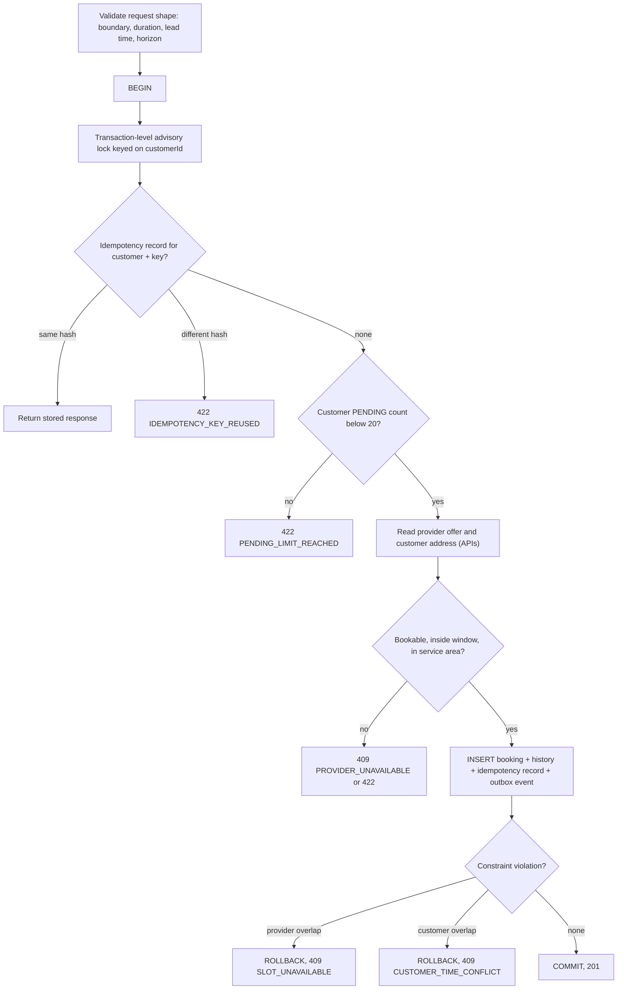

# ADR-002: Booking concurrency — database constraints, conditional transitions and safe jobs

| Field      | Value                                                                                                                                                                |
| ---------- | -------------------------------------------------------------------------------------------------------------------------------------------------------------------- |
| Status     | **Proposed — awaiting approval**                                                                                                                                     |
| Date       | 2026-10-31                                                                                                                                                           |
| Deciders   | Pooja Kumbhar (approval pending)                                                                                                                                     |
| Related    | [booking.md](../hld/booking.md), [ADR-001](ADR-001-modular-monolith.md), requirements NFR-07, BR-04 … BR-07, BR-10, BR-13 … BR-15, EC-10 … EC-16, EC-23 … EC-29, R-4 |
| Supersedes | —                                                                                                                                                                    |

## Context

Double bookings are the highest-impact risk (R-4, goal G-2: zero double-booked slots). The requirements say:

- A provider can never have two PENDING/CONFIRMED bookings whose intervals, **including the 30-minute travel buffer**, overlap. This must be enforced by a PostgreSQL constraint, not only by application code (BR-04, BR-05, NFR-07).
- A customer can never have two overlapping PENDING/CONFIRMED bookings, also enforced in the database (BR-06, EC-28).
- At most 20 PENDING bookings per customer (BR-07).
- Exactly one transition wins when actions race, the deadline check uses database time, and repeating an action that already happened returns the current state with no side effects (EC-16, EC-25, BR-15).
- Creation is idempotent by client key (FR-BKG-13, EC-10, EC-11).
- Scheduled jobs run on every app instance but process each item once (EC-27).
- 100 concurrent requests for one slot: exactly 1 succeeds, 99 get 409, and none get 5xx (EC-29, release check #3).

The app runs as 2+ identical tasks against one PostgreSQL database (ADR-001), at the default `READ COMMITTED` isolation level.

## Decision

### 1. Two exclusion constraints on the `booking` table

Each booking row stores two time ranges, computed by the application when the row is inserted:

| Column          | Value                                                                                                              | Used for                                         |
| --------------- | ------------------------------------------------------------------------------------------------------------------ | ------------------------------------------------ |
| `booked_range`  | `[start, end)`                                                                                                     | Customer overlap (BR-06)                         |
| `blocked_range` | `[start, end + buffer)`, where the buffer is the configured value at request time, also stored in `buffer_minutes` | Provider overlap including buffer (BR-04, BR-05) |

Two PostgreSQL **exclusion constraints** (GiST, using the `btree_gist` extension for the equality part):

| Constraint                    | Rejects a row when another row has…                           | Only for rows where            |
| ----------------------------- | ------------------------------------------------------------- | ------------------------------ |
| `booking_no_provider_overlap` | the same `provider_id` **and** an overlapping `blocked_range` | status is PENDING or CONFIRMED |
| `booking_no_customer_overlap` | the same `customer_id` **and** an overlapping `booked_range`  | status is PENDING or CONFIRMED |

Why extending only the end by the buffer is enough: for bookings A then B by the same provider, B's start must be ≥ A's end + buffer. A's blocked range `[A.start, A.end + buffer)` overlaps B's range exactly when B starts earlier than that. The same holds the other way around, so one extension covers both directions. Bookings can still touch the edges of availability without a buffer (BR-04), because the availability check uses `booked_range`, while `blocked_range` may run past the availability window.

Because the constraints are partial (status PENDING/CONFIRMED), a booking that becomes DECLINED, EXPIRED, CANCELLED, COMPLETED or NO_SHOW frees its slot the moment that change commits (EC-09).

The constraints guarantee no overlap under any concurrency, with no application locking. Two inserts that conflict can't both commit. PostgreSQL makes the second wait for the first and then raises an exclusion violation (SQLSTATE `23P01`) if the first committed.

### 2. Error mapping

| Database outcome                               | API response                                                                            |
| ---------------------------------------------- | --------------------------------------------------------------------------------------- |
| `23P01` on `booking_no_provider_overlap`       | 409 `SLOT_UNAVAILABLE`, plus the next 3 free starts (EC-01, EC-03, EC-23, EC-24, EC-29) |
| `23P01` on `booking_no_customer_overlap`       | 409 `CUSTOMER_TIME_CONFLICT`, plus the conflicting booking ID (EC-13, EC-28)            |
| Unique violation on `idempotency_record`       | Handled as a repeat of the same key (see §4)                                            |
| Serialization or deadlock error (not expected) | One automatic retry, then 409 `TRY_AGAIN`. Never a 5xx for a business conflict          |

The constraint name decides the mapping, so a new constraint can't be mistaken for a slot conflict.

### 3. Creation steps inside one transaction

**Advisory lock per customer.** BR-07 (max 20 PENDING) is a count, and a count can't be enforced by a constraint without race conditions. A transaction-level advisory lock on the customer ID serialises **one customer's** booking requests, so the count is exact. It also makes repeated requests with the same idempotency key wait for the first one to finish. Requests by different customers don't block each other, so the 100-customers-one-slot case (EC-29) still runs in parallel up to the provider constraint. The lock is released automatically at commit or rollback.

**Provider data read inside the transaction.** The provider's status, window and service area are read through the provider API at `READ COMMITTED` (the read exception in ADR-001). If the provider changes availability at the same moment (EC-26), the booking is either created with the old availability and then kept (EC-05), or rejected. Both outcomes are allowed. The overlap guarantee doesn't depend on this read.

### 4. Idempotency (FR-BKG-13, EC-10, EC-11)

- `idempotency_record` is unique on (customer_id, idempotency_key) and stores a hash of the normalised request body, the booking ID and the response status.
- It is inserted in the same transaction as the booking, so it exists if and only if the booking exists.
- Same key and same hash within 24 h: return the original booking, with 200 or 201 as first returned.
- Same key and different hash: 422 `IDEMPOTENCY_KEY_REUSED`, and nothing is created.
- A failed request (e.g. 409) stores no record, so the client may retry with the same key after fixing the cause.
- Records older than 24 h are deleted by a daily job.

### 5. State transitions: conditional updates with database time

Every transition after creation is one SQL update that only matches the expected state:

| Transition                    | Update condition (in words)                                                       |
| ----------------------------- | --------------------------------------------------------------------------------- |
| confirm                       | id matches, status = PENDING, database `now()` < response_deadline                |
| decline (provider)            | id matches, status = PENDING, `now()` < response_deadline                         |
| expire                        | id matches, status = PENDING, `now()` ≥ response_deadline                         |
| cancel                        | id matches, status = the status read at the start of the request, `now()` < start |
| complete (provider) / no-show | id matches, status = CONFIRMED, `now()` ≥ start (no-show also ≤ end + 48 h)       |
| auto-complete                 | id matches, status = CONFIRMED, `now()` ≥ end + 48 h                              |

At `READ COMMITTED`, PostgreSQL makes a second concurrent update on the same row wait. Once the first commits, it re-checks the condition against the new row. So:

- **exactly one** of two racing transitions applies (EC-16, EC-25)
- the loser updates 0 rows; the code reloads the booking:
  - if it is already in the requested target state by the same actor, it returns 200 with the current state and no new event (BR-15, EC-14, EC-20)
  - otherwise it returns 409 with the current state (AC-BKG-09, EC-20)
- deadline and start-time checks use the database transaction time (`now()`), not the app server clock (EC-25)

The history row and the outbox event are written in the same transaction as the update, so an event exists only for a transition that actually happened.

A `version` column also supports optimistic locking for other entity updates. Transitions rely on the conditional update itself.

### 6. Scheduled jobs (EC-27)

- Jobs run on every task (no leader election, no ShedLock).
- Each run claims a batch of up to 100 rows with `SELECT … FOR UPDATE SKIP LOCKED`, then applies the same conditional updates as in §5. Rows locked by another task are skipped, not waited for.
- A job and a user action on the same row are safe for the same reason as two user actions: the conditional update decides.
- Expiry also happens lazily: a confirm after the deadline expires the booking in the same request (AC-BKG-06).
- Reminders set `reminder_sent_at` in the same update that publishes `BookingReminderDue`, so each booking gets one reminder.

### 7. Tests that prove it

All of these run against real PostgreSQL in Testcontainers, in CI.

| Test                             | Setup                                                                           | Expected                                                            | Covers                         |
| -------------------------------- | ------------------------------------------------------------------------------- | ------------------------------------------------------------------- | ------------------------------ |
| Same slot, many customers        | 100 threads, 100 customers, same provider slot                                  | exactly 1 × 201, 99 × 409 `SLOT_UNAVAILABLE`, 0 × 5xx, 1 active row | EC-23, EC-29, release check #3 |
| Partial overlap                  | Parallel requests offset by 30 min, and requests that violate only the buffer   | 1 success per conflicting group                                     | EC-24, EC-03, BR-04            |
| Buffer edges                     | Booking ending at 12:00; requests at 12:00, 12:29, 12:30                        | Only 12:30 succeeds                                                 | BR-04                          |
| One customer, several providers  | 10 threads, same customer, same time, 10 providers                              | exactly 1 success, rest `CUSTOMER_TIME_CONFLICT`                    | EC-28, BR-06                   |
| Pending limit                    | Customer with 19 PENDING sends 5 parallel requests for free slots               | exactly 1 success                                                   | BR-07                          |
| Same idempotency key             | 10 parallel requests with the same key and body                                 | 1 booking, 10 identical responses                                   | EC-10                          |
| Key reuse                        | Same key, different body                                                        | 422, nothing created                                                | EC-11                          |
| Confirm vs cancel                | Parallel confirm and customer cancel on one PENDING booking, repeated 200 times | Always one winner, loser gets 409, history has one transition       | EC-16                          |
| Confirm vs expiry                | Deadline set to database `now()`, parallel confirm and expiry job               | One winner, and confirm after the deadline never succeeds           | EC-25, AC-BKG-06               |
| Double confirm                   | Two confirms by the same provider                                               | Both 200 CONFIRMED, one event                                       | EC-14, BR-15                   |
| Two job instances                | Two app contexts, 500 bookings past deadline                                    | Each expired once, 500 events                                       | EC-27                          |
| Availability edit during booking | Parallel availability change and booking request                                | Booking either created (and kept) or rejected; never inconsistent   | EC-26                          |
| Freed slot                       | Cancel, then book the same slot                                                 | Second booking succeeds                                             | EC-09                          |

## Alternatives considered

| Alternative                                                                              | Why rejected                                                                                                                                                                                                                                                    |
| ---------------------------------------------------------------------------------------- | --------------------------------------------------------------------------------------------------------------------------------------------------------------------------------------------------------------------------------------------------------------- |
| **Application check only** ("select overlapping, then insert")                           | Two requests both see no overlap and both insert. This is the race R-4 describes. NFR-07 explicitly rules it out                                                                                                                                                |
| **Lock the provider row** (`SELECT … FOR UPDATE` on the provider, then check and insert) | Works, but the guarantee then depends on every code path taking the lock. It also locks a row in another module's schema, which breaks ADR-001. Kept only as the idea behind the per-customer advisory lock, where no constraint can do the job                 |
| **Pre-built slot table** (one row per provider per 30 min, unique constraint)            | Simple unique constraints, but: rows must be generated and kept in sync with availability changes and DST, a booking spans many rows, and the buffer needs extra rows. More moving parts for the same guarantee                                                 |
| **SERIALIZABLE isolation for all booking transactions**                                  | Also prevents the race, but conflicts appear as generic serialization failures that need retry loops. It is harder to give precise errors (`SLOT_UNAVAILABLE` vs `CUSTOMER_TIME_CONFLICT`), and it adds load. Exclusion constraints give a precise, named error |
| **Distributed lock (Redis/DynamoDB)**                                                    | Adds an AWS resource with cost and a new failure mode, for something PostgreSQL already does                                                                                                                                                                    |
| **ShedLock / leader election for jobs**                                                  | Works, but only one task does the work and it adds a lock table. `SKIP LOCKED` lets all tasks share the work with no extra parts                                                                                                                                |
| **Optimistic version check only**                                                        | Prevents lost updates on one row, but can't stop two *new* rows from overlapping                                                                                                                                                                                |

## Consequences

**Positive**
- The no-double-booking guarantee holds no matter which code path or how many tasks insert bookings. It is the database's job, as NFR-07 requires.
- Clear, specific API errors for each conflict type.
- No extra infrastructure: no Redis, no lock service.
- The constraints use only booking-table columns, so they keep working if booking becomes its own service (architecture-options §8.4).

**Negative / accepted**
- PostgreSQL-specific (exclusion constraints, `btree_gist`, advisory locks, `SKIP LOCKED`). This is accepted, since PostgreSQL is the chosen database. `btree_gist` is supported on RDS.
- A PENDING booking past its deadline holds its slot until the expiry job runs (≤ ~1 minute) or a confirm attempt expires it. This is acceptable for a 12-hour lead time.
- If the buffer setting changes, old bookings keep their stored buffer. In the short period where old and new rows mix, the gap between two bookings uses the earlier booking's buffer.
- One customer's requests are serialised. This is harmless, since a person doesn't book many slots per second, and NFR-11 limits it to 10/min anyway.

## Follow-ups

1. LLD: exact column types, constraint definitions and indexes in the first Flyway migration for `booking`.
2. Add the concurrency tests in §7 to the CI suite from the first booking story.
