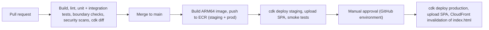

# ADR-003: AWS deployment topology and cost

| Field      | Value                                                                                                                                                                                                    |
| ---------- | -------------------------------------------------------------------------------------------------------------------------------------------------------------------------------------------------------- |
| Status     | **Proposed — awaiting cost approval**                                                                                                                                                                    |
| Date       | 2026-10-31                                                                                                                                                                                               |
| Deciders   | Pooja Kumbhar (approval pending)                                                                                                                                                                         |
| Related    | [overview.md §5](../hld/overview.md#5-aws-deployment-design), [ADR-001](ADR-001-modular-monolith.md), architecture-options §5.4, §9.7, OD-6, requirements NFR-04, NFR-05, NFR-06, NFR-08, NFR-15, NFR-17 |
| Supersedes | —                                                                                                                                                                                                        |

> **No AWS resource is created until you approve this ADR** (CLAUDE.md rule 8). After approval, resources are created only through AWS CDK from `infrastructure/`, with `cdk diff` reviewed in a pull request.

## Context

- Availability 99.5 % (NFR-04), RPO ≤ 15 min and RTO ≤ 4 h (NFR-05), encryption at rest and TLS (NFR-08), alerting on 5xx (NFR-15).
- Load is small (NFR-06, A-8): 2 small app tasks and a small database cover it.
- One region, chosen once the launch city is known (Q-1). Data should stay in the launch country or region (Q-2).
- The backend is one container (ADR-001). The frontend is static files.
- CLAUDE.md: prefer simple solutions, and ask before adding costs.

## Decision

### 1. Accounts and environments

| Item         | Decision                                                                                                                                                                                           |
| ------------ | -------------------------------------------------------------------------------------------------------------------------------------------------------------------------------------------------- |
| AWS accounts | AWS Organizations with three accounts: **management** (billing only), **staging**, **production**. Separate accounts keep staging mistakes away from production data. Organizations itself is free |
| Environments | `local` (Docker Compose), `staging` (AWS, smaller), `production` (AWS). No shared "dev" environment in AWS                                                                                         |
| Region       | One region for staging and production, picked when Q-1 is answered. CloudFront certificates live in `us-east-1`, as AWS requires                                                                   |
| Budget alarm | AWS Budgets alert at 80 % and 100 % of the approved monthly amount, per account                                                                                                                    |

### 2. Network (per environment)

| Item              | Production                                                                      | Staging                                                                                                               |
| ----------------- | ------------------------------------------------------------------------------- | --------------------------------------------------------------------------------------------------------------------- |
| VPC               | 1 VPC, 2 Availability Zones                                                     | 1 VPC, 2 AZs                                                                                                          |
| Public subnets    | ALB, NAT gateway                                                                | ALB, app tasks (with public IP)                                                                                       |
| Private subnets   | App tasks (no public IP)                                                        | —                                                                                                                     |
| Isolated subnets  | RDS (no internet route)                                                         | RDS                                                                                                                   |
| Outbound internet | **1 NAT gateway** (one AZ) + free S3 gateway endpoint                           | No NAT. Tasks use their public IP for outbound traffic. Security groups block all inbound traffic except from the ALB |
| ALB access        | Only from CloudFront (AWS-managed CloudFront prefix list in the security group) | Same                                                                                                                  |

Production keeps app tasks off the public internet, because they handle PII (NFR-12). Staging trades that for about $35/month saved, since it holds no real customer data.

### 3. Compute

| Item          | Production                                                                                           | Staging                        |
| ------------- | ---------------------------------------------------------------------------------------------------- | ------------------------------ |
| ECS Fargate   | 2 tasks (one per AZ), 1 vCPU / 2 GB, **ARM64 (Graviton)**, about 20 % cheaper than x86               | 1 task, 0.5 vCPU / 1 GB, ARM64 |
| Auto scaling  | 2 → 4 tasks on CPU > 60 % or ALB request count                                                       | Fixed at 1                     |
| Deploys       | Rolling (min 100 % healthy, max 200 %), ECS deployment circuit breaker with automatic rollback       | Same                           |
| Health checks | ALB target health on `/actuator/health/readiness`; container liveness on `/actuator/health/liveness` | Same                           |
| Images        | ECR repository per account, scan on push, lifecycle rule keeps the last 20 images                    | Same                           |

### 4. Database

| Item          | Production                                                                                                  | Staging                   |
| ------------- | ----------------------------------------------------------------------------------------------------------- | ------------------------- |
| Engine        | RDS PostgreSQL (current supported major version, same as local Docker image)                                | Same                      |
| Instance      | `db.t4g.small` (2 vCPU burstable, 2 GB), **Multi-AZ**                                                       | `db.t4g.micro`, single-AZ |
| Storage       | 20 GB gp3, storage auto-scaling to 100 GB, encrypted with KMS (AWS-managed key)                             | 20 GB gp3, encrypted      |
| Backups       | Automated daily backups kept 7 days + point-in-time recovery (5-minute granularity) → RPO ≤ 15 min (NFR-05) | 1 day                     |
| Failover      | Multi-AZ automatic failover in about 1–2 min                                                                | None                      |
| Credentials   | Master password managed by RDS in Secrets Manager. App user secret in Secrets Manager                       | Same                      |
| Restore drill | Before launch: restore to a new instance from a point in time and measure (release check #6)                | —                         |

Multi-AZ adds about $25/month. Without it, an AZ outage or OS patching causes downtime that could use up most of the 3.6 h/month budget allowed by NFR-04, and an AZ failure would need a restore within the 4 h RTO.

### 5. Edge, frontend and media

| Item             | Decision                                                                                                                                           |
| ---------------- | -------------------------------------------------------------------------------------------------------------------------------------------------- |
| Domain and DNS   | Route 53 hosted zone. Domain registration is a separate yearly cost                                                                                |
| TLS              | ACM certificates (free): one in `us-east-1` for CloudFront, one in the region for the ALB                                                          |
| CloudFront       | One distribution per environment. Behaviours: `/api/*` → ALB (no caching), `/media/*` → media bucket, everything else → web bucket (overview §6.1) |
| S3 buckets       | `web` (SPA build) and `media` (provider photos, HD-6). Both private, reached only through CloudFront Origin Access Control. Versioning on `media`  |
| Security headers | CloudFront response headers policy: HSTS, CSP, X-Content-Type-Options, Referrer-Policy                                                             |
| WAF              | **Not in the MVP.** Rate limits are in the app (NFR-11). Add AWS WAF (≈ $10–20/month) if abuse appears                                             |

### 6. Email

| Item    | Decision                                                                                                                                              |
| ------- | ----------------------------------------------------------------------------------------------------------------------------------------------------- |
| SES     | Verified sending domain with DKIM, SPF and DMARC. Request production access (out of the SES sandbox) before launch. Account-level suppression list on |
| Sending | SES API with the ECS task IAM role, so there are no SMTP passwords                                                                                    |
| Staging | SES in sandbox mode, so it can only send to verified test addresses                                                                                   |

### 7. Secrets, IAM and observability

| Item         | Decision                                                                                                                                                                 |
| ------------ | ------------------------------------------------------------------------------------------------------------------------------------------------------------------------ |
| Secrets      | Secrets Manager: DB app user, TOTP encryption key (HD-2). Injected into the task at start                                                                                |
| IAM          | Task role: SES send, S3 media read/write, CloudWatch metrics. Execution role: ECR pull, logs, secrets read. Nothing else                                                 |
| Logs         | CloudWatch Logs, JSON, retention 30 days (production) and 7 days (staging)                                                                                               |
| Metrics      | About 20 custom metrics published from Micrometer (custom metrics are billed per metric, so the set is kept small and fixed)                                             |
| Alarms       | ALB 5xx > 2 % over 5 min (NFR-15), unhealthy targets, RDS CPU/storage/connections, outbox backlog age, email failures, budget. Sent to an SNS topic that emails the team |
| Uptime check | Route 53 health check on the public `/api/v1/config` endpoint, with an alarm (NFR-04 measurement)                                                                        |

### 8. CI/CD (GitHub Actions)

- GitHub Actions signs in to AWS with **OIDC** (a short-lived role per environment). No AWS keys are stored in GitHub (CLAUDE.md rule 7).
- The production job needs a manual approval in a GitHub protected environment.
- Infrastructure code is AWS CDK in TypeScript (OD-7) in `infrastructure/`, with one stack set per environment and the same code for both.

### 9. Cost estimate (indicative)

On-demand list prices in **us-east-1**, monthly, without free tier, savings plans or reservations. Other regions differ, typically by 0–20 %. Re-check in the AWS Pricing Calculator once the region is chosen.

| Item                                                                                        | Production | Staging   |
| ------------------------------------------------------------------------------------------- | ---------- | --------- |
| Fargate ARM64 (prod 2 × 1 vCPU/2 GB, staging 1 × 0.5 vCPU/1 GB)                             | ≈ $58      | ≈ $15     |
| Application Load Balancer (hours + low LCU usage)                                           | ≈ $22      | ≈ $20     |
| RDS PostgreSQL (prod `db.t4g.small` Multi-AZ + 20 GB gp3; staging `db.t4g.micro` single-AZ) | ≈ $52      | ≈ $14     |
| NAT gateway (1, plus light data processing)                                                 | ≈ $36      | —         |
| Public IPv4 addresses (ALB nodes, NAT, staging task)                                        | ≈ $11      | ≈ $11     |
| CloudWatch (logs, ~20 metrics, alarms)                                                      | ≈ $12      | ≈ $4      |
| Secrets Manager (≈ 3 secrets)                                                               | ≈ $1       | ≈ $1      |
| S3 (web + media), ECR, Route 53 zone and health check                                       | ≈ $3       | ≈ $2      |
| CloudFront (within the always-free 1 TB and 10 M requests per month)                        | ≈ $0       | ≈ $0      |
| SES (≈ 10,000 emails/month at launch; ≈ $45 at the NFR-06 ceiling)                          | ≈ $1       | ≈ $0      |
| **Total**                                                                                   | **≈ $196** | **≈ $67** |

**Recommended total: about $265/month** for both environments at launch.

Costs that grow with usage: SES ($0.10 per 1,000 emails), CloudWatch logs ($0.50 per GB ingested), extra Fargate tasks when auto scaling (≈ $29/month per task), and data transfer beyond the CloudFront free tier.

Outside this table: domain registration (≈ $10–50/year depending on the TLD), and GitHub Actions minutes beyond the plan's free allowance.

### 10. Options for your approval

| Option                   | What changes                                                                                     | Monthly (both envs) | Meets NFRs?                                                                                                             |
| ------------------------ | ------------------------------------------------------------------------------------------------ | ------------------- | ----------------------------------------------------------------------------------------------------------------------- |
| **A. Minimal**           | No staging (test only locally/CI); production RDS single-AZ; app tasks in public subnets, no NAT | ≈ $140              | Weak on NFR-04 (AZ failure or patching = downtime) and on release check #4 (NFR load tests in staging). Not recommended |
| **B. Recommended**       | As described in §1–§8                                                                            | **≈ $265**          | Yes                                                                                                                     |
| **C. Higher resilience** | B + NAT gateway in each AZ, AWS WAF, `db.t4g.medium`, staging matching production                | ≈ $490              | Yes, with headroom. More than the MVP needs                                                                             |

Ways to lower option B later without changing the design:

- Turn staging tasks and the staging database off outside working hours (saves ≈ $15–20/month).
- Compute Savings Plan or RDS reserved instance after 2–3 stable months (saves ≈ 20–35 % on those lines).

## Alternatives considered

| Alternative                                        | Why rejected                                                                                                                                                                        |
| -------------------------------------------------- | ----------------------------------------------------------------------------------------------------------------------------------------------------------------------------------- |
| VPC interface endpoints instead of a NAT gateway   | ECR (2 endpoints), Logs, Secrets Manager, SES, STS in 2 AZs ≈ $70+/month, more than one NAT gateway at this traffic                                                                 |
| NAT gateway per AZ in production                   | ≈ $35/month more. The single NAT only affects outbound calls (email, image pulls) during a rare AZ failure. Emails are queued and retried, so nothing is lost                       |
| Single account for all environments                | Cheaper to set up, but staging mistakes (or a leaked staging credential) could reach production data                                                                                |
| Aurora PostgreSQL / Serverless v2                  | Higher minimum cost than `db.t4g.small` Multi-AZ at this size; same SQL, so it remains an easy later move                                                                           |
| Running database migrations as a separate ECS task | Clearer failure point, but more pipeline steps. Flyway at start-up with a lock is enough while migrations follow expand-then-contract (overview §5). Revisit if migrations get long |
| x86 Fargate                                        | About 20 % more expensive. Java runs well on ARM64, and GitHub Actions can build ARM64 images                                                                                       |

## Consequences

**Positive**
- Meets the availability, durability, security and observability NFRs at about $265/month for both environments.
- Everything is in CDK code, reviewed in pull requests and repeatable for each environment.
- No long-lived AWS keys anywhere.

**Negative / accepted**
- A single NAT gateway is a single point of failure for outbound calls in production. The impact is limited to delayed emails and image pulls during an AZ outage.
- Staging is smaller than production. Load tests run there can show lower numbers; NFR-01/02 load tests use a temporarily scaled-up staging (extra cost for the test day only).
- Burstable `t4g` database instances can run out of CPU credits under sustained load. CloudWatch alarms on CPU credit balance; move to `m7g`/`r7g` if needed.

## Decisions needed

| ID   | Decision                                         | Proposed                                                    |
| ---- | ------------------------------------------------ | ----------------------------------------------------------- |
| DD-1 | Cost option                                      | **B — about $265/month** for staging + production at launch |
| DD-2 | AWS region                                       | Decide with Q-1 (launch city) and Q-2 (data residency)      |
| DD-3 | Separate AWS accounts for staging and production | Yes                                                         |
| DD-4 | Monthly budget alarm amount                      | $300 total, alerts at 80 % and 100 %                        |
| DD-5 | Domain name for the product                      | To be provided by business                                  |
