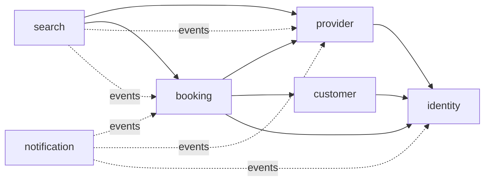
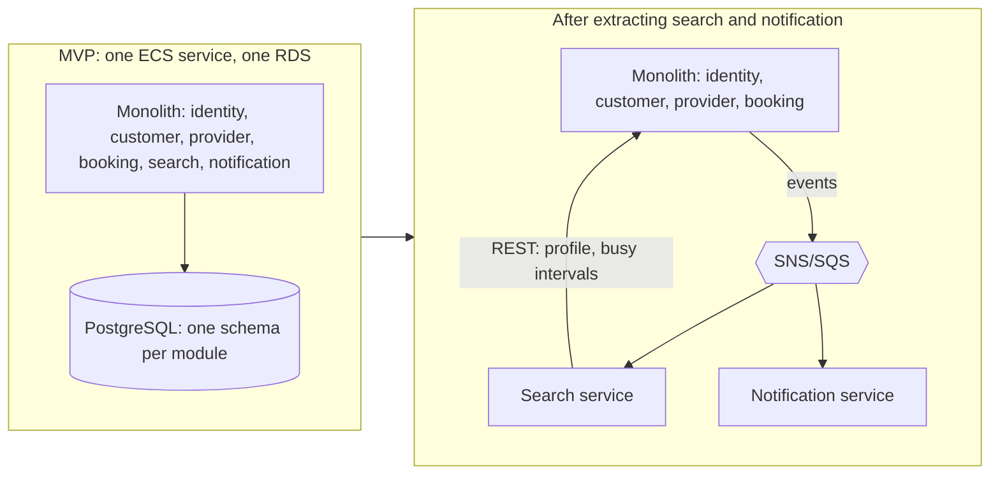

# NestaCare — Architecture Options for the MVP

| Field      | Value                                                                 |
|------------|-----------------------------------------------------------------------|
| Document   | Architecture options analysis (Phase 3)                               |
| Status     | **Draft — awaiting review**                                           |
| Version    | 0.1                                                                   |
| Date       | 2026-10-31                                                            |
| Inputs     | [CLAUDE.md](../../CLAUDE.md), [requirements.md](../requirements/requirements.md) v0.1 |
| Decision   | [ADR-001 — Modular monolith](../adr/ADR-001-modular-monolith.md)      |
| Next phase | HLD per module (`docs/hld/`) — starts only after approval             |

---

## 1. Purpose

Compare three backend architecture styles for the NestaCare MVP, pick one, and define the module boundaries the HLD will build on:

1. **Traditional (layered) monolith**
2. **Modular monolith**
3. **Microservices**

The frontend (React SPA on S3 + CloudFront) is the same in all three options and is not compared here.

## 2. Requirements that drive the decision

Not every requirement affects the architecture style. These ones do:

| Driver | Source | Why it matters for the style |
|---|---|---|
| Zero overlapping bookings per provider and per customer, enforced by PostgreSQL | NFR-07, BR-05, BR-06, EC-23 … EC-29 | Easiest when the booking table and its constraints live in one database and one transaction |
| Booking validates provider availability, service area, rate and status at commit time | BR-03, BR-08, BR-09, EC-06, EC-26 | Needs a consistent read of provider data while the booking is written |
| Exactly one winner for concurrent transitions (confirm vs cancel vs expiry) | EC-16, EC-25 | Needs compare-and-set on one row; simple in one database |
| Notifications are async, retried, deduplicated, never block a booking | AC-NOT-01, AC-NOT-02, EC-15 | Needs reliable event delivery (transactional outbox) in any style |
| Search may be 60 s stale for ratings/counts; profile calendar must be current | AC-SRCH-06, AC-REV-03, AC-ADM-01 | Allows an event-fed read model for search, with a live lookup for the calendar |
| Load ceiling: 10k providers, 100k customers, 5k bookings/day, 50 search req/s | NFR-01, NFR-02, NFR-06 | Small. 5k bookings/day is ≈ 0.06 req/s on average. One stateless app tier scaled horizontally handles it easily |
| 99.5 % uptime | NFR-04 | Allows ≈ 3.6 h downtime/month. Two app instances behind a load balancer are enough |
| Module boundaries enforced by tests | NFR-16, R-7, DoD 9.1 #5 | Requires real, checkable boundaries inside the codebase |
| CI ≤ 15 min, full stack via `docker compose up` in ≤ 30 min | NFR-17, NFR-18 | Penalises many services, repos and pipelines |
| Prepare for future microservice extraction | CLAUDE.md (Architecture) | Boundaries must be drawn so a module can leave later without a rewrite |
| Prefer simple solutions; ask before adding AWS cost | CLAUDE.md rules 8, 9 | Penalises extra infrastructure that the load does not need |

## 3. Assumptions

| ID | Assumption | If wrong |
|---|---|---|
| AA-1 | A small team (1–5 engineers) builds the MVP, all working on one backend | With several independent teams, the case for separate services gets stronger |
| AA-2 | Launch load is well below the NFR-06 ceiling (requirements A-8) | Still fine. NFR-06 is reachable with a scaled monolith |
| AA-3 | One AWS region, one launch area (A-1) | Multi-region would need a separate design anyway |
| AA-4 | Cost figures below are **indicative**. They use on-demand list prices with no free tier, savings plans or reserved instances. They must be checked in the AWS Pricing Calculator for the chosen region (Q-2) | Relative order of the options stays the same; absolute numbers move |
| AA-5 | This document does not create AWS resources. Deployment sizing (Multi-AZ RDS, NAT gateway, task count) is decided and approved separately, per CLAUDE.md rule 8 | — |

## 4. The options

### 4.1 Option A — Traditional (layered) monolith

One Spring Boot application, organised by technical layer: `controller/`, `service/`, `repository/`, `entity/` packages shared by all features. One database schema, and any service can use any repository or JPA entity.

- Fastest to start. Every Spring Boot tutorial looks like this.
- Over time, booking code calls `ProviderRepository` directly, JPA entities get relationships across features (`Booking → Provider → User`), and the tables are joined freely.
- Nothing in the code stops boundaries from eroding (R-7).

### 4.2 Option B — Modular monolith

One Spring Boot application and one deployable image, organised by **business module** (`identity`, `customer`, `provider`, `search`, `booking`, `notification`). Each module:

- exposes a small **public API** (Java interfaces and DTOs) and keeps everything else in an `internal` package;
- owns its **own PostgreSQL schema** — no other module reads or writes its tables, and there are no foreign keys or joins across schemas;
- talks to other modules only through their public API (synchronous, in-process) or through **domain events** (asynchronous, through a transactional outbox);
- is checked by **Spring Modulith / ArchUnit tests** in CI, so a boundary violation fails the build.

One database, so booking creation and its overlap constraints are still a single local ACID transaction.

### 4.3 Option C — Microservices

Separate deployable services (at least provider, search, booking, customer; realistically also identity and notification), each with its own pipeline, ECS service and database. They talk over HTTP and a message broker (SNS/SQS or EventBridge).

- Booking can no longer read provider availability in its own transaction. It calls the provider service over the network, and the result can be out of date by the time it commits.
- Cross-service workflows (suspend provider → auto-decline pending bookings → notify) become sagas with retries and compensation.
- Every service needs its own health checks, dashboards, alarms, secrets, migrations and contract tests.

## 5. Comparison

Rating per criterion: **●●●** good fit for the NestaCare MVP, **●●○** acceptable, **●○○** poor fit.

| Criterion | A. Traditional monolith | B. Modular monolith | C. Microservices |
|---|---|---|---|
| Development complexity | ●●● at first, ●○○ after months | ●●○ | ●○○ |
| Scalability (for NFR-06) | ●●● | ●●● | ●●● (more than needed) |
| Reliability / consistency | ●●○ | ●●● | ●○○ for the MVP |
| AWS cost | ●●● | ●●● | ●○○ |
| Testability | ●●○ | ●●● | ●○○ |
| Deployment complexity | ●●● | ●●● | ●○○ |
| Future migration effort | ●○○ | ●●○ | ●●● (already split) but changing boundaries is costly |

The details behind each rating:

### 5.1 Development complexity

| | A. Traditional | B. Modular | C. Microservices |
|---|---|---|---|
| Getting started | Lowest. No upfront structure | Low. Package layout and boundary rules need deciding once (this document) | High. Repos/pipelines per service, service-to-service auth, API versioning, local orchestration |
| Day-to-day change | Easy at first, harder as coupling grows | Changes inside a module are local. Cross-module changes go through a published API, which takes a little more thought | A feature that touches booking + provider needs coordinated changes and releases across services |
| Refactoring | IDE refactoring works everywhere | IDE refactoring works everywhere, including across module APIs | Changing a service API needs versioning and backward compatibility |
| Cognitive load | Rises over time. Everything can depend on everything | Bounded. Read one module plus the APIs it uses | Bounded per service, plus distributed-systems problems (timeouts, retries, partial failure, eventual consistency) everywhere |
| Local dev (NFR-18) | 1 app + Postgres + Mailpit | 1 app + Postgres + Mailpit | 4–6 services + broker emulation + Postgres(es) + Mailpit. The 30-minute onboarding target is at risk |

### 5.2 Scalability

The NFR-06 ceiling is small: 5,000 bookings/day and 50 search requests/s. One Spring Boot instance with 1 vCPU and a tuned connection pool should handle this. A and B both scale horizontally by adding stateless ECS tasks behind the load balancer.

- **A / B:** Scale everything together. Search is the busiest path, so the whole app scales for it. At this load that wastes very little.
- **B extra:** Search reads from its own read model (§7.3), so if search ever dominates, it can move to a PostgreSQL read replica or become the first service extracted, without touching booking.
- **C:** Each service scales on its own. That is a real benefit at high or very uneven load, but NestaCare does not have that load and the requirements do not expect it.
- **For all options**, the first bottleneck is PostgreSQL, not the app tier. Splitting the app does not fix that.

### 5.3 Reliability and consistency

| Concern | A / B (single deployable, single DB) | C (distributed) |
|---|---|---|
| No double bookings (NFR-07) | Exclusion constraints on the `booking` table, inside one transaction. Simple and provable with Testcontainers | Constraint still works inside the booking DB, but the availability/service-area/status check (BR-03, BR-08, EC-06) uses provider data fetched over the network, so it can be stale |
| Concurrent transitions (EC-16, EC-25) | Conditional update on one row | Same, inside the booking service. Notifications and search updates need the broker to be reliable |
| Provider suspension (AC-ADM-01) | Event handled in-process with outbox retry. Lands well inside 60 s | Event over broker, needs dead-letter handling and monitoring |
| Failure domain | One process. A memory leak or runaway query in search can affect booking | Better isolation, but more parts that can fail: network, broker, service discovery, N databases |
| Availability (NFR-04 99.5 %) | 2 tasks across 2 AZs + health checks meet it | Each of N services needs the same, and the booking flow is only as available as every service it calls |

**A vs B:** they deploy the same way, but A tends to grow long transactions that span many features and lock many tables. B keeps each transaction inside one module, apart from the booking-creation read described in §7.5.

Mitigations for the shared failure domain in A/B: at least 2 tasks, separate thread pools for scheduled jobs and event handlers, per-module DB statement timeouts, and resource limits on the search query.

### 5.4 AWS cost (indicative, per environment, per month)

Using the CLAUDE.md stack (ECS Fargate, RDS PostgreSQL, ALB, S3/CloudFront, ECR, CloudWatch). See AA-4 for caveats.

| Item | A / B — one service | C — microservices (4 core + identity + notification) |
|---|---|---|
| Fargate tasks | 2 × (1 vCPU, 2 GB) ≈ **$70** | 6 services × 2 tasks × (0.5 vCPU, 1 GB) ≈ **$215**. Each Spring Boot JVM needs ~0.75–1 GB, so tasks can't get much smaller |
| Load balancer | 1 ALB ≈ $20 | 1 shared ALB with path routing ≈ $25, plus internal service discovery (Cloud Map / Service Connect) |
| PostgreSQL | 1 RDS `db.t4g.small` Multi-AZ + 20 GB ≈ **$55** | Database per service: 4–6 × `db.t4g.micro` Multi-AZ ≈ **$110–170**. One shared instance is cheaper but loses the independence that justifies microservices |
| Messaging | Not needed. Outbox table in Postgres | SNS + SQS or EventBridge: a few dollars at this volume |
| NAT gateway (if private subnets) | 1 ≈ $35 | 1 ≈ $35 (more data processed) |
| CloudWatch logs/metrics/tracing, ECR, S3, CloudFront, SES | ≈ $15–25 | ≈ $40–70 (N log groups, more metrics, X-Ray traces between services) |
| **Total (rough)** | **≈ $195–205** | **≈ $430–520** |

- Microservices cost roughly **2–2.5× more** to run per environment. A staging environment doubles the gap again.
- A and B cost the same to run. Choosing between them costs nothing in infrastructure.
- The bigger hidden cost of C is engineering time: pipelines, observability, contract tests and on-call for N services.

### 5.5 Testability

| Test type (requirements §9.1) | A. Traditional | B. Modular | C. Microservices |
|---|---|---|---|
| Unit (JUnit 5 + Mockito) | Good | Good. Module APIs are natural seams to mock | Good |
| Integration with real Postgres (Testcontainers) | Good, but tests tend to load the whole context | Good. Spring Modulith `@ApplicationModuleTest` boots one module with stubbed neighbours. Faster and more focused | Per service: good. Across services: needs several containers or contract tests |
| Concurrency tests (EC-23 … EC-29, release check #3) | Straightforward | Straightforward. All inside booking + Postgres | Booking-side constraint is testable; cross-service races need end-to-end environments |
| Event flows (EC-15, AC-NOT-02) | Often implicit, hard to test | Spring Modulith `Scenario` API tests "publish event → handler effect"; the outbox is testable in Testcontainers | Needs broker emulation (LocalStack) or contract tests (Pact) |
| Boundary enforcement (NFR-16) | Not possible without restructuring | Built in: `ApplicationModules.verify()` fails CI on violations | Enforced by the network. No compile-time check of contracts without extra tooling |
| CI time (NFR-17 ≤ 15 min) | Easy | Easy. Module tests can run in parallel | N pipelines plus end-to-end suite, harder to keep under 15 min |

### 5.6 Deployment complexity

| | A / B | C |
|---|---|---|
| Artifacts | 1 Docker image, 1 ECR repo | 4–6 images and repos |
| ECS | 1 service, 1 task definition | 4–6 services, task definitions, scaling policies |
| Pipelines | 1 | 4–6, plus an end-to-end gate |
| DB migrations | 1 Flyway run, ordered per module schema | Per service. Each owns its migrations and they must stay compatible during rolling deploys |
| Release coordination | None. Every `main` commit is deployable (NFR-17) | API compatibility needed between services. Breaking changes need versioning |
| Rollback | Redeploy previous image | Per service. Rolling back one may break another |
| AWS CDK | One stack: VPC, ALB, ECS service, RDS | Shared stack plus a stack per service, service discovery, broker, IAM per service |

### 5.7 Future migration effort

| | A. Traditional | B. Modular | C. Microservices |
|---|---|---|---|
| Extracting a service later | **High.** Find and cut entity relationships, cross-feature joins and shared transactions first. Often a partial rewrite | **Medium–low.** Boundaries, APIs, events and schemas already exist. Extraction swaps the in-process adapter for a network one and moves one schema (§8) | Not needed. Already split |
| Fixing a wrong boundary | Not applicable. There are no boundaries | **Low.** Move code between packages in one repo, adjust tests | **High.** Move data between databases, change APIs, coordinate releases |

The last row matters. At MVP stage the domain is still being learned (e.g. Q-6 shows ownership of reviews, identity and notifications is not settled). Boundaries drawn now will likely move. Moving them is cheap in B and expensive in C.

## 6. Recommendation

**Option B — modular monolith.** The analysis supports the default set in CLAUDE.md:

- It keeps the booking guarantees (NFR-07, EC-23 … EC-29) in one local PostgreSQL transaction, which is the simplest correct design for the requirements with the highest risk (R-4).
- It costs the same to run as a traditional monolith and roughly half as much as microservices (§5.4).
- It is the only option that meets NFR-16 (boundaries enforced by tests) without the operating cost of a distributed system.
- It keeps the option of microservices open at medium–low effort (§8), while boundaries can still be cheaply corrected during the MVP.

The decision, its consequences and the rejected alternatives are recorded in [ADR-001](../adr/ADR-001-modular-monolith.md).

---

## 7. Module boundaries

### 7.1 Module map

CLAUDE.md names four business modules. The requirements (Q-6) show that authentication and notifications don't fit any of them. This document proposes two **supporting modules** and a minimal **shared kernel**. This is a proposed answer to Q-6 and needs your approval.

| Module | Type | One-line purpose |
|---|---|---|
| `provider` | Core | Who the providers are, what they offer, where and when they work |
| `search` | Core | Finding and comparing providers (read side) |
| `booking` | Core | Booking lifecycle, slot holding, reviews |
| `customer` | Core | Customer profile and addresses |
| `identity` | Supporting | User accounts, credentials, roles, email verification, password reset, sign-in lockout |
| `notification` | Supporting | Turns domain events into emails; retry and dedup |
| `shared` | Shared kernel (not a module) | Value types only: IDs, `Money` (minor units), `TimeRange` (UTC), error format, event envelope. No business logic, no persistence |

Placement decisions from Q-6:

- **Reviews → `booking`.** A review is tied to a COMPLETED booking (FR-REV-01, AC-REV-01/02). Booking publishes `ReviewSubmitted`, and search keeps the rating aggregates.
- **Admin features → the module that owns the data** (provider approval in `provider`, booking lookup/cancel in `booking`, categories in `provider`). There is no separate admin module. The admin audit log (AC-ADM-02) is written by each owning module to its own `admin_audit` table using one shared format. A later `admin` module can combine them.
- **Identity** owns accounts. `customer` and `provider` store profiles keyed by the identity `userId`.

### 7.2 Dependency rules



Solid arrow = synchronous call to the target's public API. Dotted arrow = subscribes to the target's events.

1. **The dependency graph has no cycles.** Spring Modulith verifies this in CI.
2. `provider` and `customer` **never** call `booking`. When they need booking information (AC-PRV-04, AC-CUS-04), they define a small **lookup interface in their own API**, and `booking` implements it. The dependency still points booking → provider/customer.
3. **Nothing depends on `search`.** It is a pure reader, which makes it the easiest module to extract or scale.
4. **Nothing calls `notification` directly.** It only listens to events.
5. Modules reference each other **by ID only** (`providerId`, `customerId`, `userId`). There are no shared JPA entities.
6. Each module owns **one PostgreSQL schema**. No cross-schema foreign keys, joins or views. Only the module's own repositories touch its schema.

### 7.3 Module definitions

#### Provider

| Aspect | Definition |
|---|---|
| Responsibility | Provider profile, services and hourly rates, service area, weekly availability, time off, approval lifecycle (DRAFT → PENDING_APPROVAL → APPROVED/REJECTED, APPROVED ↔ SUSPENDED), pause/resume, service categories |
| Requirements | FR-AUTH-02 (profile part), FR-PRV-01 … 07, FR-ADM-01 … 03, FR-ADM-05, AC-PRV-*, AC-ADM-03 |
| Owns data (schema `provider`) | provider profile, provider service (rate, min duration), service area postal codes, weekly availability ranges, time-off periods, status history, category, admin audit entries |
| Public API (sync) | **Bookable offer lookup:** for a provider + service, return status, bookable flag, hourly rate, min duration, service area and availability windows for a date range (used by booking at request time). **Public profile read:** profile, services, rates (used by search). **Category list.** |
| Lookup it defines, booking implements | **Scheduled bookings lookup:** "which PENDING/CONFIRMED bookings fall in these time ranges for this provider?" Used for the AC-PRV-04 warning and the AC-ADM-01 admin list |
| Events published | `ProviderApproved`, `ProviderRejected`, `ProviderSuspended`, `ProviderReinstated`, `ProviderPaused`, `ProviderResumed`, `ProviderProfileChanged`, `ProviderAvailabilityChanged`, `CategoryChanged` |
| Events consumed | `UserRegistered` (identity) if provider-role setup is needed |
| Does **not** own | Bookings or the provider dashboard (booking, FR-PRV-08), ratings (search/booking), login credentials (identity) |

#### Search

| Aspect | Definition |
|---|---|
| Responsibility | Search by category + postal code with filters, sort and pagination; public provider profile page; availability calendar for 30 days; comparison data |
| Requirements | FR-SRCH-01 … 07, FR-REV-02, AC-SRCH-*, AC-REV-03 |
| Owns data (schema `search`) | **Read model** (projection) per provider/service: display fields, rate, postal codes, languages, rating average and count, completed-booking count, searchable flag, precomputed next free slot. It is rebuilt from events and can be fully rebuilt from provider and booking APIs |
| Public API (sync) | None used by other modules. Only REST endpoints for the frontend |
| Calls (sync) | `provider` public profile read and availability windows; `booking` **busy intervals** (PENDING/CONFIRMED bookings with buffer, per provider and date range) for the live profile calendar (AC-SRCH-03, AC-SRCH-06, EC-09) |
| Events consumed | All `Provider*` events (visibility, profile, availability), `BookingRequested`, `BookingConfirmed`, `BookingCancelled`, `BookingDeclined`, `BookingExpired`, `BookingCompleted` (next free slot, completed count), `ReviewSubmitted` (rating) |
| Consistency | Search result list: event-fed and updated within seconds, allowed up to 60 s stale (AC-SRCH-06, AC-REV-03, AC-ADM-01). Profile calendar: computed live from provider availability + booking busy intervals on every request. Booking itself still re-checks everything at commit, so a stale search result can never cause a double booking |
| Comparison (FR-SRCH-07) | Frontend feature. Uses the same read-model endpoint with a list of provider IDs. No server state |

#### Booking

| Aspect | Definition |
|---|---|
| Responsibility | Booking request with slot hold, price/address/service snapshot, confirm/decline, expiry, cancellation by customer/provider/admin, completion/no-show, auto-complete, booking history, idempotency, contact-detail release window, reviews, provider dashboard and customer "My bookings" views, admin booking search |
| Requirements | FR-BKG-01 … 13, FR-PRV-08, FR-CUS-04 (data), FR-REV-01, FR-ADM-04, BR-01 … BR-17, EC-01 … EC-29 |
| Owns data (schema `booking`) | booking (with snapshots and `tstzrange` interval plus buffer), booking status history, idempotency keys, review, admin audit entries. **Holds the PostgreSQL exclusion constraints for BR-05 (per provider) and BR-06 (per customer)**. Both use only columns in this table, so they keep working after extraction |
| Public API (sync) | **Busy intervals** for a provider and date range (for search). **Implements** provider's *scheduled bookings lookup* and customer's *active bookings check* |
| Calls (sync) | `provider` bookable offer lookup (BR-03, BR-08, BR-09, EC-06); `customer` address lookup for snapshot and ownership check (FR-BKG-01, FR-BKG-03); `identity` email-verified check (AC-AUTH-06) |
| Events published | `BookingRequested`, `BookingConfirmed`, `BookingDeclined`, `BookingExpired`, `BookingCancelled`, `BookingCompleted`, `BookingNoShow`, `BookingReminderDue`, `ReviewSubmitted` |
| Events consumed | `ProviderSuspended` → auto-decline PENDING requests (AC-ADM-01, BR-17) |
| Scheduled jobs | Expiry (FR-BKG-05), auto-complete (FR-BKG-09), 24 h reminders (FR-NOT-04), contact-detail hide after 7 days (BR-16). Safe with several instances using `FOR UPDATE SKIP LOCKED` (EC-27) |
| Does **not** own | Provider availability rules (reads them), customer addresses (copies a snapshot), sending email (notification) |

#### Customer

| Aspect | Definition |
|---|---|
| Responsibility | Customer profile (name, phone), up to 5 addresses with a default, postal-code validation for the launch area, account deletion request and PII anonymisation |
| Requirements | FR-AUTH-01 (profile part), FR-CUS-01 … 05, AC-CUS-01 … 04, NFR-12 (anonymisation) |
| Owns data (schema `customer`) | customer profile, addresses, deletion requests |
| Public API (sync) | **Address lookup:** return an address only if it belongs to the given customer (used by booking for the snapshot). **Contact lookup:** customer phone for booking to release after confirmation (FR-BKG-10) |
| Lookup it defines, booking implements | **Active bookings check:** "does this customer have PENDING/CONFIRMED bookings?" (AC-CUS-04) |
| Events published | `CustomerDeleted` (booking and identity anonymise their copies of PII) |
| "My bookings" (FR-CUS-04) | The frontend calls booking's endpoint for the signed-in customer directly. Customer does not proxy it, so customer never depends on booking |
| Does **not** own | Bookings, credentials (identity) |

#### Supporting modules (summary; detailed in HLD)

| Module | Owns | Publishes | Consumes |
|---|---|---|---|
| `identity` | users, password hashes (bcrypt ≥ 12 / Argon2id, NFR-08), roles, verification and reset tokens, sign-in attempt counters | `UserRegistered`, `EmailVerificationRequested`, `PasswordResetRequested`, `EmailVerified` | `CustomerDeleted` |
| `notification` | email templates, delivery log (deduplicated by event ID, AC-NOT-02) | — | Booking, provider and identity events that trigger FR-NOT-01 … 06 |

### 7.4 How modules communicate

| Mechanism | When to use | MVP implementation | After extraction |
|---|---|---|---|
| Synchronous API call | The caller needs the answer to continue (validation, snapshot, live calendar) | Java interface in the target module's API package, called in-process | Same interface, implemented by an HTTP client adapter |
| Domain event | Something happened and others react later (notify, update read model, auto-decline) | Spring application events + **Spring Modulith event publication registry** (transactional outbox in Postgres). Events are saved in the same transaction as the state change and retried until handled | Spring Modulith event externalization to SNS/SQS or EventBridge (cost to approve then) |

Event rules, so they work unchanged over a broker later:

- Each event is an immutable record with `eventId`, `occurredAt`, `version` and IDs plus the minimum fields consumers need. No JPA entities.
- Events serialise to JSON.
- Every consumer is idempotent by `eventId` (EC-15).
- Handlers run after the publishing transaction commits, in their own transaction, so a consumer failure never rolls back the booking (AC-NOT-01).

### 7.5 Transactions across modules

- **Writes:** each transaction writes to **one** module's schema only. Cross-module effects happen through events.
- **One accepted exception (reads only):** booking creation calls the provider *bookable offer lookup* and the customer *address lookup* inside the booking transaction, then inserts the booking. Only booking tables are written. If provider availability changes at the same moment (EC-26), either outcome is valid under EC-05. The exclusion constraint, not the read, is what prevents double booking.
- This keeps extraction safe: when provider becomes a remote call, the only change is that the read may be a few milliseconds older, which EC-26 already allows.

### 7.6 Code and schema layout (illustrative, refined in LLD)

```
backend/src/main/java/com/nestacare/
├── shared/            value types, error format, event envelope
├── identity/          API package  │ internal/ (domain, persistence, web)
├── customer/          API package  │ internal/
├── provider/          API package  │ internal/
├── search/            API package  │ internal/
├── booking/           API package  │ internal/
└── notification/      (no public API) │ internal/

PostgreSQL schemas: identity, customer, provider, search, booking, notification, event_publication (outbox)
Flyway: one migration folder per module, each touching only its own schema
```

---

## 8. Path to independent services

### 8.1 When to extract

Don't extract on a schedule. Extract a module when there is evidence that one of these applies:

| Trigger | Example |
|---|---|
| Different scaling need | Search traffic grows 10× while bookings stay flat, and a read replica is no longer enough |
| Team ownership | A separate team owns provider onboarding and needs its own release cadence |
| Failure isolation | Incidents show one module's load harming booking reliability |
| Different technology | Search moves to OpenSearch for geo/radius search (currently out of scope) |

### 8.2 Likely order

| Order | Module | Why | Effort |
|---|---|---|---|
| 1 | `notification` | Event consumer only, no sync callers, failures already isolated by design | Low |
| 2 | `search` | Nothing depends on it. Its data is a rebuildable read model. Read-heavy, so it benefits most from independent scaling | Low–medium |
| 3 | `identity` | Could be replaced by a managed IdP (e.g. Cognito) instead of becoming a service. Needs token-based auth between services | Medium |
| 4 | `provider`, `customer` | Sync callers (booking) must handle network failure and timeouts | Medium |
| 5 | `booking` | Center of the domain. Likely stays as the "core" that the rest separates from | Medium–high |

### 8.3 Steps for one module (repeatable)

1. **Check readiness.** Boundary tests are green. The module has no cross-schema access. All its consumers use its public API or events.
2. **Externalize its events.** Turn on Spring Modulith event externalization for that module's events to a broker (SNS/SQS or EventBridge). The outbox already guarantees delivery.
3. **Expose its API over REST.** Add REST endpoints that mirror the Java API. Inside the monolith, callers switch to an HTTP client adapter behind the **same Java interface**, so calling code does not change. Add timeouts, retries and circuit breakers, plus contract tests.
4. **Move its data.** Copy the module's schema to its own RDS database (dump/restore or logical replication), then cut over. No other schema references it, so no foreign keys need to be broken.
5. **Deploy it separately.** New ECS service, new pipeline, ALB path rule for its public endpoints. Use the strangler pattern: route traffic to the new service, keep the module code in the monolith disabled behind a flag for rollback.
6. **Remove the module** from the monolith once stable.



### 8.4 What changes after extraction

| Aspect | Inside the monolith | After extraction |
|---|---|---|
| Sync call | Method call; same JVM | HTTP; may time out. Callers need a defined fallback (booking: reject with 503 rather than guess) |
| Event delivery | In-process with outbox | Broker with at-least-once delivery. Consumers are already idempotent |
| Booking overlap guarantees | DB constraint in booking schema | Unchanged. The constraint only uses booking columns |
| Provider data at booking time | Read in the booking transaction | Remote read just before insert. EC-26 already accepts this |
| Auth between services | Not needed | Service-to-service auth (IAM / mTLS / signed tokens). Decide auth token format in HLD with this in mind |
| Cost | One ECS service | +1 ECS service, possibly +1 RDS, broker. Needs approval (CLAUDE.md rule 8) |

### 8.5 Rules to keep extraction cheap (enforced from day one)

1. Module internals are not visible to other modules (Spring Modulith verification in CI).
2. No cross-schema foreign keys, joins or views. A test checks the Flyway migrations.
3. Cross-module data is referenced by ID only, and snapshots are copied when history must not change (booking price, address, provider name).
4. Events are versioned, JSON-serialisable records with an event ID.
5. A transaction writes to one module only (§7.5).
6. Module APIs are coarse-grained and designed as if they were remote: no chatty per-field calls, no lazy-loaded objects crossing the boundary.
7. The shared kernel contains only value types. Anything with behaviour or persistence belongs to a module.

---

## 9. Risks and open decisions

### 9.1 Risks

| ID | Risk | Mitigation |
|---|---|---|
| AR-1 | Boundaries erode under delivery pressure (R-7) | Spring Modulith verification and schema checks fail CI. Boundary changes need an ADR |
| AR-2 | Shared failure domain: one module's bug takes down the whole app | ≥ 2 tasks across AZs, health checks, separate thread pools for jobs/events, DB statement timeouts, load tests for search (NFR-01) |
| AR-3 | Search read model drifts from source data (missed or misordered events) | Outbox with retries, idempotent handlers, periodic reconciliation job, rebuild-from-source command |
| AR-4 | Cross-module sync calls are too fine-grained, so extraction later causes latency problems | Coarse APIs (§8.5 rule 6), reviewed in HLD |
| AR-5 | Spring Modulith is a newer library than core Spring | It is part of the Spring portfolio and well maintained. Fallback: ArchUnit rules and a hand-written outbox table |
| AR-6 | Cost estimates are wrong for the chosen region | Validate in AWS Pricing Calculator once Q-1/Q-2 are answered. Relative ranking does not depend on region |

### 9.2 Open decisions for you

| ID | Decision | Proposed default |
|---|---|---|
| OD-1 | Approve the modular monolith (ADR-001) | Approve |
| OD-2 | Answer to Q-6: add `identity` and `notification` as supporting modules; reviews in `booking`; admin features in the owning module | **Resolved:** default accepted in requirements v0.2 |
| OD-3 | Use Spring Modulith (boundary checks + event outbox) rather than plain ArchUnit and a hand-written outbox | Spring Modulith |
| OD-4 | One PostgreSQL schema per module in one RDS instance | Yes |
| OD-5 | Auth token style (server session vs JWT), chosen with future service-to-service auth in mind | Decide in HLD |
| OD-6 | Deployment sizing that adds cost: RDS Multi-AZ, NAT gateway vs VPC endpoints/public subnets, staging environment | Separate deployment ADR, for your approval before any resources are created |
