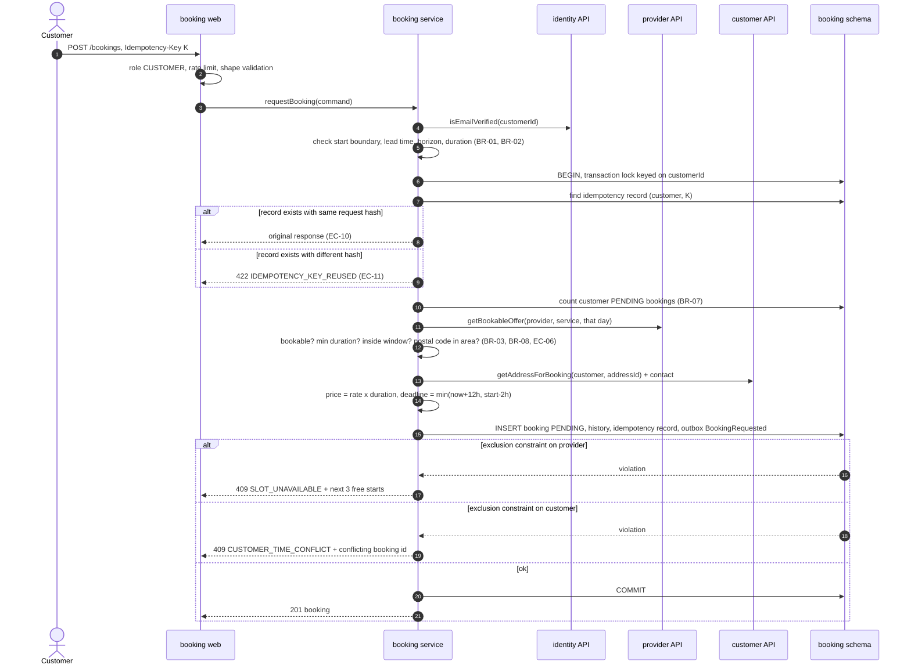
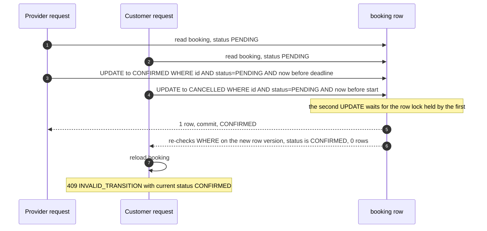
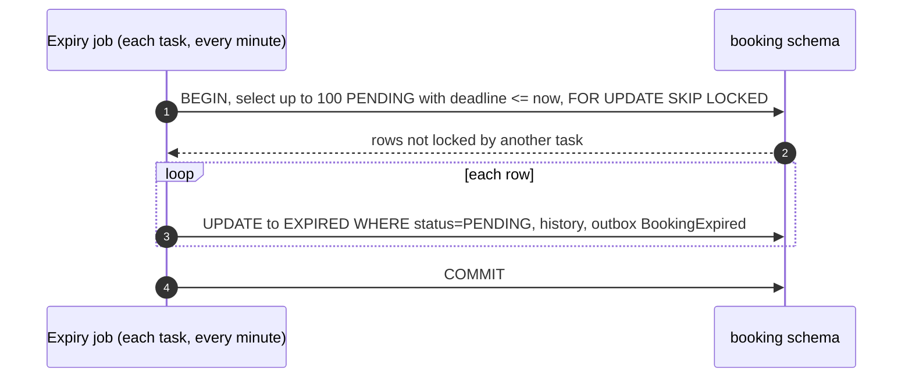
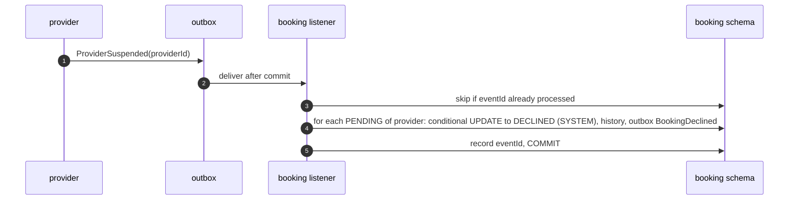
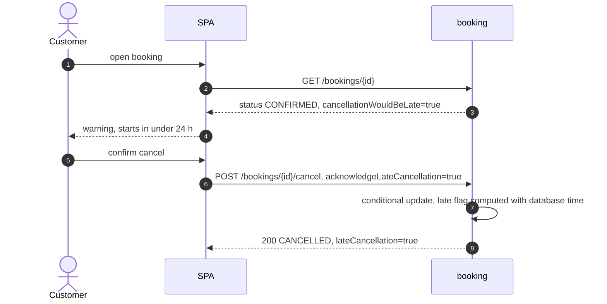

# HLD — Booking module

| Field       | Value                                            |
| ----------- | ------------------------------------------------ |
| Status      | **Draft — awaiting review**                      |
| Version     | 0.1                                              |
| Date        | 2026-10-31                                       |
| Overview    | [overview.md](overview.md)                       |
| Concurrency | [ADR-002](../adr/ADR-002-booking-concurrency.md) |

## 1. Purpose and scope

Booking owns everything about a booking from request to its final state, plus reviews and the rules for which slots can be booked.

| Covers                                                   | Requirements                                  |
| -------------------------------------------------------- | --------------------------------------------- |
| Booking request with slot hold, snapshots, idempotency   | FR-BKG-01 … 03, FR-BKG-13, BR-01 … BR-10      |
| Provider confirm/decline, expiry                         | FR-BKG-04, FR-BKG-05, BR-10                   |
| Cancellation by customer, provider, admin                | FR-BKG-06, FR-BKG-07, FR-BKG-12, BR-11, BR-12 |
| Completion, no-show, auto-complete                       | FR-BKG-08, FR-BKG-09, BR-13                   |
| History, contact release                                 | FR-BKG-10, FR-BKG-11, BR-14 … BR-16           |
| Provider dashboard, customer "My bookings", admin search | FR-PRV-08, FR-CUS-04, AC-CUS-05, FR-ADM-04    |
| Reviews                                                  | FR-REV-01, FR-REV-03, AC-REV-01, AC-REV-02    |
| Free-slot calculation for calendars (HD-4)               | AC-SRCH-02, AC-SRCH-03, EC-09                 |
| Reactions to suspension and customer deletion            | AC-ADM-01, BR-17, NFR-12                      |

**Not owned:** provider availability and rates (read from provider), addresses (copied from customer), email sending (notification), rating aggregates (search).

## 2. REST endpoints

All paths are under `/api/v1`. "Own" means the caller is the booking's customer or provider; anyone else gets 404.

### 2.1 Customer

| Method | Path                          | Purpose                                                                                                                               | Req                                                                  | Main errors                                                                                                                                                                                                                                                                                                      |     |
| ------ | ----------------------------- | ------------------------------------------------------------------------------------------------------------------------------------- | -------------------------------------------------------------------- | ---------------------------------------------------------------------------------------------------------------------------------------------------------------------------------------------------------------------------------------------------------------------------------------------------------------- | --- |
| POST   | `/bookings`                   | Request a booking. Header `Idempotency-Key` (UUID) required. Body: `providerId`, `serviceId`, `start`, `durationMinutes`, `addressId` | FR-BKG-01 … 03, 13                                                   | 403 `EMAIL_NOT_VERIFIED`; 422 `INVALID_START_TIME`, `INVALID_DURATION`, `OUTSIDE_AVAILABILITY`, `OUTSIDE_SERVICE_AREA`, `PENDING_LIMIT_REACHED`, `IDEMPOTENCY_KEY_REUSED`; 409 `SLOT_UNAVAILABLE` (with next 3 free starts), `CUSTOMER_TIME_CONFLICT` (with conflicting booking ID), `PROVIDER_UNAVAILABLE`; 429 |     |
| GET    | `/bookings/me?scope=upcoming\ | past&page`                                                                                                                            | "My bookings". Upcoming by start ascending, past by start descending | FR-CUS-04, AC-CUS-05                                                                                                                                                                                                                                                                                             | —   |
| GET    | `/bookings/{id}`              | Booking detail (own). Includes `cancellationWouldBeLate` and, once confirmed, provider contact (HD-7)                                 | FR-BKG-10                                                            | 404                                                                                                                                                                                                                                                                                                              |     |
| POST   | `/bookings/{id}/cancel`       | Body: `reason?`, `acknowledgeLateCancellation?`                                                                                       | FR-BKG-06, BR-11, AC-BKG-07/08                                       | 409 `LATE_CANCELLATION_ACK_REQUIRED` (HD-11), `BOOKING_ALREADY_STARTED`, `INVALID_TRANSITION`                                                                                                                                                                                                                    |     |
| POST   | `/bookings/{id}/review`       | Body: `rating` 1–5, `comment?` ≤ 500                                                                                                  | FR-REV-01, AC-REV-01/02                                              | 409 `NOT_REVIEWABLE`, `ALREADY_REVIEWED`; 422 `REVIEW_WINDOW_CLOSED`                                                                                                                                                                                                                                             |     |

### 2.2 Provider

| Method | Path                                  | Purpose                                                                                                              | Req                     | Main errors                                          |           |     |
| ------ | ------------------------------------- | -------------------------------------------------------------------------------------------------------------------- | ----------------------- | ---------------------------------------------------- | --------- | --- |
| GET    | `/providers/me/bookings?view=pending\ | upcoming\                                                                                                            | past&page`              | Dashboard. Pending ordered by response deadline      | FR-PRV-08 | —   |
| GET    | `/bookings/{id}`                      | Same endpoint as the customer one. Customer address and phone are included only when the release rule allows (BR-16) | FR-BKG-10               | 404                                                  |           |     |
| POST   | `/bookings/{id}/confirm`              | Confirm a PENDING booking before its deadline                                                                        | FR-BKG-04, AC-BKG-05/06 | 409 `BOOKING_EXPIRED`, `INVALID_TRANSITION`          |           |     |
| POST   | `/bookings/{id}/decline`              | Body: `reason?`                                                                                                      | FR-BKG-04               | 409 `BOOKING_EXPIRED`, `INVALID_TRANSITION`          |           |     |
| POST   | `/bookings/{id}/cancel`               | Body: `reason` (required)                                                                                            | FR-BKG-07, BR-12        | 422 `REASON_REQUIRED`; 409 `BOOKING_ALREADY_STARTED` |           |     |
| POST   | `/bookings/{id}/complete`             | After start time                                                                                                     | FR-BKG-08, BR-13        | 409 `NOT_STARTED_YET`, `INVALID_TRANSITION`          |           |     |
| POST   | `/bookings/{id}/no-show`              | After start, until end + 48 h                                                                                        | FR-BKG-08               | 409 `NOT_STARTED_YET`, `NO_SHOW_WINDOW_CLOSED`       |           |     |

### 2.3 Admin

| Method | Path                                                                     | Purpose                                                                                  | Req                  |
| ------ | ------------------------------------------------------------------------ | ---------------------------------------------------------------------------------------- | -------------------- |
| GET    | `/admin/bookings?bookingId&customerEmail&providerId&from&to&status&page` | Search bookings. `customerEmail` is resolved to a user ID through identity               | FR-ADM-04            |
| GET    | `/admin/bookings/{id}`                                                   | Detail with full status history                                                          | FR-ADM-04, AC-BKG-10 |
| POST   | `/admin/bookings/{id}/cancel`                                            | Body: `reason` (required)                                                                | FR-BKG-12            |
| GET    | `/admin/providers/{id}/booking-stats`                                    | Requested, confirmed, declined, expired, provider-cancelled, no-show counts for a period | BR-12, Q-8           |
| POST   | `/admin/reviews/{id}/hide`                                               | Body: `reason`                                                                           | FR-REV-03 (COULD)    |

### 2.4 Public

| Method | Path                           | Purpose                                      | Req        |
| ------ | ------------------------------ | -------------------------------------------- | ---------- |
| GET    | `/providers/{id}/reviews?page` | Visible reviews for a provider, newest first | FR-SRCH-06 |

The URL starts with `/providers/` because that's how the frontend uses it. The endpoint is still owned by booking.

## 3. Public module API (in-process)

| Interface                                       | Operation            | Input → output                                                                                             | Used by                             |
| ----------------------------------------------- | -------------------- | ---------------------------------------------------------------------------------------------------------- | ----------------------------------- |
| `SlotQuery`                                     | `findFreeStartTimes` | providerId, serviceId, durationMinutes, date range (≤ 30 days) → free start instants grouped by local date | search (calendar, day availability) |
| `SlotQuery`                                     | `nextFreeStart`      | providerId, serviceId, durationMinutes → first free start instant or none                                  | search (result list)                |
| `BookingPolicyQuery`                            | `currentPolicy`      | — → lead time, horizon, buffer, granularity, max duration, response deadline rules                         | search, frontend via `/config`      |
| implements provider's `ScheduledBookingsLookup` | `findActive`         | providerId, list of time ranges → bookings (id, start, end, status, customer first name)                   | provider (AC-PRV-04, AC-ADM-01)     |
| implements customer's `ActiveBookingsCheck`     | `hasActiveBookings`  | customerId → boolean                                                                                       | customer (AC-CUS-04)                |

Slot rule (shared by `findFreeStartTimes` and booking creation):

- start is on a 30-minute boundary, and `now + leadTime ≤ start ≤ now + horizon` (BR-01, BR-02)
- `[start, start + duration)` lies inside one availability window for that day, after time off is removed (BR-03)
- `[start, start + duration + buffer)` does not overlap any active booking's blocked range `[s, e + buffer)` (BR-04, BR-05)

Using one implementation for both the calendar and booking creation means the calendar never offers a slot that booking then rejects for a rule reason. It can still lose a race, which returns `SLOT_UNAVAILABLE`.

## 4. Events

### 4.1 Published

All events carry the common envelope (`eventId`, `eventType`, `version`, `occurredAt`) plus `bookingId`, `customerId` and `providerId`.

| Event                | Extra fields                                                                                             | When                            | Consumers                        |
| -------------------- | -------------------------------------------------------------------------------------------------------- | ------------------------------- | -------------------------------- |
| `BookingRequested`   | `serviceName`, `start`, `end`, `priceEstimate`, `responseDeadline`, `customerFirstName`, `postalCode`    | PENDING created                 | notification (FR-NOT-01), search |
| `BookingConfirmed`   | `serviceName`, `start`, `end`, `providerDisplayName`                                                     | PENDING → CONFIRMED             | notification (FR-NOT-02), search |
| `BookingDeclined`    | `declinedBy` (PROVIDER/SYSTEM), `reason?`, `start`                                                       | PENDING → DECLINED              | notification, search             |
| `BookingExpired`     | `start`                                                                                                  | PENDING → EXPIRED               | notification, search             |
| `BookingCancelled`   | `cancelledBy` (CUSTOMER/PROVIDER/ADMIN/SYSTEM), `previousStatus`, `reason?`, `lateCancellation`, `start` | → CANCELLED                     | notification (FR-NOT-03), search |
| `BookingCompleted`   | `completedBy` (PROVIDER/SYSTEM)                                                                          | → COMPLETED                     | search (completed count)         |
| `BookingNoShow`      | —                                                                                                        | → NO_SHOW                       | search                           |
| `BookingReminderDue` | `serviceName`, `start`, `end`, `providerDisplayName`, `customerFirstName`                                | 24 h before a CONFIRMED booking | notification (FR-NOT-04)         |
| `ReviewSubmitted`    | `reviewId`, `rating`                                                                                     | review created                  | search (rating)                  |
| `ReviewHidden`       | `reviewId`, `rating`                                                                                     | admin hides a review            | search (rating)                  |

Events never contain the full address or phone (AC-NOT-03, NFR-12). `postalCode` is enough for the provider's request email.

### 4.2 Consumed

| Event               | From     | Handling                                                                                                                                                                                                                                                                          |
| ------------------- | -------- | --------------------------------------------------------------------------------------------------------------------------------------------------------------------------------------------------------------------------------------------------------------------------------- |
| `ProviderSuspended` | provider | Decline every PENDING booking of that provider with `declinedBy = SYSTEM`, reason "provider unavailable". CONFIRMED bookings are left alone; the admin decides per booking (AC-ADM-01, BR-17)                                                                                     |
| `CustomerDeleted`   | customer | Cancel any remaining PENDING/CONFIRMED bookings (`cancelledBy = SYSTEM`; covers the race in customer.md §6.3). Then anonymise the customer snapshot fields (name, phone, address lines, access notes) on all the customer's bookings, keeping the records for accounting (NFR-12) |

Each consumed event ID is stored in `processed_event`, so a re-delivered event does nothing (EC-15).

## 5. Data owned (schema `booking`)

Tables and key columns only. Exact types and SQL are for the LLD.

| Table                    | Key columns                                                                                                                                                                                                                                                                                                                                                                                                                                                                                                                                                                              | Notes                                                                                                                                                                                                                                                                                                                                       |
| ------------------------ | ---------------------------------------------------------------------------------------------------------------------------------------------------------------------------------------------------------------------------------------------------------------------------------------------------------------------------------------------------------------------------------------------------------------------------------------------------------------------------------------------------------------------------------------------------------------------------------------- | ------------------------------------------------------------------------------------------------------------------------------------------------------------------------------------------------------------------------------------------------------------------------------------------------------------------------------------------- |
| `booking`                | id, customer_id, provider_id, service_id, status, start_at, end_at, duration_minutes, **booked_range** `[start, end)`, **blocked_range** `[start, end + buffer)`, buffer_minutes, price_estimate_minor, currency, response_deadline, service_name, category_code, provider_display_name, provider_phone_snapshot, customer_first_name, customer_phone_snapshot, address_label, address_street, address_city, address_postal_code, address_access_notes, late_cancellation, cancelled_by, cancel_reason, decline_reason, reminder_sent_at, created_at, confirmed_at, terminal_at, version | **Two exclusion constraints, active only for PENDING/CONFIRMED rows:** no two rows for the same provider with overlapping `blocked_range` (BR-05), and no two rows for the same customer with overlapping `booked_range` (BR-06). Details in ADR-002. The buffer is stored per row, so changing the config doesn't affect existing bookings |
| `booking_status_history` | id, booking_id, from_status, to_status, actor_type (CUSTOMER/PROVIDER/ADMIN/SYSTEM), actor_id, reason, occurred_at                                                                                                                                                                                                                                                                                                                                                                                                                                                                       | One row per transition (FR-BKG-11). Kept ≥ 2 years (NFR-21)                                                                                                                                                                                                                                                                                 |
| `idempotency_record`     | customer_id + idempotency_key (unique together), request_hash, booking_id, response_status, created_at                                                                                                                                                                                                                                                                                                                                                                                                                                                                                   | Kept 24 h (EC-10, EC-11)                                                                                                                                                                                                                                                                                                                    |
| `review`                 | id, booking_id (unique), provider_id, customer_id, rating, comment, hidden, hidden_reason, hidden_by, created_at                                                                                                                                                                                                                                                                                                                                                                                                                                                                         | One review per booking (AC-REV-02)                                                                                                                                                                                                                                                                                                          |
| `admin_audit`            | id, admin_id, action, target_type, target_id, reason, occurred_at                                                                                                                                                                                                                                                                                                                                                                                                                                                                                                                        | Admin cancellations, review hiding (AC-ADM-02)                                                                                                                                                                                                                                                                                              |
| `processed_event`        | event_id, processed_at                                                                                                                                                                                                                                                                                                                                                                                                                                                                                                                                                                   | Idempotent event handling                                                                                                                                                                                                                                                                                                                   |

Indexes needed (detailed in LLD): by customer and start, by provider and status and start, by status and response_deadline (expiry job), by status and end (auto-complete), by status and start (reminders).

## 6. State machine

The states and transitions are exactly those in requirements §6.2–6.3. Every transition is a **conditional update**: it changes the row only if the status is still the one read at the start of the action and the time guard still holds. If nothing changed, the code reloads the booking and decides between "already done by the same actor" (return current state, BR-15) and 409.

| Action            | Allowed from       | Guard (database time)                                                                        | Result    |
| ----------------- | ------------------ | -------------------------------------------------------------------------------------------- | --------- |
| request           | —                  | all rules pass, no overlap                                                                   | PENDING   |
| confirm           | PENDING            | `now < response_deadline`                                                                    | CONFIRMED |
| decline           | PENDING            | `now < response_deadline` (provider); none (system, on suspension)                           | DECLINED  |
| expire            | PENDING            | `now ≥ response_deadline`                                                                    | EXPIRED   |
| cancel (customer) | PENDING, CONFIRMED | `now < start`; if CONFIRMED and `start − now < 24 h` then late, and acknowledgement required | CANCELLED |
| cancel (provider) | CONFIRMED          | `now < start`, reason required                                                               | CANCELLED |
| cancel (admin)    | PENDING, CONFIRMED | `now < start`, reason required                                                               | CANCELLED |
| cancel (system)   | PENDING, CONFIRMED | customer deleted                                                                             | CANCELLED |
| complete          | CONFIRMED          | provider: `now ≥ start`; system: `now ≥ end + 48 h`                                          | COMPLETED |
| no-show           | CONFIRMED          | `start ≤ now ≤ end + 48 h`                                                                   | NO_SHOW   |

Every transition writes a history row and publishes its event in the same transaction.

## 7. Key flows

### 7.1 Request a booking

The "next 3 free starts" for `SLOT_UNAVAILABLE` (EC-01) are computed after the rollback, using `findFreeStartTimes`.

### 7.2 Provider confirms while the customer cancels (EC-16)

Each transition's update requires the **exact status read at the start of the action**, not just any status that allows it. So exactly one transition wins (first commit), and the loser gets 409 with the current state, as EC-16 requires. If the confirm won, the customer can cancel again. That second cancel is a CONFIRMED cancellation, with the late-cancellation warning if it applies. This also prevents a cancel that started on a PENDING booking (never late) from silently becoming an unacknowledged late cancellation.

### 7.3 Expiry job (FR-BKG-05, EC-25, EC-27)

A confirm that arrives at the deadline either commits first (and the job's conditional update skips the row), or finds the deadline passed and fails with `BOOKING_EXPIRED`. Expiry is also applied lazily: a confirm attempt after the deadline expires the booking itself (AC-BKG-06).

### 7.4 Provider suspended (AC-ADM-01)

New requests are already blocked because `getBookableOffer` reports the provider as not bookable (EC-06). The admin sees the CONFIRMED list in the suspend response from the provider module, which calls `ScheduledBookingsLookup`.

### 7.5 Customer cancels a confirmed booking late (AC-BKG-08, HD-11)

If the request arrives without the acknowledgement and the cancellation would be late, booking returns 409 `LATE_CANCELLATION_ACK_REQUIRED` and changes nothing.

## 8. Scheduled jobs

| Job                 | Every  | Selects                                                         | Action                                               |
| ------------------- | ------ | --------------------------------------------------------------- | ---------------------------------------------------- |
| Expire              | 1 min  | PENDING, `response_deadline ≤ now`                              | → EXPIRED                                            |
| Auto-complete       | 15 min | CONFIRMED, `end + 48 h ≤ now`                                   | → COMPLETED, `completedBy = SYSTEM` (FR-BKG-09)      |
| Reminders           | 5 min  | CONFIRMED, start within the next 24 h, `reminder_sent_at` empty | Set `reminder_sent_at`, publish `BookingReminderDue` |
| Idempotency cleanup | daily  | records older than 24 h                                         | delete                                               |

All jobs claim rows with `FOR UPDATE SKIP LOCKED` in batches of 100.

Contact release (BR-16) needs no job. The rule is applied when responses are built: the provider sees contact details only if the status is CONFIRMED, or the status is terminal and `terminal_at` was within 7 days.

## 9. Privacy and security

- Provider-facing responses for PENDING bookings contain only customer first name, postal code, time, duration and price (J-4 step 2, AC-NOT-03).
- Full address and phone are shown only under the BR-16 rule. The provider's phone is shown to the customer from confirmation until 7 days after the terminal state (HD-7).
- Admin can see all fields. Every admin action is written to `admin_audit`.
- Reviews show customer first name only.

## 10. Testing focus

| Area          | Tests                                                                                                  |
| ------------- | ------------------------------------------------------------------------------------------------------ |
| Rules         | Unit tests for each BR, response deadline formula, late flag, DST bookings (EC-08)                     |
| Concurrency   | EC-16, EC-23 … EC-29, using real PostgreSQL in Testcontainers (ADR-002 §6)                             |
| Idempotency   | Same key + same body → same response; same key + different body → 422; parallel same key → one booking |
| Authorization | Each endpoint × each role; other people's bookings → 404                                               |
| Events        | Each transition publishes exactly one event; consumed events are idempotent                            |
| Jobs          | Two app contexts running the same job → each row processed once                                        |

## 11. Open points

| ID   | Point                                                                      | Proposed                                                                                              |
| ---- | -------------------------------------------------------------------------- | ----------------------------------------------------------------------------------------------------- |
| BK-1 | Should a customer get an email when a review becomes possible?             | Not in MVP (not required)                                                                             |
| BK-2 | Should the provider get a reminder at half of the response deadline (R-1)? | Candidate fast-follow; it can be added as a booking job + notification template without design change |
