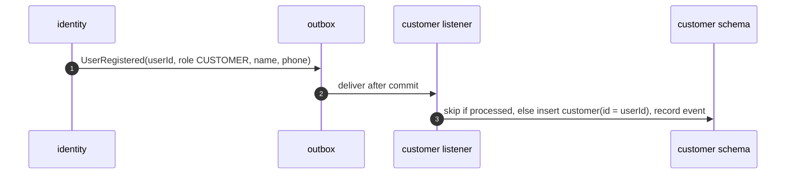
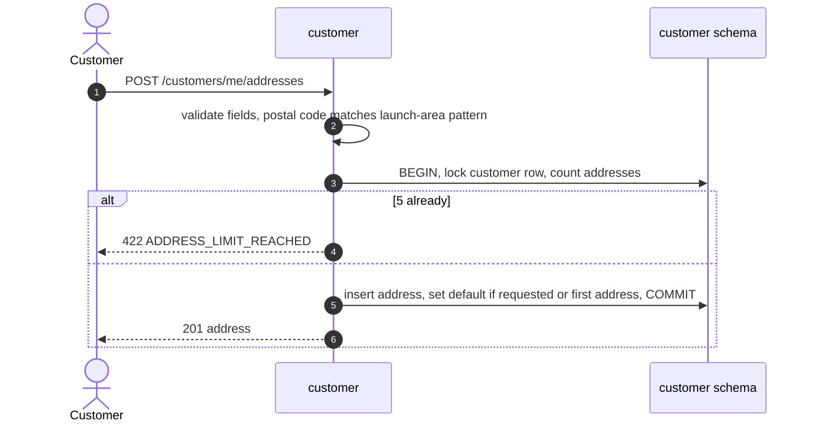
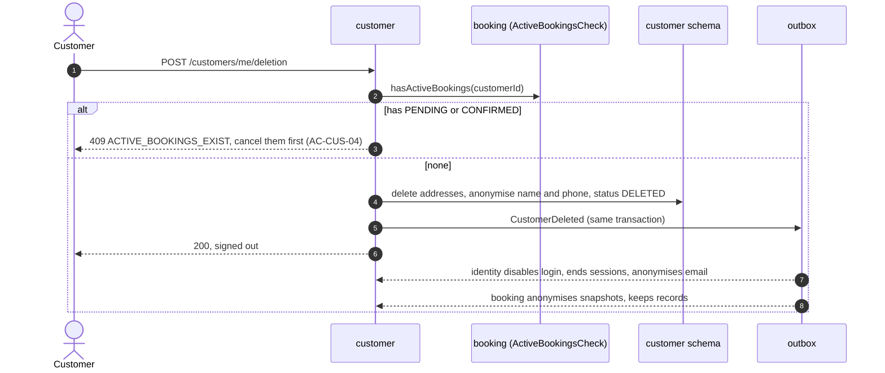

# HLD — Customer module

| Field    | Value                       |
| -------- | --------------------------- |
| Status   | **Draft — awaiting review** |
| Version  | 0.1                         |
| Date     | 2026-10-31                  |
| Overview | [overview.md](overview.md)  |

## 1. Purpose and scope

Customer owns the customer's profile and saved addresses, and handles account deletion with PII anonymisation.

| Covers                             | Requirements                               |
| ---------------------------------- | ------------------------------------------ |
| Profile (name, phone)              | FR-CUS-01, FR-AUTH-01 (profile part)       |
| Up to 5 addresses, one default     | FR-CUS-02, FR-CUS-03, AC-CUS-01, AC-CUS-03 |
| Address snapshot for bookings      | AC-CUS-02, EC-21                           |
| Account deletion and anonymisation | FR-CUS-05, AC-CUS-04, NFR-12               |

**Not owned:** login and email (identity), bookings and "My bookings" (booking, FR-CUS-04).

## 2. REST endpoints (role CUSTOMER, own data only)

All paths are under `/api/v1`.

| Method | Path                                   | Purpose                                                                 | Req                  | Main errors                                                                |
| ------ | -------------------------------------- | ----------------------------------------------------------------------- | -------------------- | -------------------------------------------------------------------------- |
| GET    | `/customers/me`                        | Profile: name, phone, email (read from identity), default address ID    | FR-CUS-01            | 404 `PROFILE_NOT_READY` (only in the seconds right after registration)     |
| PATCH  | `/customers/me`                        | Change `name`, `phone`                                                  | FR-CUS-01            | 422 validation                                                             |
| GET    | `/customers/me/addresses`              | List saved addresses                                                    | FR-CUS-02            | —                                                                          |
| POST   | `/customers/me/addresses`              | `label`, `street`, `city`, `postalCode`, `accessNotes?`, `makeDefault?` | FR-CUS-02/03         | 422 `ADDRESS_LIMIT_REACHED` (AC-CUS-01), `INVALID_POSTAL_CODE` (AC-CUS-03) |
| PUT    | `/customers/me/addresses/{id}`         | Replace an address                                                      | FR-CUS-02            | 422, 404                                                                   |
| DELETE | `/customers/me/addresses/{id}`         | Delete an address. Bookings keep their snapshot (AC-CUS-02)             | FR-CUS-02            | 404                                                                        |
| POST   | `/customers/me/addresses/{id}/default` | Make this the default                                                   | FR-CUS-03            | 404                                                                        |
| POST   | `/customers/me/deletion`               | Delete account. Body: `confirm: true`                                   | FR-CUS-05, AC-CUS-04 | 409 `ACTIVE_BOOKINGS_EXIST`                                                |

"My bookings" is `GET /api/v1/bookings/me`, owned by booking. The frontend calls it directly, so customer never depends on booking (architecture-options §7.3).

## 3. Public module API (in-process)

| Interface               | Operation              | Input → output                                                                                                                                                                  | Used by                            |
| ----------------------- | ---------------------- | ------------------------------------------------------------------------------------------------------------------------------------------------------------------------------- | ---------------------------------- |
| `AddressLookup`         | `getAddressForBooking` | customerId, addressId → `{ label, street, city, postalCode, accessNotes }` or not found. Not found also when the address belongs to another customer or the customer is deleted | booking (FR-BKG-01, FR-BKG-03)     |
| `CustomerContactLookup` | `getContact`           | customerId → `{ firstName, fullName, phone }`                                                                                                                                   | booking (snapshot at request time) |

### 3.1 Interface defined here, implemented by booking

| Interface             | Operation                                 | Why                                                                                                      |
| --------------------- | ----------------------------------------- | -------------------------------------------------------------------------------------------------------- |
| `ActiveBookingsCheck` | `hasActiveBookings(customerId)` → boolean | Block deletion while PENDING/CONFIRMED bookings exist (AC-CUS-04), without customer depending on booking |

## 4. Events

### 4.1 Published

| Event             | Fields                  | When                                               | Consumers                                                                                                |
| ----------------- | ----------------------- | -------------------------------------------------- | -------------------------------------------------------------------------------------------------------- |
| `CustomerDeleted` | envelope + `customerId` | Account deleted and the customer schema anonymised | identity (disable login, anonymise email, end sessions), booking (cancel leftovers, anonymise snapshots) |

### 4.2 Consumed

| Event                            | From     | Handling                                                                              |
| -------------------------------- | -------- | ------------------------------------------------------------------------------------- |
| `UserRegistered` (role CUSTOMER) | identity | Create the customer row with `id = userId`, name and phone from the event. Idempotent |

## 5. Data owned (schema `customer`)

| Table              | Key columns                                                                                        | Notes                                                                                             |
| ------------------ | -------------------------------------------------------------------------------------------------- | ------------------------------------------------------------------------------------------------- |
| `customer`         | id (= userId), full_name, phone, status (ACTIVE, DELETED), default_address_id, deleted_at, version | After deletion, name and phone are replaced with placeholders                                     |
| `customer_address` | id, customer_id, label, street, city, postal_code, access_notes, created_at                        | At most 5 per customer. Deleted rows are removed, not soft-deleted, since bookings hold snapshots |
| `processed_event`  | event_id, processed_at                                                                             | Idempotent `UserRegistered` handling                                                              |

**Address limit under concurrency:** adding an address locks the customer row first (`SELECT … FOR UPDATE`), then counts. Two parallel adds can't create a sixth address.

**One default:** stored as `customer.default_address_id`, so only one default can exist without an extra constraint.

## 6. Key flows

### 6.1 Profile created after registration

The customer reaches the profile only after verifying their email (FR-AUTH-04), which takes far longer than this event. `PROFILE_NOT_READY` is a safety net: the frontend retries once after a short wait.

### 6.2 Add an address

### 6.3 Delete account (FR-CUS-05, NFR-12)

**Race:** a booking could be committed between the check and the deletion. Booking handles this: after deletion, `getAddressForBooking` returns not found, so new requests fail, and the `CustomerDeleted` handler cancels any active booking that slipped through (booking.md §4.2).

Anonymisation happens within seconds, well inside the 30 days NFR-12 allows. Booking records stay for accounting, without personal data.

## 7. Validation rules

| Field        | Rule                                    |
| ------------ | --------------------------------------- |
| name         | 1–100 characters                        |
| phone        | Launch-area phone format (config)       |
| postal code  | Launch-area pattern (config, AC-CUS-03) |
| access notes | ≤ 500 characters. Never logged          |
| label        | ≤ 30 characters, e.g. "Home", "Parents" |

## 8. Testing focus

- Address limit with parallel requests.
- Default address rules (first address becomes default; deleting the default clears it).
- Deletion blocked with active bookings; deletion end to end anonymises all three modules.
- Other customers' addresses → 404 and not returned by `getAddressForBooking`.
