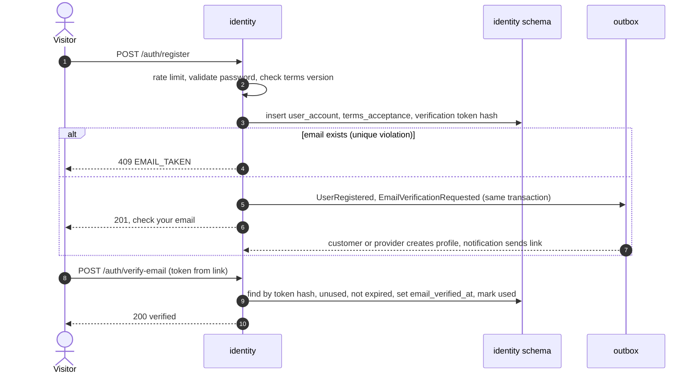
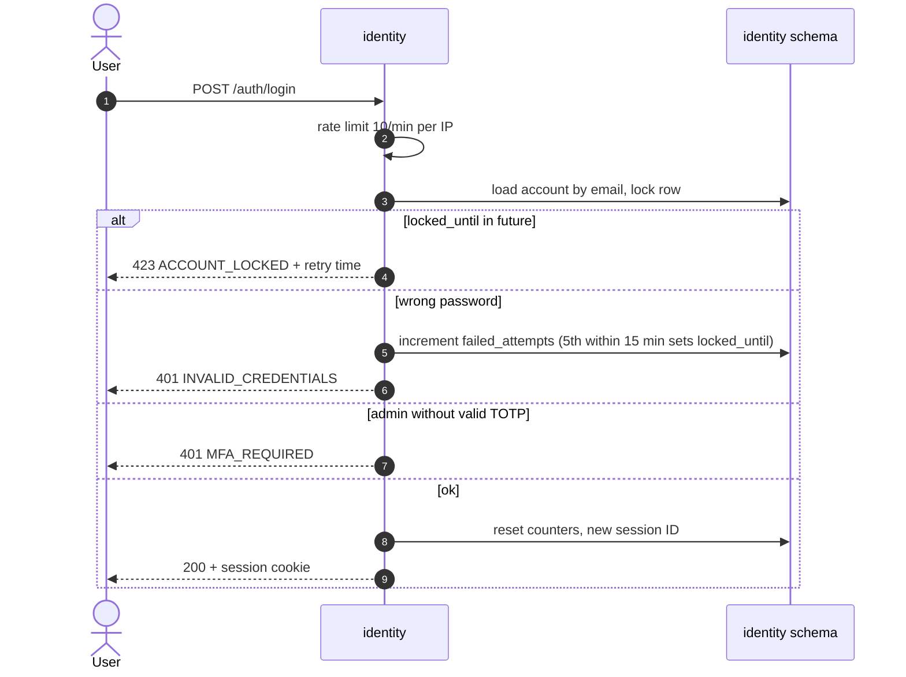
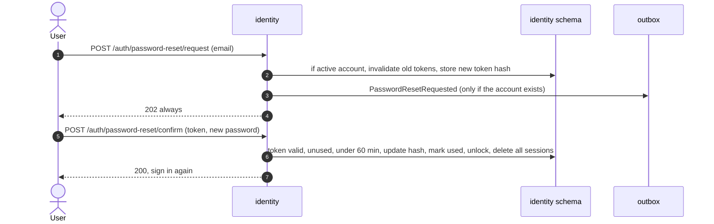

# HLD — Identity module

| Field    | Value                       |
| -------- | --------------------------- |
| Status   | **Draft — awaiting review** |
| Version  | 0.1                         |
| Date     | 2026-10-31                  |
| Overview | [overview.md](overview.md)  |

## 1. Purpose and scope

Identity owns user accounts and everything about signing in: registration, credentials, roles, email verification, password reset, lockout, sessions, terms acceptance and admin MFA.

| Covers                                   | Requirements                                   |
| ---------------------------------------- | ---------------------------------------------- |
| Registration for customers and providers | FR-AUTH-01, FR-AUTH-02, AC-AUTH-01, AC-AUTH-02 |
| Sign in, sign out, sessions              | FR-AUTH-03, OD-5 (HD-1)                        |
| Email verification                       | FR-AUTH-04, AC-AUTH-06                         |
| Password reset                           | FR-AUTH-05, AC-AUTH-04                         |
| Roles and access                         | FR-AUTH-06, AC-AUTH-05, NFR-10                 |
| Terms acceptance                         | FR-AUTH-07 (Q-10)                              |
| Lockout and rate limit                   | AC-AUTH-03, NFR-11                             |
| Admin accounts and MFA                   | FR-ADM-06, Q-11 (HD-2)                         |
| Password storage                         | NFR-08                                         |

**Not owned:** customer and provider profiles (name and phone live there), emails themselves (notification).

## 2. REST endpoints

All paths are under `/api/v1/auth` unless shown otherwise. State-changing calls need the CSRF header.

| Method | Path                         | Access    | Purpose                                                                                   | Req                    | Main errors                                                                                           |
| ------ | ---------------------------- | --------- | ----------------------------------------------------------------------------------------- | ---------------------- | ----------------------------------------------------------------------------------------------------- |
| POST   | `/register`                  | public    | Body: `role` (CUSTOMER or PROVIDER), `email`, `password`, `name`, `phone`, `termsVersion` | FR-AUTH-01/02/07       | 409 `EMAIL_TAKEN` (AC-AUTH-01); 422 `WEAK_PASSWORD` (AC-AUTH-02), `TERMS_NOT_CURRENT`; 429            |
| POST   | `/verify-email`              | public    | Body: `token`                                                                             | FR-AUTH-04             | 422 `TOKEN_INVALID_OR_EXPIRED`                                                                        |
| POST   | `/verify-email/resend`       | signed in | Send a new verification email                                                             | FR-AUTH-04             | 429                                                                                                   |
| POST   | `/login`                     | public    | Body: `email`, `password`, `totpCode?` (admins). Creates a session                        | FR-AUTH-03             | 401 `INVALID_CREDENTIALS`; 423 `ACCOUNT_LOCKED` with retry time (AC-AUTH-03); 401 `MFA_REQUIRED`; 429 |
| POST   | `/logout`                    | signed in | End the session                                                                           | FR-AUTH-03             | —                                                                                                     |
| GET    | `/me`                        | signed in | `userId`, `role`, `emailVerified`, `mfaEnabled`                                           | —                      | 401                                                                                                   |
| POST   | `/password-reset/request`    | public    | Body: `email`. Always returns 202, so the API doesn't reveal whether an account exists    | FR-AUTH-05             | 429                                                                                                   |
| POST   | `/password-reset/confirm`    | public    | Body: `token`, `newPassword`. Ends all sessions of the user                               | FR-AUTH-05, AC-AUTH-04 | 422 `TOKEN_INVALID_OR_EXPIRED`, `WEAK_PASSWORD`                                                       |
| POST   | `/mfa/setup`                 | ADMIN     | Start TOTP setup; returns a secret and QR data                                            | HD-2                   | 409 if already set                                                                                    |
| POST   | `/mfa/confirm`               | ADMIN     | Body: `totpCode`. Turns MFA on                                                            | HD-2                   | 422 `INVALID_CODE`                                                                                    |
| GET    | `/api/v1/terms/current?role` | public    | Current terms version and link for a role                                                 | FR-AUTH-07             | —                                                                                                     |

`EMAIL_TAKEN` reveals that an email is registered. AC-AUTH-01 asks for a clear message, so this is accepted. The registration rate limit (5/min per IP) slows down anyone checking emails in bulk.

## 3. Rules

| Topic              | Rule                                                                                                                                                           |
| ------------------ | -------------------------------------------------------------------------------------------------------------------------------------------------------------- |
| Email              | Stored lower-cased and trimmed. Unique across all roles. One account has exactly one role                                                                      |
| Password           | ≥ 10 characters, not in a common-password list of ≥ 10,000 entries (AC-AUTH-02). Max 128 characters                                                            |
| Hashing            | Argon2id via Spring Security's delegating encoder, so the algorithm can be upgraded later (NFR-08)                                                             |
| Lockout            | 5 failed attempts within 15 min → locked for 15 min (AC-AUTH-03). A successful sign-in resets the counter. Password reset unlocks                              |
| Verification token | Random 32 bytes, sent in the email link. Only its hash is stored. Valid 24 h, single use                                                                       |
| Reset token        | Random 32 bytes, hash stored. Valid 60 min, single use (AC-AUTH-04). A new request invalidates older tokens                                                    |
| Sessions           | See overview §8.2 (HD-1). Spring Session JDBC tables in the `identity` schema                                                                                  |
| Roles              | CUSTOMER, PROVIDER, ADMIN. Endpoint access is declared per endpoint (AC-AUTH-05, NFR-10)                                                                       |
| Admins             | Created only by an ops script or seed migration, never by registration (FR-ADM-06). MFA must be set up on first sign-in before any admin endpoint works (HD-2) |
| Terms              | Registration must send the current terms version for the role. The version and timestamp are stored (FR-AUTH-07)                                               |

## 4. Public module API (in-process)

| Interface     | Operation           | Input → output                                              | Used by                                  |
| ------------- | ------------------- | ----------------------------------------------------------- | ---------------------------------------- |
| `CurrentUser` | `get`               | → `{ userId, role, emailVerified }` for the current request | all modules' web layers                  |
| `UserLookup`  | `isEmailVerified`   | userId → boolean                                            | booking (AC-AUTH-06), provider (submit)  |
| `UserLookup`  | `getEmail`          | userId → email, or empty if the account is disabled         | notification, customer (`/customers/me`) |
| `UserLookup`  | `findUserIdByEmail` | email → userId                                              | booking (admin search by email)          |

## 5. Events

### 5.1 Published

| Event                        | Fields                                     | When                                            | Consumers                                   |
| ---------------------------- | ------------------------------------------ | ----------------------------------------------- | ------------------------------------------- |
| `UserRegistered`             | `userId`, `role`, `name`, `phone`          | Account created                                 | customer or provider (create profile, HD-3) |
| `EmailVerificationRequested` | `userId`, `verificationToken`, `expiresAt` | Registration and resend                         | notification (FR-NOT-06)                    |
| `EmailVerified`              | `userId`                                   | Token accepted                                  | (none in MVP; for future use)               |
| `PasswordResetRequested`     | `userId`, `resetToken`, `expiresAt`        | Reset requested for an existing, active account | notification (FR-NOT-06)                    |

The plain tokens exist only in the event payload and in the email. Outbox rows are deleted as soon as they are handled (HD-10), so the plain tokens don't stay in the database.

### 5.2 Consumed

| Event             | From     | Handling                                                                                                                    |
| ----------------- | -------- | --------------------------------------------------------------------------------------------------------------------------- |
| `CustomerDeleted` | customer | Set the account to DISABLED, replace the email with a unique placeholder, delete password hash and tokens, end all sessions |

## 6. Data owned (schema `identity`)

| Table                      | Key columns                                                                                                                                                | Notes                                          |
| -------------------------- | ---------------------------------------------------------------------------------------------------------------------------------------------------------- | ---------------------------------------------- |
| `user_account`             | id, email (unique), password_hash, role, status (ACTIVE, DISABLED), email_verified_at, failed_attempts, first_failed_at, locked_until, created_at, version | One row per user                               |
| `terms_version`            | id, role, version, url, published_at                                                                                                                       | Seeded by migration when terms change          |
| `terms_acceptance`         | user_id, terms_version_id, accepted_at                                                                                                                     | FR-AUTH-07                                     |
| `email_verification_token` | token_hash, user_id, expires_at, used_at                                                                                                                   | —                                              |
| `password_reset_token`     | token_hash, user_id, expires_at, used_at                                                                                                                   | —                                              |
| `admin_mfa`                | user_id, totp_secret (encrypted), enabled_at, last_used_step                                                                                               | `last_used_step` blocks reuse of the same code |
| Spring Session tables      | session ID, principal, expiry, attributes                                                                                                                  | Managed by Spring Session                      |
| `processed_event`          | event_id, processed_at                                                                                                                                     | —                                              |

The TOTP secret is encrypted with a key from Secrets Manager, so a database dump alone doesn't expose it.

## 7. Key flows

### 7.1 Register and verify

Registration doesn't sign the user in. They sign in after verifying.

### 7.2 Sign in with lockout

An unknown email gets the same 401 and takes the same time (a dummy hash check), so the response doesn't reveal which emails exist.

### 7.3 Password reset

## 8. Security notes

- Session cookie and CSRF settings: overview §8.2.
- Security headers on all API responses: `Strict-Transport-Security`, `X-Content-Type-Options`, `Referrer-Policy`. CloudFront adds `Content-Security-Policy` for the SPA.
- Passwords, tokens and TOTP codes are never logged.
- An OWASP ZAP baseline scan runs in CI (NFR-09).

## 9. Testing focus

- AC-AUTH-01 … 06 each as API tests.
- Lockout timing with a fixed clock.
- Token expiry and single use, plus old reset tokens invalidated by a new request.
- Role matrix test over all endpoints (NFR-10).
- Sessions shared across two app instances (sign in on one, call the other).
- Admin endpoints refuse admins without MFA.
