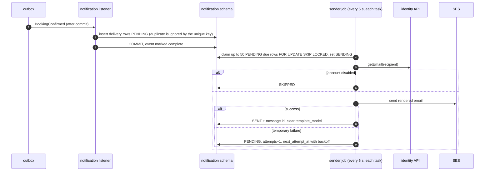

# HLD — Notification module

| Field    | Value                       |
| -------- | --------------------------- |
| Status   | **Draft — awaiting review** |
| Version  | 0.1                         |
| Date     | 2026-10-31                  |
| Overview | [overview.md](overview.md)  |

## 1. Purpose and scope

Notification turns domain events into emails. It listens only and never blocks or rolls back the action that caused the email (AC-NOT-01).

| Covers                                 | Requirements                       |
| -------------------------------------- | ---------------------------------- |
| Booking emails                         | FR-NOT-01 … 04                     |
| Provider status emails                 | FR-NOT-05                          |
| Verification and password reset emails | FR-NOT-06                          |
| Async, retried, deduplicated sending   | AC-NOT-01, AC-NOT-02, EC-14, EC-15 |
| No contact details before confirmation | AC-NOT-03, NFR-12                  |

## 2. REST endpoints

None in the MVP. Support staff find delivery problems through logs and metrics. An admin view of deliveries per booking can be added later.

## 3. Public module API

None. Nothing calls notification (architecture-options §7.2 rule 4).

Notification calls `identity.UserLookup.getEmail(userId)` at send time, to get the current address of each recipient.

## 4. Events consumed and emails sent

| Event                                                                             | Recipient(s)          | Template                                                                                                                       | Req       |
| --------------------------------------------------------------------------------- | --------------------- | ------------------------------------------------------------------------------------------------------------------------------ | --------- |
| `BookingRequested`                                                                | provider              | New request: service, date/time, duration, postal code, price estimate, customer first name, response deadline, dashboard link | FR-NOT-01 |
| `BookingConfirmed`                                                                | customer              | Booking confirmed                                                                                                              | FR-NOT-02 |
| `BookingDeclined`                                                                 | customer              | Request declined (reason if given; "provider unavailable" on suspension)                                                       | FR-NOT-02 |
| `BookingExpired`                                                                  | customer              | No response in time, with a link to book another provider                                                                      | FR-NOT-02 |
| `BookingCancelled` by CUSTOMER                                                    | provider              | Booking cancelled by customer (late flag shown)                                                                                | FR-NOT-03 |
| `BookingCancelled` by PROVIDER                                                    | customer              | Booking cancelled by provider, with reason                                                                                     | FR-NOT-03 |
| `BookingCancelled` by ADMIN                                                       | customer and provider | Booking cancelled by NestaCare, with reason                                                                                    | FR-NOT-03 |
| `BookingCancelled` by SYSTEM                                                      | provider              | Booking cancelled (customer account closed)                                                                                    | FR-NOT-03 |
| `BookingReminderDue`                                                              | customer and provider | Reminder 24 h before                                                                                                           | FR-NOT-04 |
| `ProviderApproved`, `ProviderRejected`, `ProviderSuspended`, `ProviderReinstated` | provider              | Status change, with reason where given                                                                                         | FR-NOT-05 |
| `EmailVerificationRequested`                                                      | user                  | Verify your email (link with token)                                                                                            | FR-NOT-06 |
| `PasswordResetRequested`                                                          | user                  | Reset your password (link with token, valid 60 min)                                                                            | FR-NOT-06 |

Templates use only the fields in the event plus the recipient's email. Events carry no full address or phone, so emails can't leak them (AC-NOT-03).

## 5. Data owned (schema `notification`)

| Table                   | Key columns                                                                                                                                                                                                   | Notes                                                                                                                                                                          |
| ----------------------- | ------------------------------------------------------------------------------------------------------------------------------------------------------------------------------------------------------------- | ------------------------------------------------------------------------------------------------------------------------------------------------------------------------------ |
| `notification_delivery` | id, event_id, event_type, recipient_user_id, template, template_model, status (PENDING, SENDING, SENT, FAILED, SKIPPED), attempts, next_attempt_at, last_error_code, provider_message_id, created_at, sent_at | **Unique on (event_id, recipient_user_id, template):** at most one email per recipient per event (AC-NOT-02). `template_model` is cleared after sending. Rows are kept 90 days |
| `processed_event`       | event_id, processed_at                                                                                                                                                                                        | —                                                                                                                                                                              |

`last_error_code` stores an error category (e.g. `SES_THROTTLED`), never message text that could contain PII.

## 6. How sending works

Sending happens in two steps, so a slow or failing SES never holds up event processing.

| Topic                                                       | Rule                                                                                                                                                                                                                                                                                      |
| ----------------------------------------------------------- | ----------------------------------------------------------------------------------------------------------------------------------------------------------------------------------------------------------------------------------------------------------------------------------------- |
| Retry                                                       | Up to 5 attempts with backoff of 1 min, 5 min, 15 min, 1 h, 6 h (AC-NOT-02 requires ≥ 3). Then FAILED, logged, and counted in a metric with an alarm                                                                                                                                      |
| Permanent failure (e.g. invalid address, suppressed by SES) | FAILED immediately, no retries                                                                                                                                                                                                                                                            |
| Crash during send (HD-9)                                    | A row stuck in SENDING for more than 10 min goes back to PENDING. If SES had already accepted it, the recipient gets the email twice. This is accepted because a missed booking request email is worse (R-1). It is a small deviation from AC-NOT-02's "at most one", listed for approval |
| Duplicate events                                            | The unique key on delivery rows makes repeats a no-op (EC-15). A repeated action that publishes no event (BR-15, EC-14) sends nothing                                                                                                                                                     |
| Ordering                                                    | Not guaranteed between different events. Each email stands on its own                                                                                                                                                                                                                     |
| Templates                                                   | Thymeleaf HTML + plain-text versions, English, strings in message files (NFR-20). Links use a configured base URL                                                                                                                                                                         |
| Sender                                                      | `EmailSender` port: SES API adapter in AWS (IAM task role, no SMTP passwords), SMTP adapter to Mailpit locally (A-7)                                                                                                                                                                      |
| Bounces and complaints                                      | SES account-level suppression list (no extra infrastructure). Bounce and complaint rates are watched in the SES console and with CloudWatch alarms                                                                                                                                        |
| Sending domain                                              | Verified domain with DKIM and SPF, plus a DMARC record (set up in ADR-003)                                                                                                                                                                                                                |

## 7. Testing focus

- Each event maps to the right recipients and template (table in §4).
- Repeat delivery of an event → one delivery row per recipient.
- SES errors: temporary errors retried with backoff, permanent errors fail at once.
- Two app instances running the sender job → each row sent once.
- Rendered emails contain no address or phone (AC-NOT-03); snapshot test of each template.
- Booking state changes succeed when the email sender is down (AC-NOT-01).
