# NestaCare — High-Level Design: Overview

| Field        | Value                                                                                                                                                                           |
| ------------ | ------------------------------------------------------------------------------------------------------------------------------------------------------------------------------- |
| Document     | HLD overview (Phase 4)                                                                                                                                                          |
| Status       | **Draft — awaiting review**                                                                                                                                                     |
| Version      | 0.1                                                                                                                                                                             |
| Date         | 2026-10-31                                                                                                                                                                      |
| Inputs       | [requirements.md](../requirements/requirements.md) v1.0, [architecture-options.md](../architecture/architecture-options.md) v1.0, [ADR-001](../adr/ADR-001-modular-monolith.md) |
| Module HLDs  | [booking](booking.md) · [provider](provider.md) · [search](search.md) · [customer](customer.md) · [identity](identity.md) · [notification](notification.md)                     |
| Related ADRs | [ADR-002 Booking concurrency](../adr/ADR-002-booking-concurrency.md) · [ADR-003 Deployment and cost](../adr/ADR-003-deployment-topology-and-cost.md)                            |
| Next phase   | LLD (`docs/lld/`): database schema, SQL constraints, class design — starts only after approval                                                                                  |

---

## 1. Purpose and scope

This document describes how NestaCare is built at a level that one person can hold in their head:

- the components and how they fit together (§3, §4)
- how it runs on AWS (§5)
- how the main requests flow end to end (§6)
- which module owns which data (§7)
- the rules every module follows: API style, security, errors, logging, time and money (§8)

Each module's endpoints, events, tables and flows are in its own HLD. Concurrency rules for booking are in ADR-002, and AWS sizing and cost are in ADR-003.

Not in scope here: SQL, class names and code. Those belong in the LLD.

## 2. System context

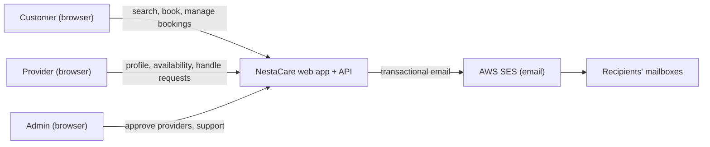

There are no other external systems in the MVP: no payments, no SMS and no external identity provider (requirements §5.2, A-9).

## 3. Containers

| Container     | Technology                                                                         | Responsibility                                                                                                  |
| ------------- | ---------------------------------------------------------------------------------- | --------------------------------------------------------------------------------------------------------------- |
| Web app (SPA) | React, TypeScript, Vite; static files on S3 behind CloudFront                      | All UI for customers, providers and admins. Talks only to the REST API                                          |
| CDN / edge    | CloudFront                                                                         | TLS, caching of static files and provider photos, routes `/api/*` to the backend so the browser sees one origin |
| Backend       | Java 21, Spring Boot, Spring Modulith; one Docker image on ECS Fargate (≥ 2 tasks) | REST API, business logic in six modules, scheduled jobs, event handling                                         |
| Database      | PostgreSQL on RDS                                                                  | All persistent data, one schema per module, plus the event outbox                                               |
| Media storage | S3 bucket (private), served via CloudFront                                         | Provider profile photos (HD-6)                                                                                  |
| Email         | AWS SES (cloud), Mailpit (local)                                                   | Sends transactional email                                                                                       |
| Secrets       | AWS Secrets Manager                                                                | Database credentials and other secrets, injected into tasks at start                                            |
| Monitoring    | CloudWatch Logs, Metrics, Alarms                                                   | JSON logs, metrics, alerts (NFR-15)                                                                             |

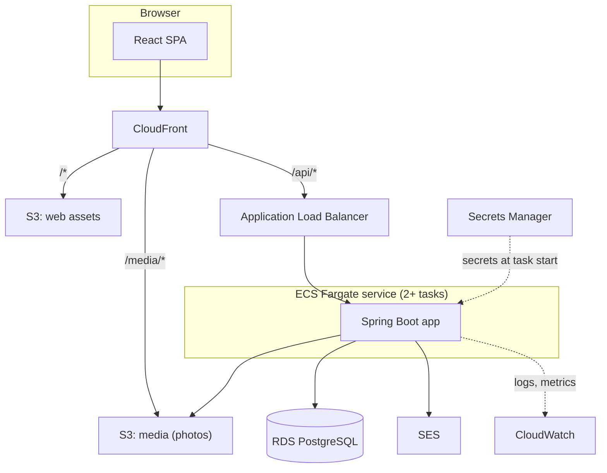

## 4. Component architecture

### 4.1 Backend components

The backend is one Spring Boot application. Inside it there are three layers that every module follows, plus shared platform components.

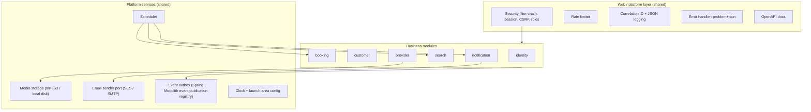

Each business module has the same inner shape:

| Layer                       | Contents                                                    | Visible to other modules?                  |
| --------------------------- | ----------------------------------------------------------- | ------------------------------------------ |
| `api` (module root package) | Public Java interfaces, DTOs (records), event types         | Yes. This is the only thing others may use |
| `internal.web`              | REST controllers, request/response models, input validation | No                                         |
| `internal.domain`           | Entities, value objects, business rules, state machines     | No                                         |
| `internal.persistence`      | Repositories for the module's own schema                    | No                                         |
| `internal.events`           | Event listeners for other modules' events                   | No                                         |
| `internal.jobs`             | Scheduled jobs                                              | No                                         |

Spring Modulith verifies these rules in CI (ADR-001, OD-3).

### 4.2 Module dependencies (sync calls)

The dependency rules from [architecture-options.md §7.2](../architecture/architecture-options.md#72-dependency-rules) still apply. The HLD adds two refinements:

- **search calls booking for free slots** instead of combining provider availability and booking busy intervals itself (HD-4)
- **notification calls identity** to look up recipient email addresses

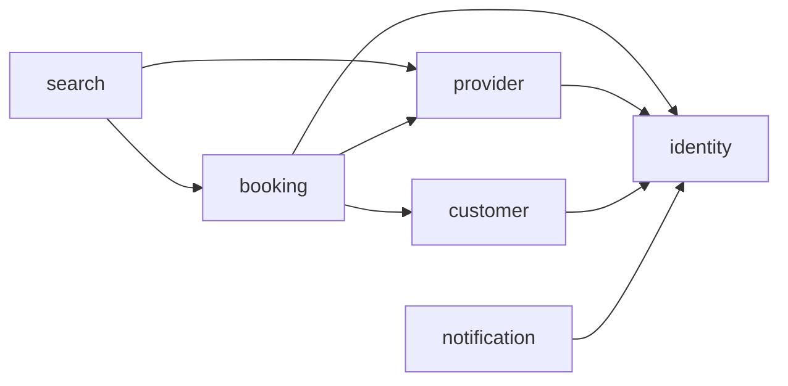

The graph has no cycles. When provider and customer need booking data, booking implements interfaces that they define.

### 4.3 Events between modules

| Publisher | Events                                                                                                                                                                                             | Consumers                                         |
| --------- | -------------------------------------------------------------------------------------------------------------------------------------------------------------------------------------------------- | ------------------------------------------------- |
| identity  | `UserRegistered`, `EmailVerificationRequested`, `PasswordResetRequested`, `EmailVerified`                                                                                                          | customer, provider (create profile), notification |
| customer  | `CustomerDeleted`                                                                                                                                                                                  | identity, booking                                 |
| provider  | `ProviderApproved`, `ProviderRejected`, `ProviderSuspended`, `ProviderReinstated`, `ProviderPaused`, `ProviderResumed`, `ProviderProfileChanged`, `ProviderAvailabilityChanged`, `CategoryChanged` | search, booking (suspension), notification        |
| booking   | `BookingRequested`, `BookingConfirmed`, `BookingDeclined`, `BookingExpired`, `BookingCancelled`, `BookingCompleted`, `BookingNoShow`, `BookingReminderDue`, `ReviewSubmitted`, `ReviewHidden`      | search, notification                              |

Field lists are in each module HLD. All events share this envelope:

| Field           | Type            | Notes                                                        |
| --------------- | --------------- | ------------------------------------------------------------ |
| `eventId`       | UUID            | Unique. Consumers deduplicate on it (EC-15)                  |
| `eventType`     | string          | e.g. `BookingConfirmed`                                      |
| `version`       | integer         | Starts at 1. Bumped on breaking change                       |
| `occurredAt`    | timestamp (UTC) | Database time of the publishing transaction                  |
| business fields | —               | IDs plus the minimum data consumers need. Never JPA entities |

### 4.4 Frontend components

The frontend is one React SPA with feature folders that mirror the backend modules. Library choices are a proposal, to be confirmed in the frontend LLD.

| Feature area       | Main screens                                                                     | Backend modules used          |
| ------------------ | -------------------------------------------------------------------------------- | ----------------------------- |
| `auth`             | Register (customer/provider), sign in, verify email, reset password              | identity                      |
| `search`           | Search form, results with filters and sort, comparison view                      | search, provider (categories) |
| `provider-profile` | Public profile, reviews, 30-day calendar, slot picker                            | search, booking (reviews)     |
| `booking`          | Booking review and submit, booking detail, cancel with late warning, review form | booking, customer (addresses) |
| `account`          | Customer profile, addresses, delete account, "My bookings"                       | customer, booking             |
| `provider-portal`  | Onboarding wizard, services, service area, availability, time off, dashboard     | provider, booking             |
| `admin`            | Provider queue, provider detail, booking search, categories                      | provider, booking             |

Proposed building blocks: React Router, TanStack Query for server state, React Hook Form with Zod for forms, and an API client generated from the backend OpenAPI spec so TypeScript types always match the API.

## 5. AWS deployment design

Full design, options and costs are in [ADR-003](../adr/ADR-003-deployment-topology-and-cost.md). Nothing is created until that ADR is approved (CLAUDE.md rule 8).

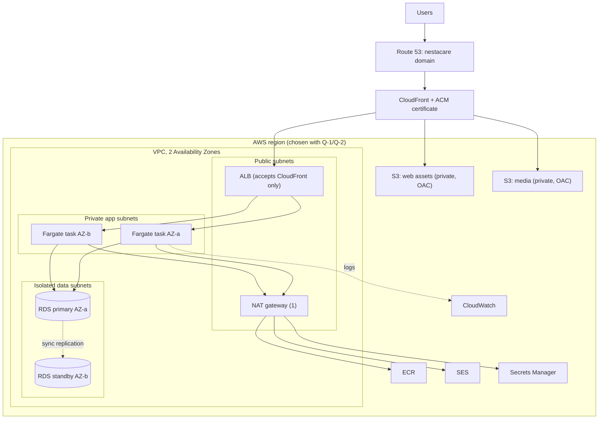

Key points:

- **One origin for the browser.** CloudFront serves the SPA and forwards `/api/*` to the ALB. No CORS is needed, and session cookies stay first-party.
- **The ALB accepts traffic only from CloudFront.** Its security group allows only the AWS-managed CloudFront origin-facing prefix list.
- **App tasks run in private subnets** and reach AWS services through one NAT gateway, with a free S3 gateway endpoint for S3. Tasks are stateless, so any task can serve any request (NFR-06).
- **RDS is Multi-AZ** for NFR-04/NFR-05, with automated backups and point-in-time recovery.
- **Environments:** local (Docker Compose), staging and production in AWS. Staging is a smaller, cheaper copy (ADR-003).
- **Delivery:** GitHub Actions builds one ARM64 image, pushes it to ECR and deploys with `cdk deploy`. ECS rolling deploys use the deployment circuit breaker to roll back automatically on failed health checks.
- **Database migrations:** Flyway runs at app start-up, using its lock table so only one task migrates at a time. Every migration must be backward compatible with the previous app version (expand, then contract), because old and new tasks run side by side during a rolling deploy.

## 6. Request flows

### 6.1 Routing of a browser request

| Path                   | CloudFront behaviour                                                         | Origin          | Caching                                                  |
| ---------------------- | ---------------------------------------------------------------------------- | --------------- | -------------------------------------------------------- |
| `/api/*`               | Forward all methods, cookies, query strings and headers needed for auth/CSRF | ALB             | Not cached                                               |
| `/media/*`             | GET only                                                                     | S3 media bucket | Cached (photos are immutable; new upload = new key)      |
| `/*` (everything else) | GET only. Unknown paths return `index.html` for client-side routing          | S3 web bucket   | `index.html` not cached; hashed JS/CSS cached for 1 year |

### 6.2 Search providers (J-1 steps 1–3)

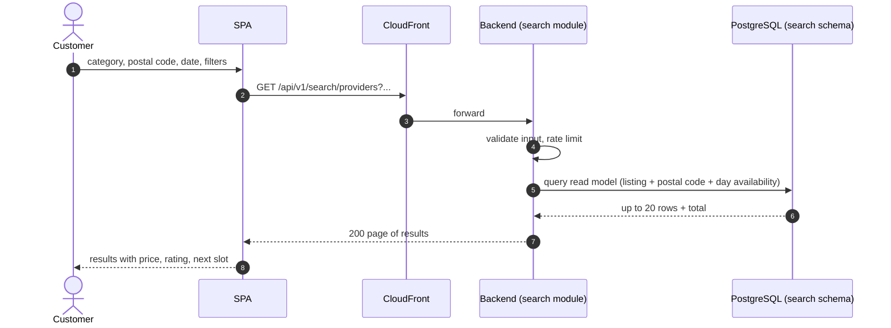

The search list reads only the search read model, which events keep up to date (≤ 60 s stale, AC-SRCH-06). It makes no calls to other modules, which keeps NFR-01 (p95 ≤ 500 ms) easy to meet.

### 6.3 View a provider's calendar (J-1 step 4)

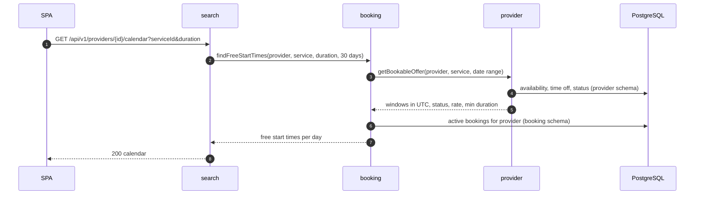

This path is live on every request, so a slot freed by a cancellation shows up on the next load (EC-09, AC-SRCH-03).

### 6.4 Create a booking (J-1 steps 5–7)

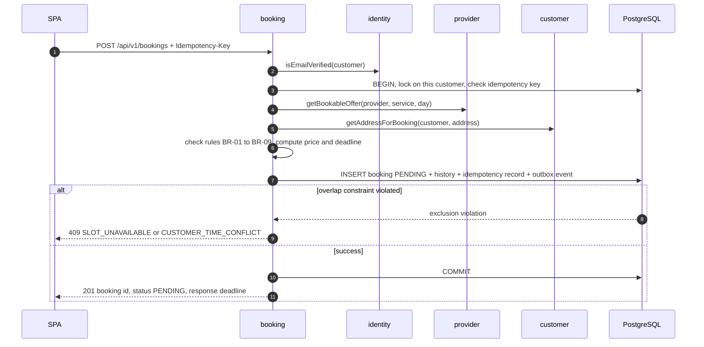

Details, including why this is safe under concurrency, are in [booking.md](booking.md) and [ADR-002](../adr/ADR-002-booking-concurrency.md).

### 6.5 From state change to email (async)

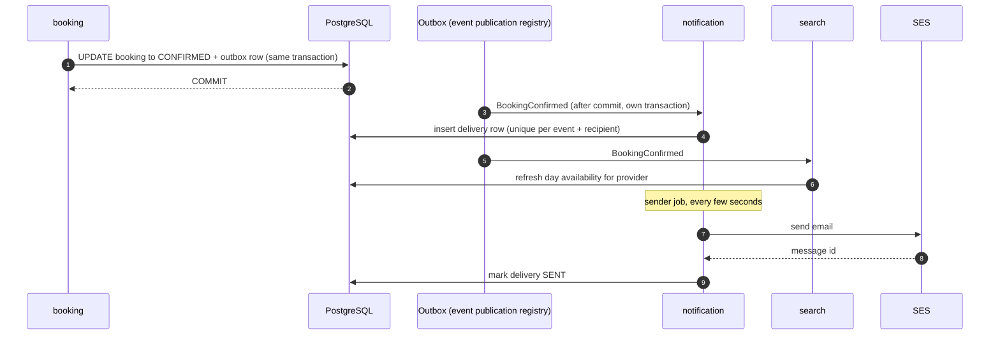

If a listener fails or the app restarts, the outbox keeps the event as incomplete and delivers it again. Consumers deduplicate on `eventId`, so a booking state change never waits for email (AC-NOT-01).

### 6.6 Sign in and authenticated call

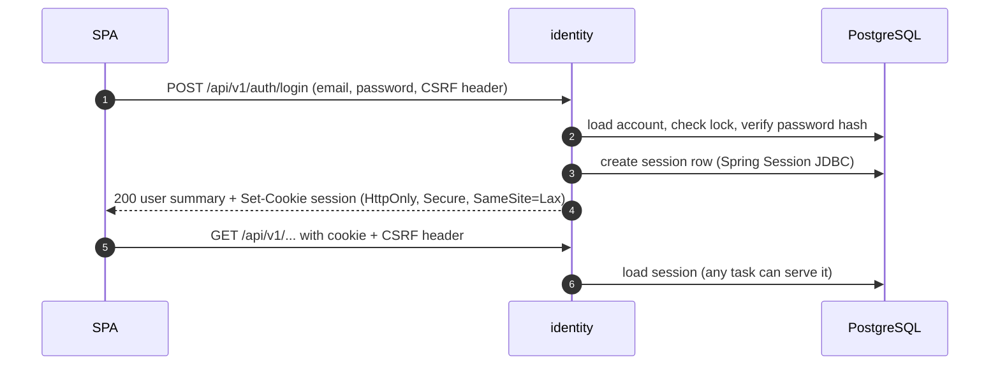

## 7. Database ownership

### 7.1 Schemas

One PostgreSQL database, one schema per module (OD-4). Table lists are in each module HLD.

| Schema         | Owner                                               | Main tables                                                                                                                                        | Other modules read it via                                           |
| -------------- | --------------------------------------------------- | -------------------------------------------------------------------------------------------------------------------------------------------------- | ------------------------------------------------------------------- |
| `identity`     | identity                                            | user_account, terms_version, terms_acceptance, email_verification_token, password_reset_token, admin_mfa (HD-2), Spring Session tables             | identity API: user summary, email lookup, verified check            |
| `customer`     | customer                                            | customer, customer_address                                                                                                                         | customer API: address for booking, contact lookup                   |
| `provider`     | provider                                            | provider, provider_language, service_category, provider_service, service_area, weekly_availability, time_off, provider_status_history, admin_audit | provider API: bookable offer, listing snapshot, categories, contact |
| `booking`      | booking                                             | booking, booking_status_history, idempotency_record, review, admin_audit, processed_event                                                          | booking API: free start times, scheduled/active booking lookups     |
| `search`       | search                                              | provider_listing, listing_postal_code, listing_day_availability, provider_stats, processed_event                                                   | none (read model only)                                              |
| `notification` | notification                                        | notification_delivery, processed_event                                                                                                             | none                                                                |
| `platform`     | application platform config (not a business module) | event_publication (Spring Modulith outbox), rate_limit_bucket, flyway history                                                                      | none                                                                |

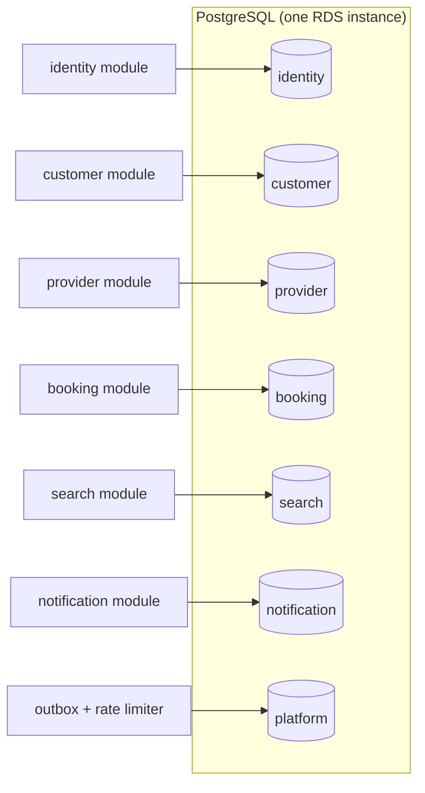

### 7.2 Rules

1. A module's repositories touch only its own schema. A test checks every entity and repository against its module's schema.
2. No foreign keys, joins or views across schemas. Cross-module references are plain UUID columns.
3. **Profile IDs equal user IDs.** `customer.id` and `provider.id` are the identity `userId`, which avoids mapping tables (HD-3).
4. A transaction writes to one schema only, plus the `platform.event_publication` outbox row in the same transaction. The booking-creation read exception is described in ADR-001.
5. Data copied into another module is a **snapshot** (e.g. the booking's price, address and provider name) and is not updated afterwards.
6. Each module has its own Flyway migration folder. Migrations touch only that module's schema.
7. Retention: booking history and admin audit for ≥ 2 years (NFR-21). Completed outbox rows are deleted on completion (HD-10). Notification delivery rows are kept 90 days.

## 8. Cross-cutting design

### 8.1 API conventions

| Topic         | Rule                                                                                                                                                                                                                  |
| ------------- | --------------------------------------------------------------------------------------------------------------------------------------------------------------------------------------------------------------------- |
| Base path     | `/api/v1`. A breaking change gets a new version prefix                                                                                                                                                                |
| Style         | REST, JSON, nouns for resources, `POST /{resource}/{id}/{action}` for state transitions (e.g. `/bookings/{id}/confirm`)                                                                                               |
| Identifiers   | UUIDs, generated by the backend                                                                                                                                                                                       |
| Times         | ISO-8601 instants in UTC in all responses (e.g. `2026-11-07T04:30:00Z`). Requests may send any offset and are converted to UTC. The frontend displays in the launch-area time zone from `GET /api/v1/config` (NFR-19) |
| Money         | `{ "amountMinor": 150000, "currency": "<ISO 4217 code of the launch currency>" }`. Integer minor units, one currency (NFR-20, Q-1)                                                                                    |
| Pagination    | `?page=0&size=20`. Response `{ items, page, size, totalItems, totalPages }`. Max size 50. Search is fixed at 20 (FR-SRCH-05)                                                                                          |
| Idempotency   | `Idempotency-Key` header required on `POST /bookings` (FR-BKG-13). Other transitions are idempotent by state (BR-15)                                                                                                  |
| Errors        | `application/problem+json` (RFC 9457) with `type`, `title`, `status`, `detail`, plus `code` (stable machine code, e.g. `SLOT_UNAVAILABLE`), `traceId` and, for validation, `errors[{field, code, message}]`           |
| Status codes  | 400 malformed, 401 not signed in, 403 wrong role or unverified email, 404 not found or not yours (NFR-10), 409 state conflict, 422 business validation, 429 rate limit                                                |
| Contract      | OpenAPI document generated by the backend. Contract tests check it. The frontend client is generated from it                                                                                                          |
| Public config | `GET /api/v1/config`: time zone, currency, postal-code pattern, booking rule values, current terms versions                                                                                                           |

### 8.2 Authentication and sessions (decides OD-5)

**Decision proposed (HD-1): server-side sessions with a secure cookie, stored in PostgreSQL via Spring Session JDBC. No JWT for the browser.**

| Option                                           | Pros                                                                                                                                                                                                  | Cons                                                                                                                           |
| ------------------------------------------------ | ----------------------------------------------------------------------------------------------------------------------------------------------------------------------------------------------------- | ------------------------------------------------------------------------------------------------------------------------------ |
| **Server session in Postgres + HttpOnly cookie** | Instant revocation (password reset, lockout, account deletion). Token not readable by JavaScript, so XSS can't steal it. Stateless tasks, because sessions live in the DB. Built into Spring Security | One DB read per request (cheap at this load; can be cached later). Needs CSRF protection                                       |
| JWT in browser storage                           | No session lookup                                                                                                                                                                                     | Hard to revoke before expiry. A token in `localStorage` is exposed to XSS. Needs refresh-token rotation, which adds complexity |
| JWT in HttpOnly cookie                           | Not readable by JS                                                                                                                                                                                    | Still hard to revoke, still needs CSRF protection; no real gain over sessions                                                  |

Details:

- Cookie: `__Host-NESTA_SESSION`, `Secure`, `HttpOnly`, `SameSite=Lax`, path `/`.
- Session ID is rotated at sign-in to prevent session fixation.
- Timeouts (configurable): customer/provider idle 24 h, absolute 30 days; admin idle 30 min, absolute 12 h.
- CSRF: Spring Security cookie-to-header pattern. The SPA reads the `XSRF-TOKEN` cookie and sends `X-XSRF-TOKEN` on every state-changing request.
- All sessions of a user are invalidated on password reset and on account deletion.
- Future services: when a module is extracted, the monolith (or a gateway) can issue short-lived signed internal tokens for service-to-service calls. The browser keeps using the session cookie, so this choice doesn't block extraction (architecture-options §8.4).

**Admin MFA (Q-11, HD-2):** proposed TOTP (authenticator app) for ADMIN accounts at launch. The admin sets it up on first sign-in. Customers and providers have no MFA in the MVP (requirements §5.2).

### 8.3 Authorization

- Every endpoint declares a role rule (public, CUSTOMER, PROVIDER, ADMIN). A test fails if an endpoint has no rule (NFR-10).
- Ownership is checked in the service layer. A customer or provider asking for someone else's resource gets **404**, so the API doesn't reveal that the resource exists (NFR-10).
- The provider sees the customer's full address and phone only when the booking is CONFIRMED and within 7 days of it reaching a terminal state (FR-BKG-10, BR-16). The booking module applies this rule when building responses.

### 8.4 Rate limiting (NFR-11)

- Implemented in the app with Bucket4j, with buckets stored in `platform.rate_limit_bucket` so limits hold across all tasks.
- Sign-in: 10/min per IP. Booking creation: 10/min per customer. Registration and password-reset requests: 5/min per IP. Search: 60/min per IP (protection only).
- Client IP comes from the `X-Forwarded-For` header, trusting only the CloudFront and ALB hops.
- The 20-pending-bookings limit is a business rule (BR-07) enforced in booking, not a rate limit.

### 8.5 Time, money, launch area

- All timestamps are `timestamptz` in UTC. Provider weekly availability is stored as local wall-clock times plus the launch-area time zone and converted per date, so DST is handled (NFR-19, EC-08).
- Launch-area settings are configuration, not code (Q-1): time zone, currency, postal-code pattern, max hourly rate, and all booking rule values from BR-01 … BR-17.
- A `Clock` bean is injected everywhere, so tests can fix the time. Deadline checks inside SQL use database time (EC-25).

### 8.6 Logging, metrics and tracing (NFR-15)

- Structured JSON logs (Spring Boot structured logging) to stdout, collected by CloudWatch Logs.
- Every request gets a correlation ID: the incoming `X-Request-Id` if present, otherwise a new one. It goes into every log line and error response (`traceId`), and into events so async work can be traced back.
- **No PII in logs** (NFR-12): request and response bodies are never logged, emails are masked, and addresses and phones are never logged. A test scans log output in integration tests for known PII patterns.
- Metrics via Micrometer: request rate, error rate and latency per endpoint; booking transitions by type; outbox backlog; email send results; job durations. A small fixed set is published to CloudWatch to control cost (ADR-003).
- Alarms: ALB 5xx > 2 % over 5 min, unhealthy targets, RDS CPU/storage/connections, outbox backlog age > 5 min, email failure rate.

### 8.7 Configuration and secrets

- Spring profiles: `local`, `test`, `staging`, `prod`.
- Secrets are never in the repo (CLAUDE.md rule 7). In AWS they come from Secrets Manager into ECS task environment variables. Locally they come from a `.env` file that git ignores, with `.env.example` documenting the keys.
- The database master password is managed by RDS in Secrets Manager. The app uses an application user.

### 8.8 Scheduled jobs

All jobs run on every task. Each job claims work rows with `FOR UPDATE SKIP LOCKED` and changes state with conditional updates, so two tasks never process the same row (EC-27). No distributed lock service is needed.

| Job                     | Module       | Frequency                   | Purpose                                                |
| ----------------------- | ------------ | --------------------------- | ------------------------------------------------------ |
| Expire pending bookings | booking      | 1 min                       | FR-BKG-05                                              |
| Auto-complete           | booking      | 15 min                      | FR-BKG-09                                              |
| Booking reminders       | booking      | 5 min                       | FR-NOT-04 (publishes `BookingReminderDue`)             |
| Idempotency cleanup     | booking      | daily                       | Delete keys older than 24 h                            |
| Send email              | notification | 5 s                         | Send pending deliveries with retry                     |
| Refresh next free slot  | search       | 15 min                      | Keep "next available" right as lead time moves forward |
| Roll calendar window    | search       | daily, after local midnight | Add the new 30th day, drop past days                   |
| Reconcile read model    | search       | nightly                     | Rebuild listings from source to fix any drift          |
| Expired token cleanup   | identity     | daily                       | Remove used/expired verification and reset tokens      |

### 8.9 Testing approach (DoD §9.1)

| Level          | Tooling                                                              | Focus                                                            |
| -------------- | -------------------------------------------------------------------- | ---------------------------------------------------------------- |
| Unit           | JUnit 5, Mockito                                                     | Domain rules, state machine, slot calculation, DST cases         |
| Module         | Spring Modulith `@ApplicationModuleTest` + Testcontainers PostgreSQL | One module with its schema; neighbours mocked through their APIs |
| Event scenario | Spring Modulith `Scenario`                                           | Publish event, then assert the listener's effect                 |
| Concurrency    | Testcontainers, parallel threads, two app contexts for jobs          | EC-23 … EC-29 (ADR-002)                                          |
| API / contract | MockMvc + OpenAPI checks                                             | Every endpoint: success, validation, auth rules, error format    |
| Architecture   | `ApplicationModules.verify()`, schema-ownership test                 | NFR-16                                                           |
| Frontend       | Vitest, React Testing Library, axe                                   | Components, hooks, accessibility                                 |
| End to end     | Scripted manual journeys J-1 … J-5 (release check #8)                | Desktop and mobile browsers                                      |

## 9. HLD decisions for approval

These are new decisions made in the HLD, or refinements of the approved architecture.

| ID    | Decision                                                    | Proposed                                                                                                                                                  | Where                                            |
| ----- | ----------------------------------------------------------- | --------------------------------------------------------------------------------------------------------------------------------------------------------- | ------------------------------------------------ |
| HD-1  | Browser auth style (resolves OD-5)                          | Server-side sessions in Postgres + HttpOnly cookie + CSRF token                                                                                           | §8.2, [identity.md](identity.md)                 |
| HD-2  | Admin MFA at launch (resolves Q-11)                         | TOTP for ADMIN only                                                                                                                                       | §8.2, [identity.md](identity.md)                 |
| HD-3  | How registration creates profiles                           | identity owns registration and publishes `UserRegistered`; customer/provider create the profile from it. Profile ID = user ID                             | [identity.md](identity.md)                       |
| HD-4  | Who computes free slots (refines architecture-options §7.3) | booking owns slot rules and exposes `findFreeStartTimes`; search calls it instead of combining provider and booking data itself                           | [booking.md](booking.md), [search.md](search.md) |
| HD-5  | Where the outbox and rate-limit tables live                 | A `platform` schema owned by the app's platform config, not a business module                                                                             | §7.1                                             |
| HD-6  | Provider photo storage                                      | Upload through the API (validate, resize, strip metadata), store in a private S3 bucket, serve through CloudFront. Adds one S3 bucket (cost in ADR-003)   | [provider.md](provider.md)                       |
| HD-7  | Contact sharing after confirmation                          | Customer also sees the provider's phone once CONFIRMED (requirements state only the provider side)                                                        | [booking.md](booking.md)                         |
| HD-8  | Provider edits after decisions                              | REJECTED providers can edit and resubmit; APPROVED providers can edit without re-approval in the MVP                                                      | [provider.md](provider.md)                       |
| HD-9  | Email delivery when the app crashes mid-send                | Retry a send stuck for 10 min. Accepts a rare duplicate email instead of a missed booking email. This is a small deviation from AC-NOT-02's "at most one" | [notification.md](notification.md)               |
| HD-10 | Outbox retention                                            | Delete outbox rows when completed, so tokens and PII in events don't stay in the database                                                                 | §7.2, [notification.md](notification.md)         |
| HD-11 | Late-cancellation warning                                   | The server requires `acknowledgeLateCancellation=true` when a cancellation is late, so the warning in AC-BKG-08 can't be skipped                          | [booking.md](booking.md)                         |
| HD-12 | Database users                                              | MVP uses one application database user plus the RDS master user for administration. Separate migration and runtime users are a later hardening step       | §8.7                                             |

## 10. Risks

| ID   | Risk                                                          | Mitigation                                                                                           |
| ---- | ------------------------------------------------------------- | ---------------------------------------------------------------------------------------------------- |
| HR-1 | Session table read on every request adds DB load              | Small at NFR-06 load; index on session ID; add a short in-memory cache if load tests show a need     |
| HR-2 | Search read model drifts from source data                     | Idempotent handlers, nightly reconcile job, admin-triggered rebuild                                  |
| HR-3 | Calendar endpoint is slower than search because it is live    | Single provider, 30 days, two indexed queries. Load-test against NFR-01 in staging                   |
| HR-4 | Rolling deploys break with non-backward-compatible migrations | Expand-then-contract rule in the DoD for migrations; migration review checklist                      |
| HR-5 | Email reputation problems (bounces, complaints)               | SES account-level suppression list; monitor bounce/complaint rate; verified sending domain with DKIM |
| HR-6 | PII in event payloads                                         | Minimal fields in events; outbox rows deleted on completion (HD-10); no event payloads in logs       |
