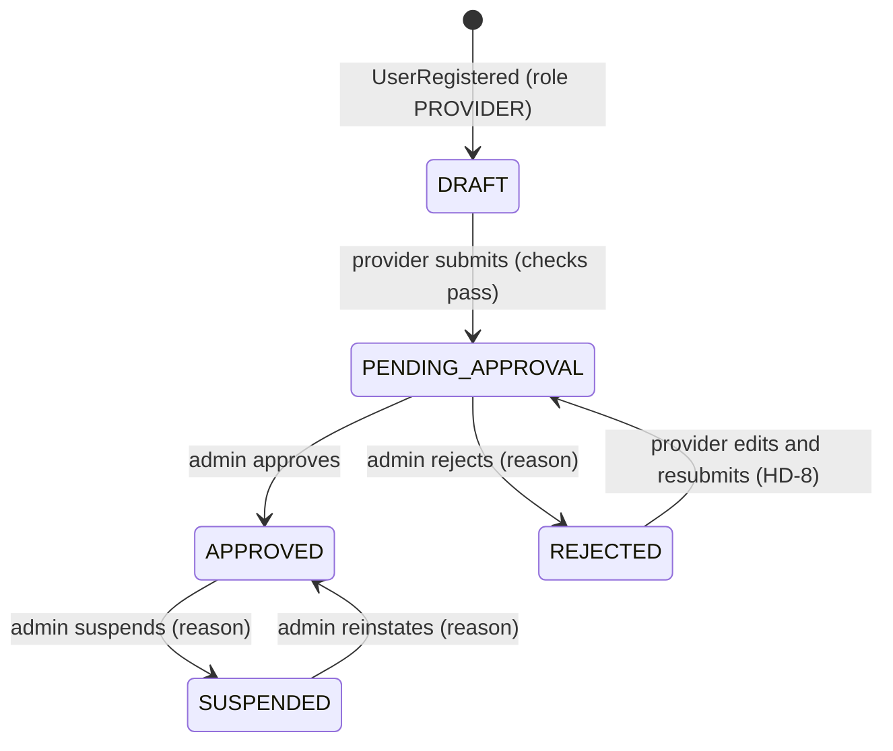
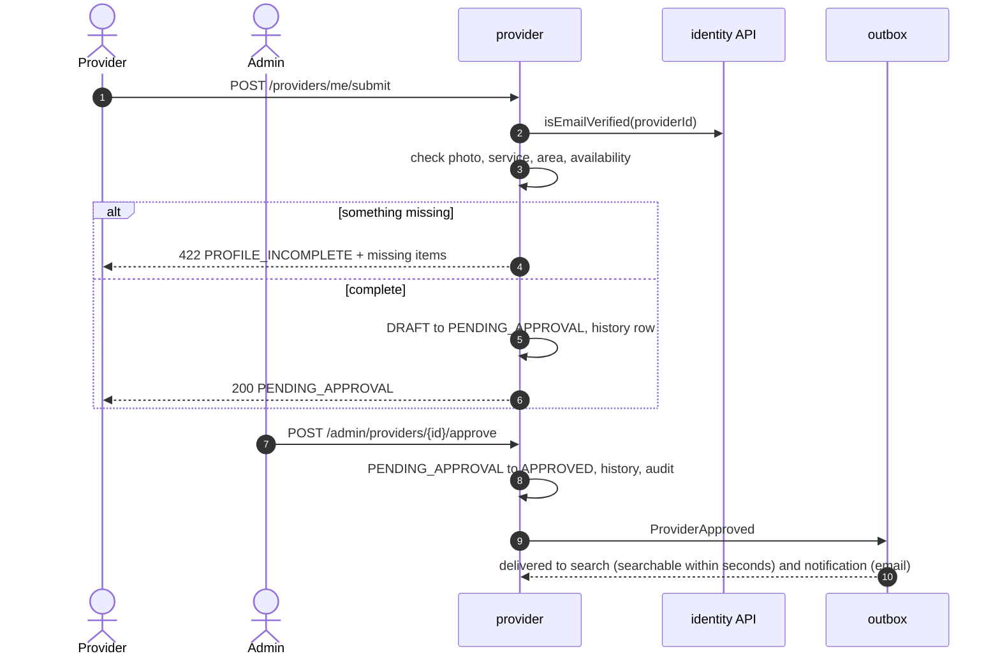
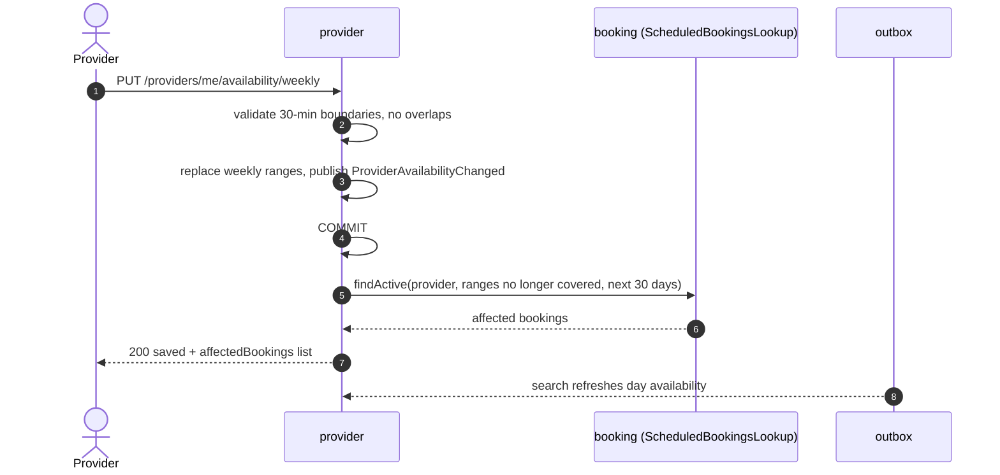
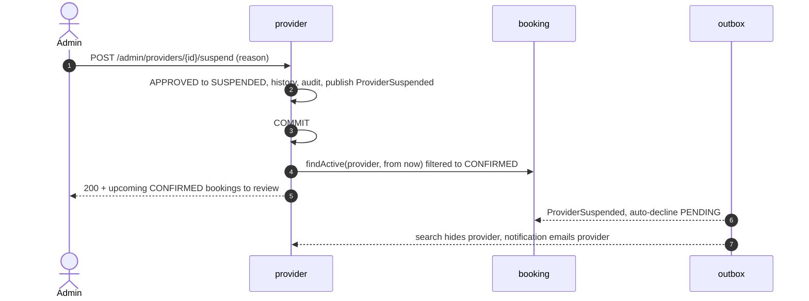

# HLD — Provider module

| Field    | Value                       |
| -------- | --------------------------- |
| Status   | **Draft — awaiting review** |
| Version  | 0.1                         |
| Date     | 2026-10-31                  |
| Overview | [overview.md](overview.md)  |

## 1. Purpose and scope

Provider owns who the providers are, what they offer, where they work and when they are available. It also owns the approval lifecycle and service categories.

| Covers                                                       | Requirements                                      |
| ------------------------------------------------------------ | ------------------------------------------------- |
| Profile, photo, languages                                    | FR-PRV-01, FR-AUTH-02 (profile part)              |
| Services with rates and minimum duration                     | FR-PRV-02, AC-PRV-02, AC-PRV-05                   |
| Service area (postal codes)                                  | FR-PRV-03                                         |
| Weekly availability and time off                             | FR-PRV-04, FR-PRV-05, AC-PRV-03, AC-PRV-04, EC-05 |
| Approval lifecycle, pause/resume                             | FR-PRV-06, FR-PRV-07, AC-PRV-01, AC-PRV-06        |
| Admin: list, approve, reject, suspend, reinstate, categories | FR-ADM-01 … 03, FR-ADM-05, AC-ADM-01 … 03         |

**Not owned:** bookings and the provider dashboard (booking), ratings (booking + search), login (identity), public search pages (search).

## 2. Provider lifecycle

`paused` is a separate flag that only an APPROVED provider can set. A provider is **bookable and searchable** only when the status is APPROVED and `paused` is false (AC-PRV-06).

Submission checks (AC-PRV-01): email verified (identity), photo present, at least one active service, at least one postal code, at least one weekly availability range. If any check fails, the response lists every missing item.

Edits while APPROVED are saved immediately, with no re-approval in the MVP (HD-8). Admins can suspend if needed.

## 3. REST endpoints

All paths are under `/api/v1`.

### 3.1 Provider (role PROVIDER, own data only)

| Method | Path                                       | Purpose                                                                                                              | Req                  | Main errors                                                                                       |
| ------ | ------------------------------------------ | -------------------------------------------------------------------------------------------------------------------- | -------------------- | ------------------------------------------------------------------------------------------------- |
| GET    | `/providers/me`                            | Full own profile, status, missing-items list                                                                         | FR-PRV-01            | —                                                                                                 |
| PATCH  | `/providers/me`                            | `displayName`, `bio` (≤ 1,000), `experienceYears`, `languages[]`, `phone`                                            | FR-PRV-01            | 422 validation                                                                                    |
| PUT    | `/providers/me/photo`                      | Multipart image ≤ 5 MB (JPEG/PNG/WebP). Server checks type, strips metadata, resizes, stores in media storage (HD-6) | FR-PRV-01            | 422 `INVALID_IMAGE`                                                                               |
| GET    | `/providers/me/services`                   | List own services                                                                                                    | FR-PRV-02            | —                                                                                                 |
| POST   | `/providers/me/services`                   | `categoryId`, `hourlyRate`, `minDurationMinutes` (60–240, step 30), `description?`                                   | FR-PRV-02, AC-PRV-02 | 422 `RATE_OUT_OF_RANGE`, `CATEGORY_INACTIVE`, `DUPLICATE_SERVICE`                                 |
| PATCH  | `/providers/me/services/{id}`              | Change rate, minimum duration, description, active                                                                   | FR-PRV-02, AC-PRV-05 | 422                                                                                               |
| DELETE | `/providers/me/services/{id}`              | Deactivate (kept for history)                                                                                        | FR-PRV-02            | —                                                                                                 |
| PUT    | `/providers/me/service-area`               | `postalCodes[]` (1–30, launch-area format)                                                                           | FR-PRV-03            | 422 `INVALID_POSTAL_CODE`, `AREA_SIZE`                                                            |
| GET    | `/providers/me/availability`               | Weekly ranges + time off                                                                                             | FR-PRV-04/05         | —                                                                                                 |
| PUT    | `/providers/me/availability/weekly`        | Full replace: per weekday, list of `{start, end}` local times on 30-min boundaries                                   | FR-PRV-04, AC-PRV-03 | 422 `INVALID_RANGE`, `OVERLAPPING_RANGES`                                                         |
| POST   | `/providers/me/availability/time-off`      | `{start, end}` as local date-times (whole days or a partial day)                                                     | FR-PRV-05            | 422 `INVALID_RANGE`                                                                               |
| DELETE | `/providers/me/availability/time-off/{id}` | Remove time off                                                                                                      | FR-PRV-05            | —                                                                                                 |
| POST   | `/providers/me/submit`                     | DRAFT or REJECTED → PENDING_APPROVAL                                                                                 | FR-PRV-06, AC-PRV-01 | 422 `PROFILE_INCOMPLETE` (with missing items), 403 `EMAIL_NOT_VERIFIED`, 409 `INVALID_TRANSITION` |
| POST   | `/providers/me/pause`                      | Hide from search; PENDING requests stay for the provider to answer (BR-17)                                           | FR-PRV-07            | 409 if not APPROVED                                                                               |
| POST   | `/providers/me/resume`                     | Show again                                                                                                           | FR-PRV-07            | 409                                                                                               |

**Affected-bookings warning (AC-PRV-04, EC-05):** the responses of the weekly-availability PUT and the time-off POST include `affectedBookings[]`, listing PENDING/CONFIRMED bookings that fall outside the new availability. The change is always saved, and the bookings are never changed automatically. The list comes from booking through `ScheduledBookingsLookup`.

### 3.2 Admin (role ADMIN)

| Method | Path                              | Purpose                                                                                                                         | Req                  |
| ------ | --------------------------------- | ------------------------------------------------------------------------------------------------------------------------------- | -------------------- |
| GET    | `/admin/providers?status&page`    | List providers by status, oldest submission first for PENDING_APPROVAL                                                          | FR-ADM-01            |
| GET    | `/admin/providers/{id}`           | Full profile, services, area, availability, status history                                                                      | FR-ADM-01            |
| POST   | `/admin/providers/{id}/approve`   | PENDING_APPROVAL → APPROVED                                                                                                     | FR-ADM-02            |
| POST   | `/admin/providers/{id}/reject`    | `reason` required                                                                                                               | FR-ADM-02            |
| POST   | `/admin/providers/{id}/suspend`   | `reason` required. Response lists the provider's upcoming CONFIRMED bookings so the admin can decide on each (AC-ADM-01, EC-22) | FR-ADM-03            |
| POST   | `/admin/providers/{id}/reinstate` | `reason` required                                                                                                               | FR-ADM-03            |
| GET    | `/admin/categories`               | All categories, including inactive                                                                                              | FR-ADM-05            |
| POST   | `/admin/categories`               | `code`, `name`, `sortOrder`                                                                                                     | FR-ADM-05            |
| PATCH  | `/admin/categories/{id}`          | Rename, reorder, activate/deactivate                                                                                            | FR-ADM-05, AC-ADM-03 |

Every admin action writes an `admin_audit` row (AC-ADM-02).

### 3.3 Public

| Method | Path          | Purpose                                             |
| ------ | ------------- | --------------------------------------------------- |
| GET    | `/categories` | Active categories for search filters and onboarding |

## 4. Public module API (in-process)

| Interface               | Operation                   | Input → output                                                                                                                                                                                                                                      | Used by                              |
| ----------------------- | --------------------------- | --------------------------------------------------------------------------------------------------------------------------------------------------------------------------------------------------------------------------------------------------- | ------------------------------------ |
| `BookableOfferLookup`   | `getBookableOffer`          | providerId, serviceId, date range → `{ bookable, status, paused, displayName, phone, service { id, categoryCode, name, hourlyRate, minDurationMinutes, active }, postalCodes[], availabilityWindows[] (UTC ranges with time off already removed) }` | booking (creation, slot calculation) |
| `ProviderListingLookup` | `getListingSnapshot`        | providerId → profile fields, photo URL, languages, experience, active services with rates, postal codes, searchable flag                                                                                                                            | search (read model)                  |
| `ProviderListingLookup` | `listSearchableProviderIds` | page → IDs                                                                                                                                                                                                                                          | search (rebuild)                     |
| `CategoryLookup`        | `listActive`, `getById`     | → categories                                                                                                                                                                                                                                        | search, booking                      |

`getBookableOffer` converts weekly local-time ranges into UTC ranges for each date using the launch-area time zone, which handles DST days correctly (NFR-19, EC-08). It also removes time-off periods.

### 4.1 Interface defined here, implemented by booking

| Interface                 | Operation                                                                                     | Why                                                                                                                                    |
| ------------------------- | --------------------------------------------------------------------------------------------- | -------------------------------------------------------------------------------------------------------------------------------------- |
| `ScheduledBookingsLookup` | `findActive(providerId, ranges[])` → `{ bookingId, start, end, status, customerFirstName }[]` | Affected-bookings warning (AC-PRV-04) and the confirmed-bookings list on suspension (AC-ADM-01), without provider depending on booking |

## 5. Events

### 5.1 Published

Common envelope plus `providerId`.

| Event                         | Extra fields                                       | When                                   | Consumers                                                   |
| ----------------------------- | -------------------------------------------------- | -------------------------------------- | ----------------------------------------------------------- |
| `ProviderApproved`            | `displayName`                                      | admin approves                         | search (make searchable), notification (FR-NOT-05)          |
| `ProviderRejected`            | `displayName`, `reason`                            | admin rejects                          | notification                                                |
| `ProviderSuspended`           | `displayName`, `reason`                            | admin suspends                         | booking (auto-decline PENDING), search (hide), notification |
| `ProviderReinstated`          | `displayName`                                      | admin reinstates                       | search, notification                                        |
| `ProviderPaused`              | —                                                  | provider pauses                        | search                                                      |
| `ProviderResumed`             | —                                                  | provider resumes                       | search                                                      |
| `ProviderProfileChanged`      | `changed` (PROFILE, PHOTO, SERVICES, SERVICE_AREA) | any profile, service or area edit      | search (refresh listing)                                    |
| `ProviderAvailabilityChanged` | `from`, `to` (affected date range)                 | weekly availability or time-off change | search (refresh day availability)                           |
| `CategoryChanged`             | `categoryId`, `active`, `name`                     | admin edits a category                 | search (filters, hide inactive, AC-ADM-03)                  |

Events are deliberately thin. Search fetches the current snapshot through `ProviderListingLookup`, so a late or repeated event can't put old data back.

### 5.2 Consumed

| Event                            | From     | Handling                                                                                                                             |
| -------------------------------- | -------- | ------------------------------------------------------------------------------------------------------------------------------------ |
| `UserRegistered` (role PROVIDER) | identity | Create a DRAFT provider with `id = userId`, display name and phone from the event. Idempotent: if the row already exists, do nothing |

## 6. Data owned (schema `provider`)

| Table                     | Key columns                                                                                                              | Notes                                                                             |
| ------------------------- | ------------------------------------------------------------------------------------------------------------------------ | --------------------------------------------------------------------------------- |
| `provider`                | id (= userId), status, paused, display_name, bio, experience_years, phone, photo_key, submitted_at, approved_at, version | Optimistic version for concurrent edits                                           |
| `provider_language`       | provider_id, language_code                                                                                               | ISO 639-1 codes                                                                   |
| `service_category`        | id, code (unique), name, active, sort_order                                                                              | Seeded with CLEANING, COOKING, NANNY                                              |
| `provider_service`        | id, provider_id, category_id, hourly_rate_minor, min_duration_minutes, description, active                               | One active service per provider per category                                      |
| `service_area`            | provider_id, postal_code                                                                                                 | 1–30 rows per provider; unique per pair                                           |
| `weekly_availability`     | id, provider_id, weekday, start_local, end_local                                                                         | Local wall-clock times on 30-min boundaries; ranges on the same day don't overlap |
| `time_off`                | id, provider_id, start_at, end_at, note                                                                                  | Stored as UTC instants, converted from local input                                |
| `provider_status_history` | id, provider_id, from_status, to_status, actor_id, reason, occurred_at                                                   | Kept ≥ 2 years                                                                    |
| `admin_audit`             | id, admin_id, action, target_type, target_id, reason, occurred_at                                                        | AC-ADM-02                                                                         |
| `processed_event`         | event_id, processed_at                                                                                                   | Idempotent `UserRegistered` handling                                              |

Photos are stored in media storage (S3 in AWS, local disk in Docker Compose). The table stores only the object key. Each upload gets a new random key, so CloudFront can cache photos forever.

## 7. Key flows

### 7.1 Submit for approval and approve (J-3)

### 7.2 Change weekly availability with affected bookings (AC-PRV-04)

The lookup runs after the commit, because it only builds the warning and doesn't affect what is saved.

### 7.3 Suspend (AC-ADM-01)

Search hides the provider within seconds, well inside the 60 seconds AC-ADM-01 allows. Booking creation is blocked immediately, because `getBookableOffer` reads the committed status.

## 8. Validation rules

| Rule                                                                                      | Source                                 |
| ----------------------------------------------------------------------------------------- | -------------------------------------- |
| Hourly rate > 0 and ≤ configured maximum                                                  | AC-PRV-02                              |
| Minimum duration 1–4 h in 30-min steps                                                    | FR-PRV-02                              |
| Postal codes match the launch-area pattern; 1–30 per provider                             | FR-PRV-03, AC-CUS-03                   |
| Availability ranges start and end on 30-min boundaries, and end after start               | AC-PRV-03                              |
| Ranges on the same weekday don't overlap                                                  | Design choice, keeps slot logic simple |
| Bio ≤ 1,000 characters                                                                    | FR-PRV-01                              |
| Images: JPEG/PNG/WebP, ≤ 5 MB; output 400×400 and 96×96, metadata (including GPS) removed | HD-6, NFR-12                           |

## 9. Testing focus

- Lifecycle transitions and the missing-items list.
- Local-to-UTC window conversion around DST changes.
- Thin events plus snapshot reads: a repeated or late event leaves search correct.
- Suspension end to end: PENDING declined, CONFIRMED listed, search hidden, email queued.
- Authorization: providers can't read or change other providers; only admins reach `/admin/**`.

## 10. Open points

| ID   | Point                                                   | Proposed                                                                            |
| ---- | ------------------------------------------------------- | ----------------------------------------------------------------------------------- |
| PR-1 | Admin notification when a provider submits for approval | Not required; admins check the queue. Can be added as a notification template later |
| PR-2 | Structured cook fields (cuisines)                       | Free text in the service description (Q-9)                                          |
