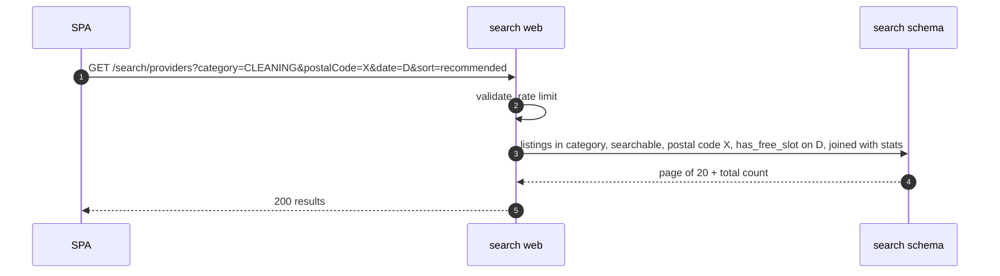
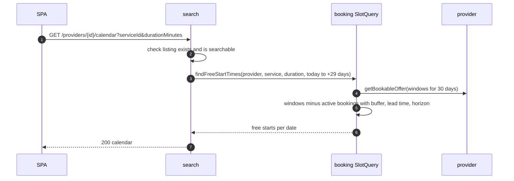
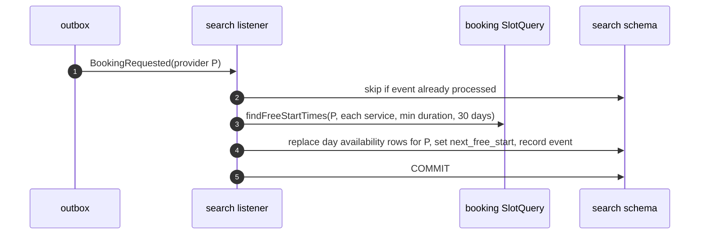

# HLD — Search module

| Field    | Value                       |
| -------- | --------------------------- |
| Status   | **Draft — awaiting review** |
| Version  | 0.1                         |
| Date     | 2026-10-31                  |
| Overview | [overview.md](overview.md)  |

## 1. Purpose and scope

Search is the read side of the marketplace: finding, viewing and comparing providers. It owns a **read model** built from provider and booking events. It never changes provider or booking data.

| Covers                                                      | Requirements                                        |
| ----------------------------------------------------------- | --------------------------------------------------- |
| Search by category + postal code, filters, sort, pagination | FR-SRCH-01 … 05, AC-SRCH-01, 02, 04, 05             |
| Public provider profile and 30-day calendar                 | FR-SRCH-06, AC-SRCH-03, AC-SRCH-06, EC-09           |
| Comparison of 2–3 providers                                 | FR-SRCH-07                                          |
| Rating and counts shown in results                          | FR-REV-02, AC-REV-03                                |
| Hide suspended/paused providers quickly                     | AC-PRV-06, AC-ADM-01                                |
| Performance                                                 | NFR-01 (p95 ≤ 500 ms at 50 req/s, 10,000 providers) |

**Not owned:** the source data (provider), slot rules (booking, HD-4), reviews (booking).

## 2. Freshness model

| What the user sees                                                          | Source                                                                      | Freshness                                                                          |
| --------------------------------------------------------------------------- | --------------------------------------------------------------------------- | ---------------------------------------------------------------------------------- |
| Result list: name, photo, rate, rating, counts, next free slot, date filter | Read model in the `search` schema                                           | Updated by events within seconds. Allowed up to 60 s stale (AC-SRCH-06, AC-REV-03) |
| Provider profile text, services, languages                                  | Read model                                                                  | Same as above                                                                      |
| Calendar on the profile page                                                | **Live** call to booking `SlotQuery` on every request                       | Reflects committed bookings at request time (AC-SRCH-06, EC-09)                    |
| Reviews on the profile page                                                 | Live call to booking's public reviews endpoint (frontend calls it directly) | Live                                                                               |

A stale result can never cause a double booking, because booking re-checks everything when the booking is committed.

## 3. REST endpoints (all public, rate-limited)

| Method | Path                                        | Purpose                                                                                                                                                                      | Req                    |
| ------ | ------------------------------------------- | ---------------------------------------------------------------------------------------------------------------------------------------------------------------------------- | ---------------------- |
| GET    | `/api/v1/search/providers`                  | Query: `category` (required), `postalCode` (required), `date?`, `maxRate?`, `minRating?`, `language?`, `sort` (`recommended` default, `price`, `rating`, `earliest`), `page` | FR-SRCH-01 … 05        |
| GET    | `/api/v1/providers/{id}/profile`            | Public profile with services, rates, languages, experience, rating, counts. 404 if not searchable                                                                            | FR-SRCH-06             |
| GET    | `/api/v1/providers/{id}/calendar`           | Query: `serviceId`, `durationMinutes?` (default: the service's minimum), `from?` (default today). Returns free start times per local date for up to 30 days                  | FR-SRCH-06, AC-SRCH-03 |
| GET    | `/api/v1/search/compare?ids=a,b,c&category` | 2–3 providers side by side: rate, rating, review count, experience, languages, next free slot                                                                                | FR-SRCH-07             |

### 3.1 Result item (FR-SRCH-04)

`providerId`, `serviceId`, `displayName`, `photoUrl`, `categoryCode`, `hourlyRate`, `ratingAverage` (or null), `reviewCount` (the UI shows "New" when it is below 1), `completedBookings`, `languages[]`, `experienceYears`, `nextFreeStart`.

### 3.2 Filters and sort

| Filter / sort             | Rule                                                                                                                                                      |
| ------------------------- | --------------------------------------------------------------------------------------------------------------------------------------------------------- |
| category + postal code    | Listing for that category, and the provider's service area contains the postal code (AC-SRCH-01)                                                          |
| date                      | The provider has at least one free start that day for the service's minimum duration (AC-SRCH-02)                                                         |
| maxRate                   | `hourlyRate ≤ maxRate`                                                                                                                                    |
| minRating                 | `ratingAverage ≥ minRating`. Providers without reviews are excluded when this filter is set                                                               |
| language                  | The provider speaks it                                                                                                                                    |
| recommended               | Providers with ≥ 3 reviews by average rating desc, then providers with < 3 reviews; ties broken by earliest next free slot, then provider ID (AC-SRCH-04) |
| price / rating / earliest | Main key as named, then provider ID, so pages are stable                                                                                                  |
| no results                | 200 with an empty list. The UI suggests widening filters (AC-SRCH-05)                                                                                     |

## 4. Public module API

None. No other module calls search (architecture-options §7.2 rule 3).

Search calls:

| Module   | Operation                                                           | Why                                                               |
| -------- | ------------------------------------------------------------------- | ----------------------------------------------------------------- |
| provider | `getListingSnapshot`, `listSearchableProviderIds`, `CategoryLookup` | Build and rebuild listings                                        |
| booking  | `SlotQuery.findFreeStartTimes`, `SlotQuery.nextFreeStart`           | Calendar (live), day availability and next free slot (projection) |

## 5. Events consumed

| Event                                                                                           | Handling                                                                                          |
| ----------------------------------------------------------------------------------------------- | ------------------------------------------------------------------------------------------------- |
| `ProviderApproved`, `ProviderReinstated`, `ProviderResumed`                                     | Fetch snapshot, upsert listings, set searchable, recompute day availability                       |
| `ProviderSuspended`, `ProviderPaused`, `ProviderRejected`                                       | Set searchable = false (the provider disappears from results immediately)                         |
| `ProviderProfileChanged`                                                                        | Fetch snapshot, upsert listings and postal codes. If services changed, recompute day availability |
| `ProviderAvailabilityChanged`                                                                   | Recompute day availability and next free slot for that provider                                   |
| `CategoryChanged`                                                                               | Deactivated category: hide its listings and remove it from filters (AC-ADM-03)                    |
| `BookingRequested`, `BookingConfirmed`, `BookingDeclined`, `BookingExpired`, `BookingCancelled` | Recompute day availability and next free slot for the provider (a hold was added or released)     |
| `BookingCompleted`                                                                              | Increase completed count                                                                          |
| `ReviewSubmitted`                                                                               | Add rating to the provider's sum and count                                                        |
| `ReviewHidden`                                                                                  | Subtract rating from sum and count                                                                |

Every handler stores the event ID in `processed_event` and skips repeats (EC-15). Count updates (completed, rating) are applied in the same transaction as the processed-event insert, so a repeat never double-counts.

Search publishes no events.

## 6. Data owned (schema `search`)

| Table                      | Key columns                                                                                                                                                                                        | Notes                                                                  |
| -------------------------- | -------------------------------------------------------------------------------------------------------------------------------------------------------------------------------------------------- | ---------------------------------------------------------------------- |
| `provider_listing`         | provider_id + service_id (key), category_id, category_code, display_name, photo_url, hourly_rate_minor, min_duration_minutes, languages, experience_years, searchable, next_free_start, updated_at | One row per provider per active service, because search is by category |
| `listing_postal_code`      | provider_id, postal_code                                                                                                                                                                           | Index on postal code for the main filter                               |
| `listing_day_availability` | provider_id, service_id, local_date, has_free_slot, first_free_start                                                                                                                               | Rows for today + 29 days. Used by the date filter                      |
| `provider_stats`           | provider_id, rating_sum, review_count, completed_count                                                                                                                                             | Average = sum / count, computed in the query                           |
| `processed_event`          | event_id, processed_at                                                                                                                                                                             | Idempotency                                                            |

Sizing at NFR-06: 10,000 providers × ~1.5 services ≈ 15,000 listings, ≈ 450,000 day-availability rows, ≈ 100,000 postal-code rows. These are small tables for PostgreSQL. The main query uses indexes on (category, searchable), postal code, and (local_date, has_free_slot).

## 7. Key flows

### 7.1 Search

### 7.2 Profile calendar (live)

### 7.3 Projection update after a booking event

## 8. Scheduled jobs

| Job                    | Every                            | Action                                                                                                                                 |
| ---------------------- | -------------------------------- | -------------------------------------------------------------------------------------------------------------------------------------- |
| Refresh next free slot | 15 min                           | For listings whose `next_free_start` is earlier than `now + lead time`, recompute. Without events this value goes stale as time passes |
| Roll window            | daily, just after local midnight | Delete past dates and compute the new 30th day for every searchable listing                                                            |
| Reconcile              | nightly                          | Rebuild all listings and stats from provider and booking. Fixes drift (HR-2). Batched to keep load low                                 |

An admin endpoint `POST /api/v1/admin/search/rebuild` starts a full rebuild on demand (for recovery after an incident).

## 9. Performance (NFR-01)

- The search query reads only the `search` schema and makes no cross-module calls.
- The count query and the page query share the same filter. If counting gets expensive, show "20+ results" instead of an exact total.
- The calendar is per provider only, so it needs at most a few queries per request.
- Load test in staging: 50 req/s mixed search, with 10,000 seeded providers, against the p95/p99 targets.

## 10. Testing focus

- Each filter and sort rule (AC-SRCH-01, 02, 04, 05), including recommended-order ties.
- Event handlers: repeat and out-of-order delivery leave the same result.
- Suspension: provider hidden on the next query after the event is handled.
- Calendar matches booking's acceptance: any start in the calendar can be booked when no race happens (shared rule, HD-4).
- Rebuild from scratch equals the incrementally updated read model.

## 11. Open points

| ID   | Point                                                                 | Proposed                                                                                                                 |
| ---- | --------------------------------------------------------------------- | ------------------------------------------------------------------------------------------------------------------------ |
| SR-1 | Show exact result totals or "20+"?                                    | Exact total in the MVP; revisit if load tests show cost                                                                  |
| SR-2 | Search by city name as well as postal code (CLAUDE.md says "by city") | Postal code is required by FR-SRCH-01. The UI can offer a city picker that maps to postal codes in the launch area later |
