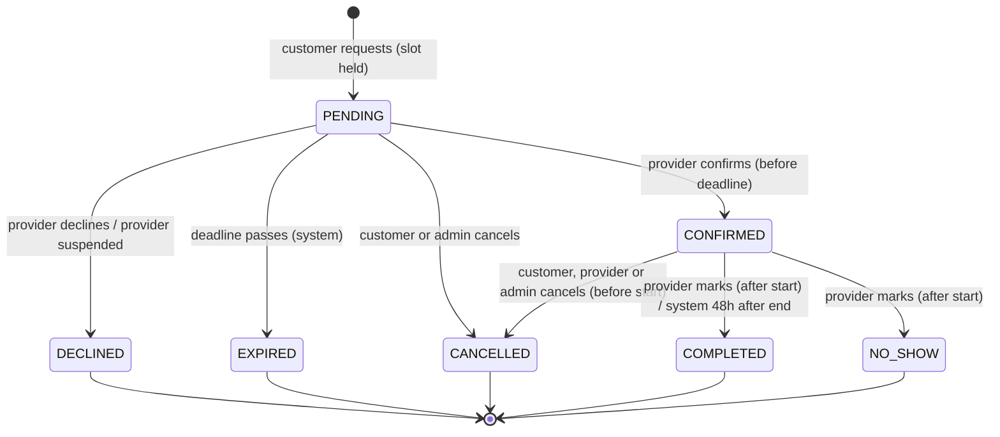

# NestaCare — MVP Requirements

| Field     | Value                                |
|-----------|--------------------------------------|
| Document  | Requirements specification (Phase 2) |
| Status    | **Draft — awaiting review**          |
| Version   | 0.1                                  |
| Date      | 2026-10-29                           |
| Stack     | React + TypeScript + Vite · Java 21 + Spring Boot (modular monolith) · PostgreSQL                             |
| Next phase | Architecture and HLD (`docs/architecture/`, `docs/hld/`) — starts only after approval                         |

Requirement keywords: **MUST** = required for MVP release, **SHOULD** = expected in MVP but can slip with sign-off, **COULD** = only if time allows. Priority in tables uses the same scale (M / S / C).

---

## 1. Product Overview and Goals

### 1.1 Problem

Households that need cleaner, cook, Nanny usually find one through word of mouth. They cannot easily compare price, availability or reliability, and booking means a round of calls and messages. Independent providers, in turn, have no simple way to show their services, manage their schedule and receive bookings.

### 1.2 Product

NestaCare is a web marketplace where customers **discover**, **compare** and **book** local household service providers, and providers **publish** their services, pricing and availability and **manage** incoming bookings.

### 1.3 MVP goals

| ID  | Goal                                           | Success measure (first 3 months after launch) |
|-----|------------------------------------------------|-----------------------------------------------|
| G-1 | Customers can find a suitable provider quickly | Median time from first search to submitted booking request ≤ 5 minutes |
| G-2 | Bookings are reliable                          | ≥ 80 % of booking requests are confirmed by the provider; 0 double-booked provider slots|
| G-3 | Providers can self-serve                       | ≥ 90 % of approved providers publish availability without admin help |
| G-4 | Customers come back                            | ≥ 30 % of customers with a completed booking make a second booking within 60 days |
| G-5 | Validate the marketplace in one launch area    | ≥ 50 approved providers and ≥ 300 completed bookings in the launch area |

### 1.4 Service categories at launch

- **Cleaning** (home cleaning, deep cleaning)
- **Cooking** (home-cooked meal preparation at the customer's home)
- **Nanny** (a professional childcare provider who looks after children at the customer's home)

The category list is data-driven (stored in the database, managed by admins) so new categories can be added later without code changes.

## 2. Personas and User Journeys

### 2.1 Personas

| ID  | Persona                                   | Description | Main needs | Frustrations today |
|-----|------------------------------------------ |-------------|------------|--------------------|
| P-1 | **Busy professional customer** (Asha, 32) | Works full time, lives in an apartment, books cleaning every 1–2 weeks | Find a trusted cleaner available this weekend, see price up front, book in minutes on phone | Calling several people; no-shows; unclear pricing |
| P-2 | **Family organiser customer** (Ravi, 45)  | Arranges a cook for a family of five, sometimes for elderly parents at another address | Compare cooks by cuisine, languages and reviews; book for a different address | Can't judge quality before trying; hard to coordinate times |
| P-3 | **Independent provider** (Meena, 38)      | Self-employed cleaner, 6 years' experience, works across a few neighbourhoods | Fill empty slots, control her own schedule and rates, avoid travel overlaps | Last-minute cancellations; double commitments; unpaid waiting time |
| P-4 | **Provider new to digital tools** (Joseph, 52) | Experienced cook, uses a smartphone mostly for messaging | Simple onboarding, clear notifications, few steps to accept a job | Complicated apps; too many fields |
| P-5 | **Operations admin** (NestaCare staff) | Approves providers, handles escalations | See pending providers, suspend bad actors, view any booking | No single view of providers and bookings |

### 2.2 User journeys

**J-1 Discover and book (P-1, P-2)**
1. Customer opens NestaCare and enters a city, category and preferred date.
2. Sees a list of providers serving that area, with price, rating and next available slot.
3. Filters and sorts; optionally adds up to 3 providers to a comparison view.
4. Opens a provider profile, picks an available start time and duration.
5. Signs in or registers (if not already), chooses or adds an address.
6. Reviews the price estimate and booking rules, submits the request.
7. Booking is created as **Pending**; the slot is held. Customer gets an email.
8. Provider confirms → customer gets a confirmation email; booking appears as **Confirmed**.

**J-2 Manage a booking (P-1, P-2)**
1. Customer opens "My bookings" and sees upcoming and past bookings with status.
2. Cancels an upcoming booking (with a warning if it is a late cancellation).
3. To reschedule, cancels and books a new slot (no in-place reschedule in MVP).
4. After a completed booking, rates and reviews the provider.

**J-3 Provider onboarding (P-3, P-4)**
1. Provider registers, fills in profile (name, photo, bio, experience, languages).
2. Adds services from the category list with an hourly rate.
3. Adds service area (postal codes) and weekly availability.
4. Submits for review → status **Pending approval**.
5. Admin approves → provider becomes visible in search; provider gets an email.

**J-4 Provider handles requests (P-3, P-4)**
1. Provider gets an email for a new booking request with a link to the dashboard.
2. Sees request details (date, time, duration, area, price estimate, customer first name).
3. Confirms or declines before the response deadline.
4. After confirmation, sees the full address and customer contact details.
5. After the job, marks the booking **Completed** (or **No-show**).

**J-5 Admin operations (P-5)**
1. Admin reviews pending providers and approves or rejects with a reason.
2. Admin suspends a provider after complaints; the provider disappears from search.
3. Admin looks up a booking and cancels it on behalf of either party if needed.

---

## 3. Functional Requirements

Each requirement has an ID, a priority, a proposed owning backend module (`customer`, `provider`, `search`, `booking`; ownership of cross-cutting areas is confirmed in the architecture phase — see Q-6) and acceptance criteria in Given / When / Then form.

### 3.1 Accounts and authentication (FR-AUTH)

| ID         | Requirement                                                                           | Pri | Module   |
|------------|---------------------------------------------------------------------------------------|-----|----------|
| FR-AUTH-01 | A visitor can register as a **customer** with name, email, phone and password         | M   | customer |
| FR-AUTH-02 | A visitor can register as a **provider** with name, email, phone and password         | M   | provider |
| FR-AUTH-03 | A registered user can sign in and sign out                                            | M   | shared (Q-6) |
| FR-AUTH-04 | A user must verify their email before creating a booking (customer) or submitting for approval (provider)                                                                                           |  M  | shared |
| FR-AUTH-05 | A user can reset a forgotten password via an emailed, single-use, time-limited link   | M   | shared |
| FR-AUTH-06 | The system supports three roles: CUSTOMER, PROVIDER, ADMIN; each endpoint enforces role-based access 
                                                                                                     | M   | shared |

Acceptance criteria:
- **AC-AUTH-01** Given an email already in use, when a visitor registers with it, then registration fails with a clear message and no second account is created.
- **AC-AUTH-02** Given a password shorter than 10 characters or found in a common-password list, when registering, then registration is rejected.
- **AC-AUTH-03** Given 5 failed sign-in attempts for one account within 15 minutes, when a 6th attempt is made, then the account is temporarily locked for 15 minutes and the user is told to wait or reset the password.
- **AC-AUTH-04** Given a password-reset link older than 60 minutes or already used, when it is opened, then it is rejected.
- **AC-AUTH-05** Given a signed-in CUSTOMER, when they call a PROVIDER or ADMIN endpoint, then the response is 403 and no data is returned.
- **AC-AUTH-06** Given an unverified customer, when they try to submit a booking, then they are asked to verify their email first.

### 3.2 Customer profile and addresses (FR-CUS)

| ID        | Requirement                                                                            | Pri | Module   |
|-----------|----------------------------------------------------------------------------------------|-----|----------|
| FR-CUS-01 | A customer can view and edit name and phone                                            | M   | customer |
| FR-CUS-02 | A customer can save up to 5 addresses (label, street, city, postal code, access notes) | M   | customer |
| FR-CUS-03 | A customer can mark one address as default                                             | S   | customer |
| FR-CUS-04 | A customer can view booking history (upcoming and past) with status                    | M   | customer (reads via booking API) |
| FR-CUS-05 | A customer can request account deletion                                                | S   | customer |

Acceptance criteria:
- **AC-CUS-01** Given a customer with 5 saved addresses, when adding a 6th, then the system rejects it with a message.
- **AC-CUS-02** Given an address used by a Pending or Confirmed booking, when the customer edits or deletes it, then the booking keeps its original address snapshot (bookings are not affected).
- **AC-CUS-03** Given a postal code that does not match the launch area format, when saving an address, then validation fails.
- **AC-CUS-04** Given a customer with active (Pending/Confirmed) bookings, when they request account deletion, then they are asked to cancel those bookings first.
- **AC-CUS-05** "My bookings" lists upcoming bookings by start time ascending and past bookings by start time descending, each showing provider name, service, date/time, duration, price estimate and status.

### 3.3 Provider profile, services and availability (FR-PRV)

| ID | Requirement | Pri | Module |
|---|---|---|---|
| FR-PRV-01 | A provider can create and edit a profile: display name, photo, bio (≤ 1,000 chars), years of experience, languages spoken | M | provider |
| FR-PRV-02 | A provider can offer one or more services from the category list, each with an hourly rate, minimum duration (1–4 h) and optional description (e.g. cuisines for cooks) | M | provider |
| FR-PRV-03 | A provider can define a service area as a list of postal codes (1–30) | M | provider |
| FR-PRV-04 | A provider can define a recurring weekly availability (per weekday, one or more time ranges, 30-minute granularity) | M | provider |
| FR-PRV-05 | A provider can add time-off periods (date ranges or single-day partial ranges) that override weekly availability | M | provider |
| FR-PRV-06 | A provider can submit the profile for admin approval; status lifecycle: DRAFT → PENDING_APPROVAL → APPROVED / REJECTED; APPROVED ↔ SUSPENDED | M | provider |
| FR-PRV-07 | A provider can pause their listing (hidden from search, existing bookings unaffected) and resume it | S | provider |
| FR-PRV-08 | A provider dashboard shows pending requests (with response deadline), upcoming confirmed bookings and past bookings | M | booking (provider view) |

Acceptance criteria:
- **AC-PRV-01** Given a provider profile missing a photo, a service, a service area or any availability, when they submit for approval, then submission is blocked and the missing items are listed.
- **AC-PRV-02** Given an hourly rate ≤ 0 or above the configured maximum, when saving a service, then validation fails.
- **AC-PRV-03** Given an availability range that does not start and end on a 30-minute boundary, or ends before it starts, when saving, then validation fails.
- **AC-PRV-04** Given a provider with a Confirmed booking on Saturday 10:00–13:00, when they remove Saturday from their weekly availability, then the change is saved, the existing booking stays Confirmed, and the provider sees a warning listing affected bookings (cancelling them is a separate, explicit action).
- **AC-PRV-05** Given a provider changes their hourly rate, when existing Pending/Confirmed bookings are viewed, then they still show the price captured at request time.
- **AC-PRV-06** Given a provider in any status other than APPROVED (or APPROVED but paused), when a customer searches, then the provider does not appear and cannot be booked.

### 3.4 Search, discovery and comparison (FR-SRCH)

| ID         | Requirement                                                                                   | Pri | Module |
|------------|-----------------------------------------------------------------------------------------------|-----|--------|
| FR-SRCH-01 | Anyone (signed in or not) can search providers by **category** and **postal code** (both required) | M | search |
| FR-SRCH-02 | Results can be filtered by date (has at least one free slot that day), max hourly rate, minimum rating, and language | M | search |
| FR-SRCH-03 | Results can be sorted by: recommended (default), price low→high, rating, earliest available slot | M | search |
| FR-SRCH-04 | Each result shows display name, photo, service, hourly rate, average rating and review count (or "New"), completed-bookings count, next available slot | M | search |
| FR-SRCH-05 | Results are paginated (20 per page) | M | search |
| FR-SRCH-06 | A user can view a provider's public profile with services, rates, reviews and an availability calendar for the next 30 days | M | search (reads provider API) |
| FR-SRCH-07 | A user can select 2–3 providers and see them side by side (rate, rating, reviews count, experience, languages, next available slot) | S | search (frontend) |

Acceptance criteria:
- **AC-SRCH-01** Given providers A (serves 10001) and B (serves 10002), when searching cleaning in 10001, then only A is returned.
- **AC-SRCH-02** Given a date filter for Saturday and a provider whose only Saturday window is fully booked, when searching, then that provider is excluded.
- **AC-SRCH-03** The availability calendar never offers a slot that overlaps a Pending or Confirmed booking, a time-off period, the buffer time around bookings (BR-04), or falls inside the minimum lead time (BR-02).
- **AC-SRCH-04** "Recommended" order is deterministic: providers with ≥ 3 reviews by average rating desc, then providers with < 3 reviews, ties broken by earliest available slot, then provider ID.
- **AC-SRCH-05** Given no matching providers, when searching, then an empty state suggests widening filters; no error is shown.
- **AC-SRCH-06** Search results may be up to 60 seconds stale for rating and counts, but slot availability shown on the provider profile reflects committed bookings at the time of the request.

### 3.5 Booking (FR-BKG)

| ID        | Requirement                                                                                    | Pri | Module |
|-----------|------------------------------------------------------------------------------------------------|-----|--------|
| FR-BKG-01 | A verified customer can request a booking by choosing provider, service, start time, duration and one of their addresses                                                                                                    | M | booking |
| FR-BKG-02 | On request, the booking is created as PENDING and the slot is **held** (unavailable to others) | M | booking |
| FR-BKG-03 | The booking stores a snapshot of price (rate × duration), service, address and provider name at request time 
                                                                                                             | M | booking |
| FR-BKG-04 | A provider can confirm or decline (with optional reason) a PENDING booking before the response deadline 
                                                                                                             | M | booking |
| FR-BKG-05 | PENDING bookings not answered by the response deadline become EXPIRED automatically and the slot is released 
                                                                                                             | M | booking |
| FR-BKG-06 | A customer can cancel a PENDING or CONFIRMED booking before its start time, with an optional reason 
                                                                                                             | M | booking |
| FR-BKG-07 | A provider can cancel a CONFIRMED booking before its start time with a mandatory reason        | M | booking |
| FR-BKG-08 | After the start time, a provider can mark a CONFIRMED booking as COMPLETED or NO_SHOW          | M | booking |
| FR-BKG-09 | CONFIRMED bookings not marked within 48 hours after their end time are auto-marked COMPLETED   | S | booking |
| FR-BKG-10 | The customer's full address and phone are visible to the provider only once the booking is CONFIRMED | M | booking |
| FR-BKG-11 | Every status change is recorded in a booking history (from, to, actor, timestamp, reason)      | M | booking |
| FR-BKG-12 | An admin can cancel any PENDING or CONFIRMED booking with a reason                             | M | booking |
| FR-BKG-13 | Booking creation is idempotent per client-supplied idempotency key                             | M | booking |

Acceptance criteria:
- **AC-BKG-01** Given a free slot, when a verified customer submits a valid request, then a PENDING booking is created, the slot disappears from the provider's calendar, and the response includes the booking ID and response deadline.
- **AC-BKG-02** Given a start time inside the minimum lead time or beyond the booking horizon (BR-02), when submitting, then the request is rejected with a validation error.
- **AC-BKG-03** Given a duration below the service's minimum or not a multiple of 30 minutes, when submitting, then the request is rejected.
- **AC-BKG-04** Given an address whose postal code is outside the provider's service area, when submitting, then the request is rejected.
- **AC-BKG-05** Given a PENDING booking, when the provider confirms before the deadline, then status becomes CONFIRMED, the customer is notified and the provider can see the full address.
- **AC-BKG-06** Given a PENDING booking past its deadline, when the provider tries to confirm, then the action fails with 409 and the booking is (or becomes) EXPIRED.
- **AC-BKG-07** Given a CONFIRMED booking that has started, when the customer tries to cancel, then the action is rejected.
- **AC-BKG-08** Given a customer cancels less than 24 hours before start, when the cancellation succeeds, then the booking is flagged `lateCancellation = true` and the customer was shown a warning before confirming.
- **AC-BKG-09** Given a terminal booking (DECLINED, EXPIRED, CANCELLED, COMPLETED, NO_SHOW), when any status-changing action is attempted, then it is rejected with 409 and the status is unchanged.
- **AC-BKG-10** Given any status change, when the booking history is queried, then the change appears with actor and timestamp.

### 3.6 Reviews and ratings (FR-REV)

| ID        | Requirement                                                                              | Pri | Module |
|-----------|------------------------------------------------------------------------------------------|-----|--------|
| FR-REV-01 | A customer can leave one rating (1–5) and optional comment (≤ 500 chars) per COMPLETED booking, within 14 days after completion                                                                                       | S   | booking (Q-6) |
| FR-REV-02 | A provider's average rating and review count are shown on profile and search results     | S   | search |
| FR-REV-03 | An admin can hide a review that breaks content rules                                     | C   | admin (Q-6) |

Acceptance criteria:
- **AC-REV-01** Given a booking that is not COMPLETED, when the customer tries to review, then it is rejected.
- **AC-REV-02** Given a booking already reviewed, when the customer submits a second review, then it is rejected.
- **AC-REV-03** Given a new review, within 60 seconds the provider's average rating in search reflects it.

### 3.7 Notifications (FR-NOT)

| ID        | Requirement                                                                          | Pri | Module       |
|-----------|------------------------------------------------------------------------------------- |-----|--------------|
| FR-NOT-01 | Email to provider on new booking request (with deadline)                             | M   | notification (Q-6) |
| FR-NOT-02 | Email to customer on confirmed / declined / expired                                  | M   | notification |
| FR-NOT-03 | Email to the other party on any cancellation (including admin cancellation, to both) | M   | notification |
| FR-NOT-04 | Reminder email to both parties 24 hours before a CONFIRMED booking                   | S   | notification |
| FR-NOT-05 | Email to provider on approval, rejection or suspension                               | M   | notification |
| FR-NOT-06 | Email verification and password reset emails                                         | M   | notification |

Acceptance criteria:
- **AC-NOT-01** Notifications are sent asynchronously, triggered by domain events; a failure to send email never rolls back or blocks a booking state change.
- **AC-NOT-02** Failed sends are retried at least 3 times with backoff and are logged; each event results in at most one delivered email per recipient (deduplicated by event ID).
- **AC-NOT-03** Emails contain no full address or phone number of the other party before confirmation.

### 3.8 Administration (FR-ADM)

| ID        | Requirement                                                                  | Pri | Module |
|-----------|------------------------------------------------------------------------------|-----|--------|
| FR-ADM-01 | Admin can list providers by status and view full provider profiles           | M   | provider |
| FR-ADM-02 | Admin can approve or reject (with reason) a PENDING_APPROVAL provider        | M   | provider |
| FR-ADM-03 | Admin can suspend and reinstate an APPROVED provider with a reason           | M   | provider |
| FR-ADM-04 | Admin can search bookings by ID, customer email, provider, date and status, and see booking history | M | booking |
| FR-ADM-05 | Admin can manage service categories (add, rename, deactivate)                | S   | provider |
| FR-ADM-06 | Admin accounts are created only by seeding/ops, not by self-registration     | M   | shared   |

Acceptance criteria:
- **AC-ADM-01** Given a provider is suspended, then they are removed from search within 60 seconds, cannot receive new requests, and their PENDING requests are auto-declined with reason "provider unavailable". CONFIRMED bookings are listed to the admin for an explicit decision (keep or cancel).
- **AC-ADM-02** Every admin action is written to an audit log with admin ID, action, target and timestamp.
- **AC-ADM-03** Given a category is deactivated, then it no longer appears in search filters, and existing bookings for it are unaffected.

---

## 4. Non-Functional Requirements

| ID     | Area                 | Requirement and measurable target                      | How it is verified            |
|--------|----------------------|--------------------------------------------------------|-------------------------------|
| NFR-01 | Performance — search | Search API p95 ≤ 500 ms, p99 ≤ 1 s at 50 requests/s with 10,000 providers in the database | Load test (e.g. k6/Gatling) in staging |
| NFR-02 | Performance — booking | Create/confirm/cancel booking API p95 ≤ 800 ms at 10 requests/s | Load test |
| NFR-03 | Performance — frontend | Largest Contentful Paint ≤ 2.5 s and initial JS bundle ≤ 250 KB gzipped on a mid-range phone over 4G (Lighthouse "Slow 4G" profile) | Lighthouse in CI |
| NFR-04 | Availability | 99.5 % monthly uptime for customer-facing APIs (≈ 3.6 h downtime/month), excluding announced maintenance | CloudWatch uptime checks |
| NFR-05 | Data durability | RPO ≤ 15 minutes, RTO ≤ 4 hours; automated daily backups kept 7 days plus point-in-time recovery | Restore drill before launch |
| NFR-06 | Scalability | Supports 10,000 providers, 100,000 customers, 5,000 bookings/day without architectural change; app tier scales horizontally (stateless instances) | Load test; design review |
| NFR-07 | Consistency | Zero overlapping PENDING/CONFIRMED bookings for one provider, enforced by a PostgreSQL constraint, not only by application code | Concurrency integration test (Testcontainers) |
| NFR-08 | Security — transport & storage | TLS 1.2+ for all traffic; passwords hashed with bcrypt (cost ≥ 12) or Argon2id; database encrypted at rest | Config review; automated TLS scan |
| NFR-09 | Security — application | No High/Critical findings from OWASP ZAP baseline scan and dependency scan (e.g. OWASP Dependency-Check / Dependabot) at release | CI security jobs |
| NFR-10 | Security — access | Every API endpoint has an explicit authorization rule; access to another user's booking or profile returns 404/403 | API authorization tests per endpoint |
| NFR-11 | Abuse protection | Rate limits: sign-in 10/min per IP; booking creation 10/min and 20 active PENDING bookings per customer | API tests |
| NFR-12 | Privacy | Customer address and phone shared with a provider only after confirmation; PII never written to logs; account deletion anonymises PII within 30 days while keeping booking records for accounting | Log review; tests |
| NFR-13 | Accessibility | WCAG 2.1 AA for all customer and provider flows; no critical axe violations | axe checks in frontend tests; manual keyboard test |
| NFR-14 | Responsiveness & browsers | Usable from 360 px width up; latest 2 versions of Chrome, Safari, Firefox, Edge; iOS Safari and Android Chrome | Manual test matrix |
| NFR-15 | Observability | Structured JSON logs with correlation ID per request; metrics for request rate, error rate, latency, booking state transitions; alert when 5xx rate > 2 % over 5 min | Dashboard and alert review |
| NFR-16 | Maintainability | Module boundary rules (CLAUDE.md) enforced by Spring Modulith/ArchUnit tests; ≥ 80 % line coverage on backend domain and service code; ≥ 70 % on frontend features | CI |
| NFR-17 | Build & delivery | CI pipeline (build + all tests + lint) completes in ≤ 15 minutes; any commit on `main` is deployable | CI timing |
| NFR-18 | Local development | A new developer can run the full stack with `docker compose up` and documented steps in ≤ 30 minutes | Onboarding check |
| NFR-19 | Time handling | All timestamps stored in UTC (`timestamptz`); displayed in the launch area's time zone; DST changes handled correctly | Unit tests around DST dates |
| NFR-20 | Localisation | English only in MVP; UI strings externalised so more languages can be added; single currency, amounts stored as integer minor units | Code review |
| NFR-21 | Auditability | Booking status history and admin actions retained ≥ 2 years | Schema review |

---

## 5. MVP Scope

### 5.1 In scope

- Customer and provider registration, email verification, sign-in, password reset
- Customer profile and up to 5 addresses
- Provider profile, services with hourly rates, service area by postal code, weekly availability, time off
- Admin approval / rejection / suspension of providers; category management
- Search by category and postal code with filters, sorting, pagination; provider profile; comparison of up to 3
- One-off bookings with provider confirmation, slot hold, expiry, cancellation, completion, no-show
- Ratings and reviews after completed bookings
- Email notifications and 24-hour reminders
- Responsive web app (desktop and mobile browsers)
- One launch area, one time zone, one currency, English
- Local development with Docker Compose

### 5.2 Explicitly out of scope (MVP)

| Feature | Reason / later phase |
|---|---|
| Online payments, deposits, cancellation fees, refunds, payouts, invoices | Payment is settled directly between customer and provider; the app shows a price estimate only (see A-2) |
| Recurring / subscription bookings | High complexity; MVP validates one-off flow first |
| In-place rescheduling | Customer cancels and rebooks |
| In-app chat or calling | Contact details shared after confirmation |
| SMS, WhatsApp or push notifications | Email only |
| Native mobile apps | Responsive web only |
| Background checks and automated ID verification | Manual admin review |
| Map/radius search and geolocation | Postal-code matching only |
| Dynamic pricing, discounts, promo codes | Fixed hourly rates |
| Provider teams / agencies, multiple workers per booking | Individual providers only |
| Social login (Google, Apple), MFA | Email + password only (MFA for admins is a candidate for later) |
| Dispute resolution workflow | Handled manually by admin via email |
| Multi-language, multi-currency, multi-region | Single launch area |
| Customer-side "favourite providers", waitlists | Later |
| Analytics dashboards for providers | Later |

---

## 6. Booking Business Rules and Lifecycle

### 6.1 Business rules

All numeric values below are **configurable** (application configuration, not hard-coded) and these are the MVP defaults.

| ID | Rule |
|---|---|
| BR-01 | Bookings start on a 30-minute boundary; duration is a multiple of 30 minutes, ≥ the service's minimum duration and ≤ 8 hours. |
| BR-02 | **Lead time & horizon:** start time must be ≥ 12 hours and ≤ 30 days from the moment of request. |
| BR-03 | The whole booking interval `[start, end)` must fall inside the provider's availability for that day and must not overlap any time-off period. |
| BR-04 | **Buffer:** a 30-minute travel buffer is required between any two of the provider's PENDING/CONFIRMED bookings. Bookings may touch availability edges without buffer. |
| BR-05 | **No overlap per provider:** a provider can never have two PENDING/CONFIRMED bookings whose intervals (including buffer) overlap. PENDING bookings hold the slot. Enforced in the database (NFR-07). |
| BR-06 | **No overlap per customer:** a customer cannot have two PENDING/CONFIRMED bookings that overlap in time (prevents booking several providers for the same slot and abandoning the rest). |
| BR-07 | A customer can have at most 20 PENDING bookings at any time. |
| BR-08 | The address's postal code must be in the provider's service area at request time. |
| BR-09 | **Price snapshot:** price estimate = provider's hourly rate × duration, captured at request time, stored in minor currency units; later rate changes do not affect the booking. |
| BR-10 | **Response deadline** = earliest of (request time + 12 hours) and (start time − 2 hours). |
| BR-11 | **Customer cancellation** is allowed for PENDING and CONFIRMED bookings until start time. Cancelling a CONFIRMED booking < 24 h before start is a **late cancellation** (flagged; no fee in MVP). |
| BR-12 | **Provider cancellation** of a CONFIRMED booking is allowed until start time with a mandatory reason; counted in the provider's cancellation metric (visible to admins). |
| BR-13 | Only after start time can a provider mark COMPLETED or NO_SHOW. Auto-complete runs 48 h after end time. |
| BR-14 | Status changes are only allowed along the transitions in §6.3; every other transition is rejected (HTTP 409). |
| BR-15 | Repeating an action that already took effect by the same actor (e.g. cancel an already-cancelled booking) returns the current state without error and without side effects (no second notification). |
| BR-16 | Customer full address and phone are released to the provider on CONFIRMED and hidden again 7 days after the booking reaches a terminal state. |
| BR-17 | Suspending or pausing a provider does not change CONFIRMED bookings automatically; suspension auto-declines PENDING requests (AC-ADM-01); pausing leaves PENDING requests for the provider to answer. |

### 6.2 Booking states

| State | Meaning | Holds slot? | Terminal? |
|---|---|---|---|
| PENDING | Requested by customer, awaiting provider response | Yes | No |
| CONFIRMED | Accepted by provider | Yes | No |
| DECLINED | Rejected by provider (or auto-declined on suspension) | No | Yes |
| EXPIRED | No provider response before deadline | No | Yes |
| CANCELLED | Cancelled by customer, provider or admin (`cancelledBy`, `reason`, `lateCancellation` recorded) | No | Yes |
| COMPLETED | Service delivered (marked by provider, or auto-completed) | No | Yes |
| NO_SHOW | Provider reports customer was not present / no access | No | Yes |

### 6.3 Lifecycle

| From | To | Actor | Guard |
|---|---|---|---|
| — | PENDING | Customer | BR-01 … BR-09 pass; slot free at commit time |
| PENDING | CONFIRMED | Provider | now < response deadline |
| PENDING | DECLINED | Provider / System (suspension) | now < response deadline (provider) |
| PENDING | EXPIRED | System | now ≥ response deadline |
| PENDING | CANCELLED | Customer / Admin | now < start |
| CONFIRMED | CANCELLED | Customer / Provider (reason required) / Admin (reason required) | now < start |
| CONFIRMED | COMPLETED | Provider / System | now ≥ start (provider); now ≥ end + 48 h (system) |
| CONFIRMED | NO_SHOW | Provider | now ≥ start and ≤ end + 48 h |

Every transition emits a domain event (e.g. `BookingRequested`, `BookingConfirmed`, `BookingCancelled`) used by notifications and by the search module to update availability and statistics.

---

## 7. Edge Cases

### 7.1 Unavailable slots

| ID | Scenario | Expected behaviour |
|---|---|---|
| EC-01 | Slot was free when the customer viewed it, but another booking took it before submit | Request rejected with 409 `SLOT_UNAVAILABLE`; UI refreshes the calendar and shows the next 3 available slots for that provider |
| EC-02 | Request for a slot outside the provider's availability or in time-off (e.g. crafted API call) | 422 validation error; nothing created |
| EC-03 | Requested interval partly overlaps an existing booking or its 30-min buffer | Rejected as EC-01 |
| EC-04 | Start time is inside lead time / beyond horizon / in the past | 422 validation error |
| EC-05 | Provider removes availability or adds time off covering existing CONFIRMED/PENDING bookings | Change saved; existing bookings untouched; provider warned with the list of affected bookings (AC-PRV-04). New requests use the new availability |
| EC-06 | Provider is suspended, paused or rejected between customer viewing and submitting | Request rejected with 409 `PROVIDER_UNAVAILABLE` |
| EC-07 | Provider removes the postal code of the customer's address from their area after a booking is made | Existing booking stays valid (BR-08 checked only at request time) |
| EC-08 | Booking spans a DST change | Duration is computed in real elapsed time; displayed local times are correct; covered by tests (NFR-19) |
| EC-09 | Slot becomes free again (cancellation/expiry/decline) | Visible as available on next calendar load (no cache longer than the request) |

### 7.2 Duplicate requests

| ID | Scenario | Expected behaviour |
|---|---|---|
| EC-10 | Customer double-clicks "Book" or the client retries after a timeout with the same idempotency key | Exactly one booking exists; repeated calls within 24 h return the original response (same booking ID, status 201/200) |
| EC-11 | Same idempotency key reused with a different request body | 422 `IDEMPOTENCY_KEY_REUSED`; nothing created |
| EC-12 | Customer submits a second request for the same provider and overlapping time without an idempotency key | Rejected by BR-05/BR-06 with 409 |
| EC-13 | Customer tries to book a different provider for a time overlapping one of their active bookings | Rejected with 409 `CUSTOMER_TIME_CONFLICT` (BR-06), message links to the existing booking |
| EC-14 | Provider clicks "Confirm" twice | Second call is a no-op returning CONFIRMED; only one notification sent (BR-15) |
| EC-15 | The same domain event is processed twice (e.g. retry after crash) | Consumers are idempotent by event ID; no duplicate emails or counters |

### 7.3 Cancellation

| ID | Scenario | Expected behaviour |
|---|---|---|
| EC-16 | Customer cancels while the provider is confirming at the same moment | Exactly one transition wins (first committed). The loser gets 409 with the current state. If confirm won, the customer may cancel again (now a CONFIRMED cancellation) |
| EC-17 | Customer cancels after start time | Rejected; UI explains and offers "contact support" |
| EC-18 | Customer cancels < 24 h before start | Allowed with a warning; `lateCancellation = true` (BR-11) |
| EC-19 | Provider cancels a CONFIRMED booking | Reason required; customer notified; slot released; provider cancellation counted (BR-12) |
| EC-20 | Cancel an already cancelled booking | Same actor: returns current state, no side effects (BR-15). Different terminal state: 409 |
| EC-21 | Customer deletes the address used by an upcoming booking | Booking keeps its address snapshot (AC-CUS-02) |
| EC-22 | Admin suspends a provider with upcoming CONFIRMED bookings | Admin shown the list and decides per booking; nothing cancelled silently (AC-ADM-01) |

### 7.4 Concurrent bookings

| ID | Scenario | Expected behaviour |
|---|---|---|
| EC-23 | Two customers request the same provider slot at the same instant | Exactly one PENDING booking is created; the other gets 409 `SLOT_UNAVAILABLE`. Guaranteed by a PostgreSQL exclusion/uniqueness constraint on the provider's time range (NFR-07), with the application check as a fast path |
| EC-24 | Two customers request partially overlapping intervals concurrently | Same as EC-23 |
| EC-25 | Expiry job and provider confirmation run at the same time at the deadline | State changes are conditional on the current state (optimistic locking / compare-and-set). Exactly one wins; the deadline check uses the database time of the transaction |
| EC-26 | Provider edits availability while a booking for that window is being created | Booking transaction validates availability and inserts in one transaction; outcome is consistent either way (booking either created before change and kept per EC-05, or rejected) |
| EC-27 | Multiple app instances run scheduled jobs (expiry, auto-complete, reminders) | Each job item is processed once (e.g. DB row locking / `SKIP LOCKED` or a distributed lock); verified with two instances in integration test |
| EC-28 | Customer submits requests to several providers in parallel for the same time | At most one succeeds (BR-06), enforced at database level per customer |
| EC-29 | Load test: 100 concurrent requests for the same slot | Exactly 1 succeeds, 99 receive 409; no 5xx errors |

---

## 8. Assumptions, Risks and Open Questions

### 8.1 Assumptions

| ID | Assumption |
|---|---|
| A-1 | MVP launches in one area with one time zone, one currency and English only. |
| A-2 | No online payment: customer pays the provider directly; NestaCare shows a price estimate. Monetisation is not part of MVP. |
| A-3 | Providers are individuals (not agencies) and are vetted manually by admins outside the system (e.g. ID seen in person). |
| A-4 | Booking is request-to-book (provider confirms), not instant booking. |
| A-5 | Postal-code matching is accurate enough for service areas in the launch area. |
| A-6 | Email is a reliable enough channel for providers to respond within 12 hours. |
| A-7 | A transactional email service is available (AWS SES in the cloud; a local mail catcher such as Mailpit in Docker Compose). |
| A-8 | Expected launch load is well below NFR-06 limits; NFR-06 is the design ceiling, not the launch load. |
| A-9 | Authentication is built into the Spring Boot app (Spring Security); no external identity provider in MVP. |

### 8.2 Risks

| ID | Risk | Likelihood | Impact | Mitigation |
|---|---|---|---|---|
| R-1 | Providers respond slowly by email → many EXPIRED bookings, poor customer experience | High | High | 12 h deadline; reminder email to provider at half the deadline (candidate); track expiry rate; SMS/WhatsApp as fast follow |
| R-2 | Not enough providers at launch (cold start) | High | High | Admin-assisted onboarding; launch in one dense area only |
| R-3 | Off-platform leakage after contact details are shared | Medium | Medium | Accepted for MVP (no payments); reconsider with payments |
| R-4 | Double bookings from race conditions | Medium | High | DB-level constraints (NFR-07), concurrency tests (EC-23 … EC-29) |
| R-5 | Safety/trust incidents in customers' homes | Low | High | Manual vetting, suspension flow, reviews, clear terms; legal review before launch |
| R-6 | Customers abuse slot holds (many PENDING requests) | Medium | Medium | BR-06, BR-07, rate limits (NFR-11) |
| R-7 | Module boundaries erode under delivery pressure | Medium | Medium | Automated boundary tests in CI (NFR-16) |
| R-8 | Unknown data-protection obligations for the launch jurisdiction | Medium | High | Resolve Q-2 before LLD; privacy-by-design rules (NFR-12) |
| R-9 | Time-zone/DST bugs in availability calculation | Medium | Medium | UTC storage, explicit DST tests (NFR-19) |

### 8.3 Open questions (need your decision)

Each question has a **proposed default**; if you agree with the default, no action is needed.

| ID | Question | Proposed default |
|---|---|---|
| Q-1 | Which city/area, time zone and currency is the launch market? | One city, decided by business; config-driven |
| Q-2 | Which data-protection regime applies (e.g. GDPR, India DPDP Act)? Any data residency requirement for AWS region? | Treat as GDPR-level; AWS region in the launch country/region |
| Q-3 | Request-to-book (provider confirms) or instant booking? | Request-to-book (A-4) |
| Q-4 | Is "no online payment in MVP" acceptable? | Yes (A-2) |
| Q-5 | Are reviews (FR-REV) required for MVP or a fast follow? | Include as SHOULD |
| Q-6 | Which module owns identity/auth, notifications, reviews and admin features? The four modules in CLAUDE.md do not cover them | Decide in architecture: likely `identity` and `notification` as additional modules or shared infrastructure; reviews in `booking`; admin features in the module that owns the data |
| Q-7 | Are the defaults for lead time (12 h), horizon (30 d), buffer (30 min), response deadline (12 h), late-cancellation window (24 h) right? | Yes, configurable |
| Q-8 | Should customers be able to see a provider's cancellation rate? | Admin-only in MVP |
| Q-9 | Do cooks need extra profile fields (cuisines, dietary specialties) as structured filters? | Free text in service description for MVP |
| Q-10 | Is there a provider-facing terms of service / customer terms we must show and record acceptance of? | Yes, store accepted terms version and timestamp at registration |
| Q-11 | Admin MFA required at launch? | Recommended; decide in architecture |

---

## 9. Definition of Done

### 9.1 Per user story / feature

A feature is **done** when all of the following are true:

1. Its acceptance criteria (AC-*) are each covered by at least one automated test that passes in CI.
2. It follows the approved LLD; any divergence is recorded in the design doc or an ADR first.
3. Backend: unit tests (JUnit 5 + Mockito) for domain/service logic; integration tests against PostgreSQL via Testcontainers for persistence and concurrency rules; controller/contract tests for every new or changed endpoint, including authorization (NFR-10) and error responses.
4. Frontend: Vitest + React Testing Library tests for new components and hooks; no critical axe violations (NFR-13).
5. Module boundary tests (Spring Modulith / ArchUnit) pass; no module accesses another module's internals or tables.
6. Database changes are delivered as Flyway migrations and apply cleanly on an empty database and on the previous version.
7. Input is validated at the API boundary; errors use the central error format.
8. Lint (ESLint, Prettier, Java formatting/static checks) passes; TypeScript strict with no `any`.
9. No secrets in code; new configuration is documented in `.env.example`.
10. Logs contain no PII (NFR-12); new state transitions emit metrics (NFR-15).
11. Code reviewed and approved; review notes recorded in `docs/reviews/` for significant changes.
12. Runs locally with `docker compose up`.

### 9.2 MVP release

The MVP is **ready to release** when:

| # | Check | Evidence |
|---|---|---|
| 1 | All MUST requirements implemented; each SHOULD either implemented or explicitly deferred with sign-off | Traceability table FR → test |
| 2 | All acceptance criteria and edge cases EC-01 … EC-29 have passing automated tests | CI report |
| 3 | Concurrency test: 100 parallel requests for one slot → exactly 1 success, 0 overlapping bookings, 0 5xx | Integration/load test report |
| 4 | NFR-01, NFR-02, NFR-03 targets met in staging | Load test and Lighthouse reports |
| 5 | Security scans show no High/Critical findings (NFR-09) | CI security report |
| 6 | Backup restore drill meets RPO/RTO (NFR-05) | Drill record |
| 7 | Monitoring dashboard and 5xx alert active (NFR-15) | Screenshot/link |
| 8 | End-to-end journeys J-1 … J-5 pass a scripted manual test on desktop and mobile browsers (NFR-14) | Test checklist in `docs/reviews/` |
| 9 | Open questions Q-1 … Q-11 resolved or explicitly accepted | Updated version of this document |
| 10 | Product owner sign-off | Approval recorded |

---

## 10. Traceability to Next Phases

| This document | Feeds into |
|---|---|
| §3 functional requirements, module ownership | Module map and HLD per module (`docs/hld/`) |
| §4 NFRs | Architecture and deployment view (`docs/architecture/`) |
| §6 business rules and lifecycle | Booking module LLD, DB schema and constraints (`docs/lld/`) |
| §7 edge cases | Concurrency design ADR, API error contract, test plan |
| §8 open questions | ADRs (`docs/adr/`) |
